::: {.lecture-meta}
**Reading** Prince, *Understanding Deep Learning*, Chapter 8 (pp. 118–137) &nbsp;·&nbsp;
**UDL notebooks** 8.1–8.4 &nbsp;·&nbsp;
**Coming up** Midterm in class, Thursday, October 22
:::

::: {.callout-note appearance="simple"}
## How to read the references in these notes
Every section below opens with the section number and page range it covers in
Prince, *Understanding Deep Learning* (MIT Press, 2024). Page numbers are those
of the printed book. Figures taken from the textbook are captioned with their
original figure number and page; figures generated by the code behind this page
are ours. A complete cross-reference table appears in @sec-reference-map.
:::

## Learning Objectives

By the end of this week you should be able to:

1. Explain why zero training error says little about performance on new data, and why the test loss of a classifier can rise while its test error stays flat.
2. Name the three sources of test error — **noise**, **bias**, and **variance** — and say which of them more data, more capacity, or neither can reduce.
3. Derive the decomposition of the expected least squares test loss into variance, bias, and noise, step by step, and verify it numerically.
4. Describe the **bias–variance trade-off** and explain why the best capacity depends on the size of the training set.
5. Describe **double descent**, its three regimes, and the leading explanation in terms of smooth interpolation and **implicit regularization**; relate it to the **curse of dimensionality**.
6. Design a training/validation/test split, explain why the test set is used once, and use **$k$-fold cross-validation** when data are scarce.
7. Compare grid search, random search, Bayesian optimization, and Hyperband for **hyperparameter search**.
8. Recognize **covariate**, **prior**, and **concept shift** in an industrial deployment, and explain why a good test score does not guarantee good real-world performance.

::: {.callout-tip}
## The code lives in a notebook
This page shows the figures and results; the Python behind them is not printed
here. All of it — every cell, in the order the note uses it — is in a notebook
you can open in the browser with nothing to install:

- **[▶ Open the Week 8 notebook in Google Colab](https://colab.research.google.com/github/harunpirim/IMSE774-NeuralNetworks/blob/main/notebooks/week08-measuring-performance.ipynb)** — all of this page's code, in order.
- **[▶ UDL notebook 8.1 — MNIST-1D performance](https://colab.research.google.com/github/udlbook/udlbook/blob/main/Notebooks/Chap08/8_1_MNIST_1D_Performance.ipynb)** — the experiment of @fig-udl-8-2.
- **[▶ UDL notebook 8.2 — Bias–variance trade-off](https://colab.research.google.com/github/udlbook/udlbook/blob/main/Notebooks/Chap08/8_2_Bias_Variance_Trade_Off.ipynb)** — the simplified model of @fig-udl-8-4 and the curves of @fig-udl-8-9.
- **[▶ UDL notebook 8.3 — Double descent](https://colab.research.google.com/github/udlbook/udlbook/blob/main/Notebooks/Chap08/8_3_Double_Descent.ipynb)** — @fig-udl-8-10 on MNIST-1D.
- **[▶ UDL notebook 8.4 — High-dimensional spaces](https://colab.research.google.com/github/udlbook/udlbook/blob/main/Notebooks/Chap08/8_4_High_Dimensional_Spaces.ipynb)** — the strange geometry behind problems 8.6–8.9.

Colab gives you a Python environment with NumPy, matplotlib, and PyTorch
already installed. In Colab, run a cell with **Shift+Enter**. If you prefer to
work locally, `pip install -r requirements.txt` from the [course
repository](https://github.com/harunpirim/IMSE774-NeuralNetworks) gives you the
same environment.
:::

```{python}
#| label: setup
#| code-fold: true
#| code-summary: "Plotting setup (click to expand)"

import numpy as np
import matplotlib.pyplot as plt
import torch
import torch.nn as nn

torch.manual_seed(774)
np.random.seed(774)

plt.rcParams.update({
    "figure.figsize": (7, 4),
    "figure.dpi": 130,
    "axes.spines.top": False,
    "axes.spines.right": False,
    "axes.grid": True,
    "grid.alpha": 0.25,
    "font.size": 10,
    "axes.titlesize": 11,
    "axes.labelsize": 10,
    "legend.frameon": False,
})

NDSU_GREEN = "#005643"
NDSU_GOLD  = "#FFC72C"
ACCENT     = "#C1121F"
STEEL      = "#1864AB"
```

---

## A Trained Model Is Not Yet a Good Model

*Prince, Chapter 8 opening, p. 118.*

Weeks 4–7 gave us everything needed to train a network: a model, a loss, an
optimizer, an initialization, and backpropagation to compute the gradients. Run
that machinery on a network with enough hidden units and it will often classify
the *training* data perfectly. That tells us almost nothing about what we
actually care about, which is how the network does on examples it has never
seen — how well it **generalizes**.

This chapter makes that question precise. Prince shows that test error has
three distinct causes, and that how much each contributes depends on three
things: how much inherent uncertainty the task has, how much training data we
have, and which model we chose. The last of these raises a practical problem
that occupies the end of the chapter: how to choose the **hyperparameters** —
the number of layers and hidden units, the learning rate, the batch size, and so
on — that training itself does not choose.

## Training a Simple Model

*Prince §8.1, pp. 118–120; figures on p. 119.*

Prince's running example is **MNIST-1D** [@greydanus2020], a deliberately
small stand-in for the MNIST handwritten digits. There are ten classes $y \in
\{0, 1, \ldots, 9\}$, one per digit. Each class has a one-dimensional template,
and each data example $\mathbf{x}$ is made by randomly transforming a template,
adding noise, and sampling the result at $D_i = 40$ positions (@fig-udl-8-1).
The training set has $I = 4{,}000$ examples, about 400 per class.

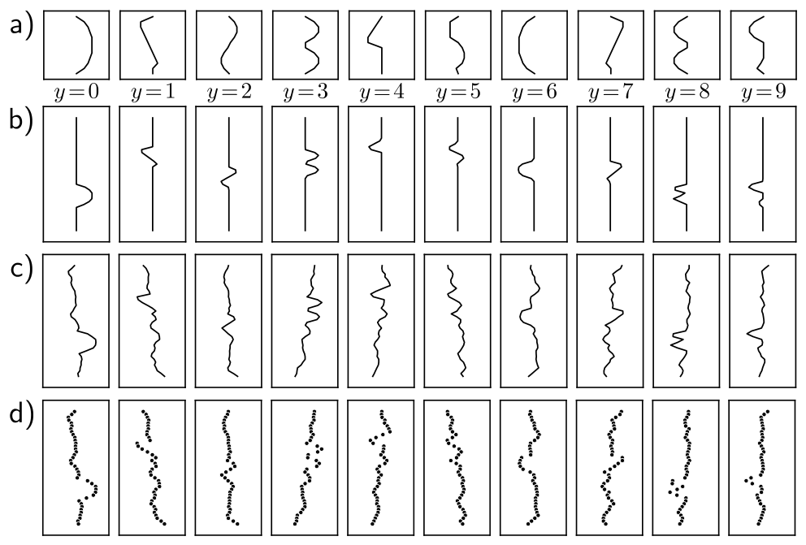{#fig-udl-8-1 width=72%}

The network has 40 inputs, two hidden layers of 100 units, and 10 outputs that
pass through a softmax (Week 5). It is trained with SGD — batch size 100,
learning rate 0.1 — for 6,000 steps (150 epochs) on the multiclass cross-entropy
loss. The training error falls steadily and reaches zero after about 4,000 steps;
the training loss heads toward zero too (@fig-udl-8-2).

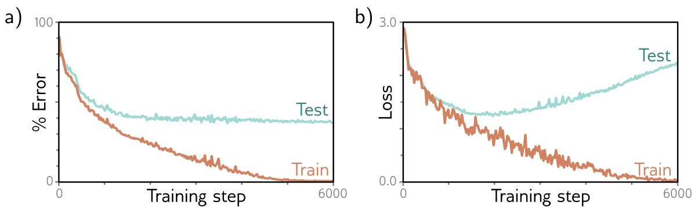{#fig-udl-8-2 width=84%}

Perfect training performance does not mean a perfect classifier: the network may
simply have **memorized** the training set. To find out, we need a separate
**test set**, generated by the same process but never used in training. Prince
draws 1,000 more examples. The test error falls during training, but only to
about 40% — far better than the 90% of random guessing, far worse than the 0%
on the training set. The model has not generalized well.

The test *loss* tells a stranger story. It falls for the first 1,500 steps or so
and then *rises*, even though the test error has stopped changing. The network
is making the same mistakes with ever greater confidence. To push the
probability of every training label toward one, training drives the pre-softmax
activations to more and more extreme values (recall Prince's figure 5.10 from Week 5).
On a test example the network gets wrong, that same extremity pushes the
probability of the correct class toward zero, and the negative log-likelihood of
that example grows without bound.

We can reproduce the whole effect in a couple of seconds with a synthetic
problem of the same shape: ten classes, 40-dimensional inputs, and the same
network and optimizer, but only 400 training examples. Each class is a Gaussian
blob around its own mean. Because we generated the data, we also know the best
error *any* classifier could achieve: assigning each test point to the nearest
class mean is optimal here, and it still errs about 31% of the time, because the
blobs overlap.

```{python}
#| label: fig-overconfident
#| fig-cap: "Our version of figure 8.2 on synthetic data: ten Gaussian classes in 40 dimensions, 400 training and 2,000 test examples, two hidden layers of 100 ReLUs, SGD with batch size 100. Left: training error reaches zero within about 700 steps; test error levels off near 44%, above the best achievable error of about 31% (dashed), which no model can beat. Right: the test loss is lowest near step 340 (dotted) and then climbs steadily for the rest of training, although the test error barely moves. The network keeps its mistakes and grows more confident in them."

g = torch.Generator().manual_seed(774)
K, D_i = 10, 40
class_means = 0.33 * torch.randn(K, D_i, generator=g)

def make_data(n):
    """n examples: a random class label, then that class's mean plus unit Gaussian noise."""
    y = torch.randint(0, K, (n,), generator=g)
    return class_means[y] + torch.randn(n, D_i, generator=g), y

x_train, y_train = make_data(400)
x_test,  y_test  = make_data(2000)

# With equal priors and identical isotropic noise, the nearest class mean is the
# Bayes-optimal classifier, so its error is the noise floor for this problem.
dist = ((x_test[:, None, :] - class_means[None]) ** 2).sum(-1)
bayes_error = 100 * (dist.argmin(1) != y_test).float().mean().item()

torch.manual_seed(774)
model = nn.Sequential(nn.Linear(D_i, 100), nn.ReLU(),
                      nn.Linear(100, 100), nn.ReLU(),
                      nn.Linear(100, K))
opt = torch.optim.SGD(model.parameters(), lr=0.05)
criterion = nn.CrossEntropyLoss()

log = []                                                # step, train error, train loss, test error, test loss
for step in range(3001):
    if step % 20 == 0:
        with torch.no_grad():
            row = [step]
            for x, y in [(x_train, y_train), (x_test, y_test)]:
                out = model(x)
                row += [100 * (out.argmax(1) != y).float().mean().item(), criterion(out, y).item()]
            log.append(row)
    idx = torch.randint(0, 400, (100,), generator=g)
    loss = criterion(model(x_train[idx]), y_train[idx])
    opt.zero_grad(); loss.backward(); opt.step()
log = np.array(log)
best = log[log[:, 4].argmin()]

fig, ax = plt.subplots(1, 2, figsize=(8, 3.2))
ax[0].plot(log[:, 0], log[:, 1], color=ACCENT, label="Train")
ax[0].plot(log[:, 0], log[:, 3], color=NDSU_GREEN, label="Test")
ax[0].axhline(bayes_error, ls="--", color="gray", lw=1, label="Best possible")
ax[0].set(xlabel="Training step", ylabel="% error", ylim=(0, 100))
ax[0].legend()
ax[1].plot(log[:, 0], log[:, 2], color=ACCENT, label="Train")
ax[1].plot(log[:, 0], log[:, 4], color=NDSU_GREEN, label="Test")
ax[1].axvline(best[0], ls=":", color="gray", lw=1)
ax[1].set(xlabel="Training step", ylabel="Cross-entropy loss")
fig.tight_layout()
plt.show()

print(f"best achievable test error (nearest class mean): {bayes_error:.1f}%")
print(f"lowest test loss {best[4]:.3f} at step {best[0]:.0f}, where test error is {best[3]:.1f}%")
print(f"after 3,000 steps: train error {log[-1, 1]:.1f}%, train loss {log[-1, 2]:.4f}; "
      f"test error {log[-1, 3]:.1f}%, test loss {log[-1, 4]:.3f}")
```

Two lessons carry through the rest of the chapter. First, the training numbers
are not evidence of anything; only held-out data can tell us how the model will
do. Second, error and loss can disagree. The classification error is what we
usually report, but the loss is what the network optimizes, and a rising test
loss with a flat test error is the signature of a model growing overconfident.

## Sources of Error

*Prince §8.2, pp. 120–122; figures on pp. 120–122.*

To see *why* a model fails to generalize, Prince switches to a problem where we
know the ground truth exactly: one-dimensional least squares regression. Inputs
are drawn from $[0, 1]$, outputs are a fixed quasi-sinusoidal function plus
Gaussian noise of fixed variance, and training and test data come from the same
process. To spread $I$ training inputs evenly, $[0, 1]$ is cut into $I$ equal
segments and one $x_i$ is drawn uniformly from each (@fig-udl-8-3).

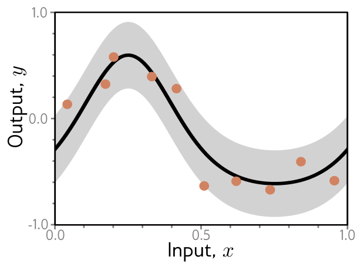{#fig-udl-8-3 width=48%}

The model is a **simplified shallow network** (@fig-udl-8-4). With $D$ hidden
units, the first-layer weights and biases are *fixed* so that each hidden unit is
a ReLU of slope one whose joint sits at $0, 1/D, 2/D, \ldots, (D-1)/D$. Only the
output layer, $\boldsymbol{\phi} = \{\beta, \omega_1, \ldots, \omega_D\}$, is
learned. The model can represent any piecewise linear function on $[0, 1]$ with
$D$ equal-width linear regions. Because it is linear in $\boldsymbol{\phi}$, its
least squares fit has a closed form (problem 8.3), so we are guaranteed the
global minimum of the training loss — any error we see is the model's fault or
the data's, never the optimizer's.

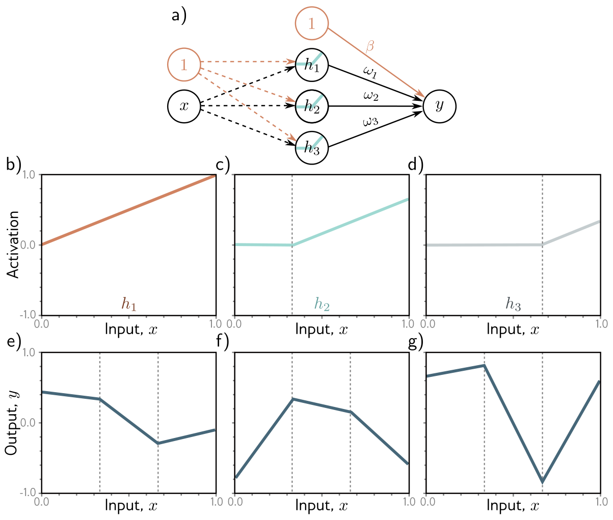{#fig-udl-8-4 width=78%}

### Noise, bias, and variance

*Prince §8.2.1, pp. 122–123; figure on p. 122.*

There are three possible sources of test error (@fig-udl-8-5).

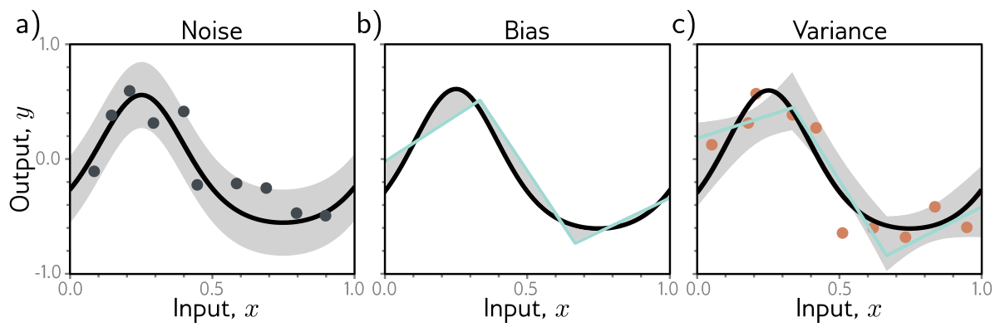{#fig-udl-8-5 width=88%}

**Noise.** The data-generating process itself is random, so a single input $x$
has many valid outputs $y$. Even a model that reproduced the true underlying
function exactly would still miss the test points by the noise (panel **a**).
Noise is insurmountable on test data. It does not, however, limit *training*
performance: we will almost never see the same $x$ twice, so a flexible enough
model can still pass through every training point. Noise arises from genuine
randomness, from mislabeled data, or from explanatory variables we did not
observe — in a plant, an unmeasured ambient temperature or tool-wear state looks
exactly like noise to a model that cannot see it. Occasionally there is no noise
(a network approximating an expensive deterministic simulation, for instance),
but usually noise sets a floor on test performance. In @fig-overconfident the
floor was the 31% error of the best possible classifier.

**Bias.** The model may not be flexible enough to represent the true function,
even with its parameters set optimally. The three-region model cannot trace the
quasi-sinusoid however we choose $\boldsymbol{\phi}$ (panel **b**). This
systematic shortfall is the **bias**.

**Variance.** We have only a limited, noisy training set, and the fit cannot
tell which wiggles in it belong to the underlying function and which are noise.
So we do not recover the best possible function of panel **b**; we recover one
that reflects the quirks of our particular sample, and a different sample would
give a different fit (panel **c**). This extra variability is the **variance**.
With a stochastic optimizer there is more: two training runs on the *same* data
need not converge to the same solution.

### Mathematical formulation of test error

*Prince §8.2.2, pp. 123–124.*

We now make the three terms exact for one-dimensional regression with additive
noise of variance $\sigma^2$. Because the same $x$ can produce different $y$,
each input has a distribution $Pr(y|x)$ with mean

$$
\mu[x] = \mathbb{E}_y\big[y[x]\big] = \int y[x]\, Pr(y|x)\, dy,
$$ {#eq-mu}

and the noise is $\sigma^2 = \mathbb{E}_y\big[(\mu[x] - y[x])^2\big]$. The
notation $y[x]$ is a reminder that we are looking at the output at one fixed
input position $x$.

::: {.callout-note}
## Notation
$\mathbb{E}_y[\bullet]$ averages over the noise in a test output; $\mathbb{E}_{\mathcal{D}}[\bullet]$, below, averages over random training sets $\mathcal{D} = \{x_i, y_i\}$. The function $\mu[x]$ is the true mean output and $f_\mu[x]$ is the *average fitted model*. Neither can be computed in practice: one needs the true process, the other infinitely many training sets. They exist to make the decomposition exact. Appendix C.2 reviews the rules for expectations used below.
:::

**Step 1: split off the noise.** Take the least squares loss at position $x$,
then add and subtract $\mu[x]$ inside the square and expand:

$$
\begin{aligned}
L[x] &= \big(\mathrm{f}[x, \boldsymbol{\phi}] - y[x]\big)^2 \\
&= \Big(\big(\mathrm{f}[x, \boldsymbol{\phi}] - \mu[x]\big) + \big(\mu[x] - y[x]\big)\Big)^2 \\
&= \big(\mathrm{f}[x, \boldsymbol{\phi}] - \mu[x]\big)^2 + 2\big(\mathrm{f}[x, \boldsymbol{\phi}] - \mu[x]\big)\big(\mu[x] - y[x]\big) + \big(\mu[x] - y[x]\big)^2.
\end{aligned}
$$ {#eq-loss-expand}

The loss depends on which $y[x]$ we happen to observe, so take its expectation.
The model term does not depend on $y$, so the expectation passes it untouched;
the cross term vanishes because $\mathbb{E}_y[y[x]] = \mu[x]$ by definition; and
the last term is $\sigma^2$ by definition:

$$
\begin{aligned}
\mathbb{E}_y\big[L[x]\big] &= \big(\mathrm{f}[x, \boldsymbol{\phi}] - \mu[x]\big)^2 + 2\big(\mathrm{f}[x, \boldsymbol{\phi}] - \mu[x]\big)\big(\mu[x] - \mathbb{E}_y[y[x]]\big) + \mathbb{E}_y\big[(\mu[x] - y[x])^2\big] \\
&= \big(\mathrm{f}[x, \boldsymbol{\phi}] - \mu[x]\big)^2 + 2\big(\mathrm{f}[x, \boldsymbol{\phi}] - \mu[x]\big) \cdot 0 + \sigma^2 \\
&= \big(\mathrm{f}[x, \boldsymbol{\phi}] - \mu[x]\big)^2 + \sigma^2.
\end{aligned}
$$ {#eq-loss-noise}

So the expected loss is the squared distance between the model and the true mean,
plus the noise.

**Step 2: split the model term into bias and variance.** The parameters were
learned from a training set $\mathcal{D}$, so properly we should write
$\boldsymbol{\phi}[\mathcal{D}]$. The training set is a random sample; a
different sample gives different parameters. The model's average output over
all possible training sets is

$$
f_\mu[x] = \mathbb{E}_{\mathcal{D}}\Big[\mathrm{f}\big[x, \boldsymbol{\phi}[\mathcal{D}]\big]\Big].
$$ {#eq-fmu}

Repeat the trick on the first term of @eq-loss-noise, adding and subtracting
$f_\mu[x]$ this time:

$$
\begin{aligned}
\big(\mathrm{f}[x, \boldsymbol{\phi}[\mathcal{D}]] - \mu[x]\big)^2
&= \Big(\big(\mathrm{f}[x, \boldsymbol{\phi}[\mathcal{D}]] - f_\mu[x]\big) + \big(f_\mu[x] - \mu[x]\big)\Big)^2 \\
&= \big(\mathrm{f}[x, \boldsymbol{\phi}[\mathcal{D}]] - f_\mu[x]\big)^2 + 2\big(\mathrm{f}[x, \boldsymbol{\phi}[\mathcal{D}]] - f_\mu[x]\big)\big(f_\mu[x] - \mu[x]\big) + \big(f_\mu[x] - \mu[x]\big)^2.
\end{aligned}
$$ {#eq-model-expand}

Taking the expectation over $\mathcal{D}$ kills the cross term for the same
reason as before, since $\mathbb{E}_{\mathcal{D}}\big[\mathrm{f}[x,
\boldsymbol{\phi}[\mathcal{D}]]\big] = f_\mu[x]$:

$$
\mathbb{E}_{\mathcal{D}}\Big[\big(\mathrm{f}[x, \boldsymbol{\phi}[\mathcal{D}]] - \mu[x]\big)^2\Big] = \mathbb{E}_{\mathcal{D}}\Big[\big(\mathrm{f}[x, \boldsymbol{\phi}[\mathcal{D}]] - f_\mu[x]\big)^2\Big] + \big(f_\mu[x] - \mu[x]\big)^2.
$$ {#eq-model-split}

**Step 3: put it together.** Substituting @eq-model-split into @eq-loss-noise:

::: {.callout-important}
## The bias–variance decomposition
$$
\mathbb{E}_{\mathcal{D}}\Big[\mathbb{E}_y\big[L[x]\big]\Big] = \underbrace{\mathbb{E}_{\mathcal{D}}\Big[\big(\mathrm{f}[x, \boldsymbol{\phi}[\mathcal{D}]] - f_\mu[x]\big)^2\Big]}_{\text{variance}} + \underbrace{\big(f_\mu[x] - \mu[x]\big)^2}_{\text{bias}} + \underbrace{\sigma^2}_{\text{noise}}.
$$ {#eq-bias-variance}

The **variance** is how much the fitted model moves around with the training
set we happen to draw. The **bias** is how far the *average* fitted model sits
from the true mean. The **noise** is the uncertainty in the true mapping from
input to output.
:::

Two remarks. First, the "bias" term is a *squared* bias; Prince follows common
usage and calls it the bias. Second, the three terms are present for any task,
but they *add* this cleanly only for least squares regression. For other losses
their interaction is more complicated: in classification, more variance can even
*help*, if it pushes some predictions in a region where the model is biased
toward the wrong class back over the decision threshold (chapter notes,
pp. 133–134).

The decomposition is exact, so we can check it. The cell below builds Prince's
simplified model in a few lines — its features are a column of ones plus one
shifted ReLU per hidden unit, and `np.linalg.lstsq` gives the global least
squares fit. Our true function is our own quasi-sinusoid with $\sigma = 0.15$.
We then estimate each side of @eq-bias-variance by brute force over 4,000 random
training sets of 15 points, for a model with $D = 3$.

```{python}
#| label: decomposition-check

SIGMA = 0.15                                            # noise standard deviation

def mu(x):
    """Our quasi-sinusoidal ground truth (Prince's figure 8.3 uses a similar curve)."""
    return 0.5 * (np.exp(np.sin(2 * np.pi * x)) - 1.27)

def sample(I, rng):
    """One x_i drawn uniformly from each of I equal segments of [0, 1], as in figure 8.3."""
    x = (np.arange(I) + rng.uniform(size=I)) / I
    return x, mu(x) + SIGMA * rng.standard_normal(I)

def features(x, D):
    """Figure 8.4: a column of ones (for beta) plus D slope-one ReLUs with joints at 0, 1/D, ..., (D-1)/D."""
    joints = np.arange(D) / D
    return np.hstack([np.ones((len(x), 1)), np.maximum(x[:, None] - joints, 0)])

def fit(x, y, D):
    """Closed-form least squares (problem 8.3). When D + 1 > I, lstsq returns the minimum-norm solution."""
    return np.linalg.lstsq(features(x, D), y, rcond=None)[0]

def predict(phi, x, D):
    return features(x, D) @ phi

x_grid = np.linspace(0, 1, 501)                         # test inputs spread over [0, 1]

def bias_variance(D, I, R=1000, seed=774):
    """Estimate the bias and variance terms of equation (8.7), averaged over x, from R training sets."""
    rng = np.random.default_rng(seed)
    preds = np.array([predict(fit(*sample(I, rng), D), x_grid, D) for _ in range(R)])
    f_mu = preds.mean(axis=0)                           # equation (8.4)
    return np.mean((f_mu - mu(x_grid)) ** 2), np.mean(preds.var(axis=0))

# Left side of (8.7): train on a fresh dataset, test against fresh noisy outputs, average.
rng = np.random.default_rng(774)
I, D, R = 15, 3, 4000
test_loss = np.empty(R)
for r in range(R):
    phi = fit(*sample(I, rng), D)
    y_new = mu(x_grid) + SIGMA * rng.standard_normal(x_grid.size)
    test_loss[r] = np.mean((predict(phi, x_grid, D) - y_new) ** 2)

b, v = bias_variance(D, I, R)
print(f"expected test loss, by simulation:     {test_loss.mean():.4f}")
print(f"variance {v:.4f} + bias {b:.4f} + noise {SIGMA**2:.4f} = {v + b + SIGMA**2:.4f}")
```

The two sides agree to within Monte Carlo error. For this model and this amount
of data, the noise is about half the test loss, the bias about a third, and the
variance the rest.

## Reducing Error

*Prince §8.3, pp. 124–125; figures on pp. 126–128.*

Of the three terms, the noise is beyond our control: it is a fundamental limit
on performance. The other two can be reduced, and the ways of reducing them pull
against each other.

### Reducing variance

*Prince §8.3.1, p. 125; figure on p. 126.*

Variance comes from fitting limited, noisy data, so the remedy is **more data**.
More examples average out the noise and sample the input space more densely.
@fig-udl-8-6 fits the three-region model to datasets of 6, 10, and 100 points.
With six points the fit changes markedly from one dataset to the next; with 100
it barely changes. As a rule, adding training data almost always improves test
performance. (Double descent will supply a strange exception.)

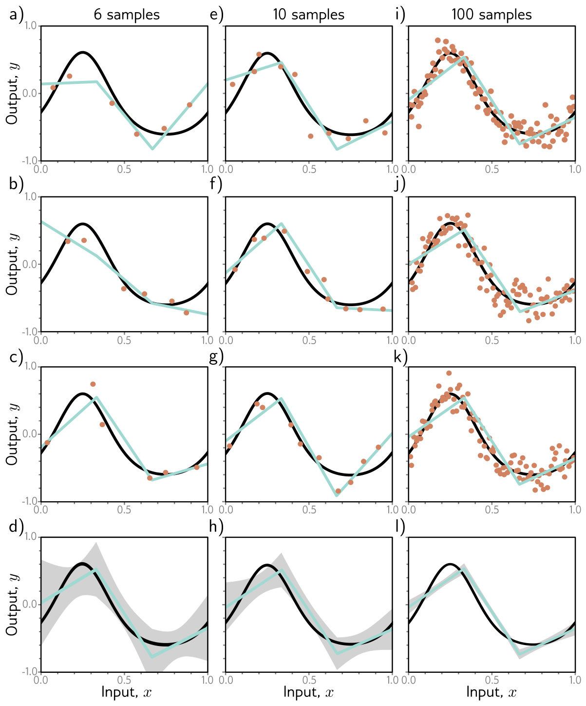{#fig-udl-8-6 width=82%}

### Reducing bias

*Prince §8.3.2, p. 125; figure on p. 127.*

Bias comes from a model too inflexible to describe the true function, so the
remedy is **more capacity**: for neural networks, more hidden units or more
hidden layers. In the simplified model, more hidden units means more linear
regions, and with ten regions the model can follow the true function closely
(@fig-udl-8-7**a**–**c**).

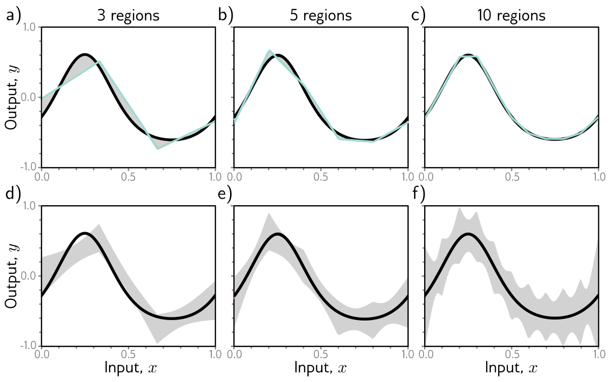{#fig-udl-8-7 width=86%}

### The bias–variance trade-off

*Prince §8.3.3, p. 125; figures on p. 128.*

But look at @fig-udl-8-7**d**–**f**. With the training-set size held fixed,
**the variance grows as the capacity grows**. Adding capacity therefore does not
necessarily reduce test error; it trades bias for variance. This is the
**bias–variance trade-off** [@geman1992].

@fig-udl-8-8 shows why. A three-region model fitted to three datasets of fifteen
points gives nearly the same answer each time, because the noise roughly averages
out within each region. A ten-region model fitted to the same three datasets fits
each one better, so its training error is lower, but it spends much of its extra
flexibility describing the noise. The fitted curves differ from one dataset to
the next and are no closer to the truth. This is **overfitting**.

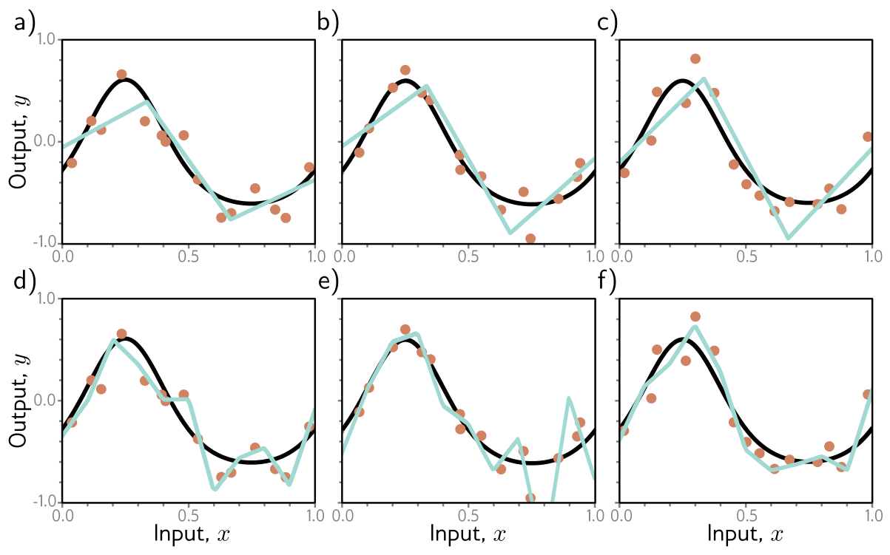{#fig-udl-8-8 width=86%}

Since bias falls and variance rises with capacity, there should be an optimal
capacity where their sum is smallest. @fig-udl-8-9 computes both terms for the
toy model with the data of @fig-udl-8-8. The sum is minimized at a capacity of
four: four hidden units, four linear regions.

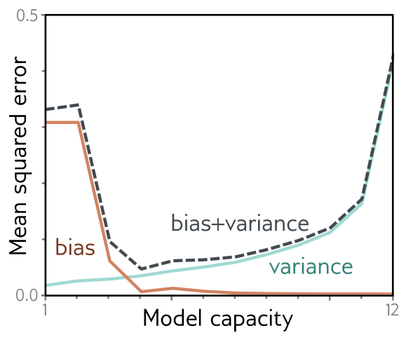{#fig-udl-8-9 width=48%}

Our version follows, with one addition. The optimum is not a property of the
model alone; it depends on how much data there is.

```{python}
#| label: fig-bias-variance
#| fig-cap: "Our version of figure 8.9, from 1,000 training sets per point. Left: with $I = 15$ training points, bias (red) falls and variance (green) rises as the capacity $D$ grows; their sum (dashed) is smallest at $D = 4$, as in the book. Right: the sum for three training-set sizes, with each minimum marked. More data lowers the whole curve and moves the optimum to the right — with $I = 200$ the best model has about nine regions — because variance is what punishes capacity, and more data shrinks the variance."

caps = np.arange(1, 13)
bv = np.array([bias_variance(D, 15) for D in caps])     # columns: bias, variance

fig, ax = plt.subplots(1, 2, figsize=(8, 3.2))
ax[0].plot(caps, bv[:, 0], color=ACCENT, label="bias")
ax[0].plot(caps, bv[:, 1], color=NDSU_GREEN, label="variance")
ax[0].plot(caps, bv.sum(1), "--", color="gray", label="bias + variance")
ax[0].set(xlabel="Capacity $D$ (hidden units)", ylabel="Mean squared error", ylim=(0, 0.1), title="$I$ = 15")
ax[0].legend()

print(f"{'I':>5}{'best D':>8}{'bias + variance':>17}")
for I, c in [(15, NDSU_GREEN), (50, STEEL), (200, ACCENT)]:
    total = np.array([sum(bias_variance(D, I, R=400)) for D in caps])
    ax[1].plot(caps, total, color=c, label=f"$I$ = {I}")
    ax[1].plot(caps[total.argmin()], total.min(), "o", color=c)
    print(f"{I:>5}{caps[total.argmin()]:>8}{total.min():>17.4f}")
ax[1].set(yscale="log", xlabel="Capacity $D$", ylabel="Bias + variance", title="Three training-set sizes")
ax[1].legend()
fig.tight_layout()
plt.show()
```

### What "capacity" means

*Prince, chapter notes, p. 134.*

We have used **capacity** informally, to mean the number of hidden units or
parameters. The notes sharpen it in two ways. The **representational capacity**
is the set of functions the model can produce over all possible parameter
values. The **effective capacity** is the smaller set an optimization algorithm
can actually reach. More formal measures exist. The **Vapnik–Chervonenkis (VC)
dimension** is the largest number of training examples a binary classifier can
label in every possible way. The **Rademacher complexity** measures how well the
model, with its parameters fitted optimally, can match random labels. The next
section shows why counting parameters is a poor proxy for either.

## Double Descent

*Prince §8.4, pp. 127–129; figure on p. 130.*

Does the bias–variance trade-off show up in practice? Prince returns to
MNIST-1D, now with 10,000 training and 5,000 test examples, trains with Adam
(step size 0.005, full batch, 4,000 steps), and steadily increases the number of
hidden units in each of two hidden layers (@fig-udl-8-10).

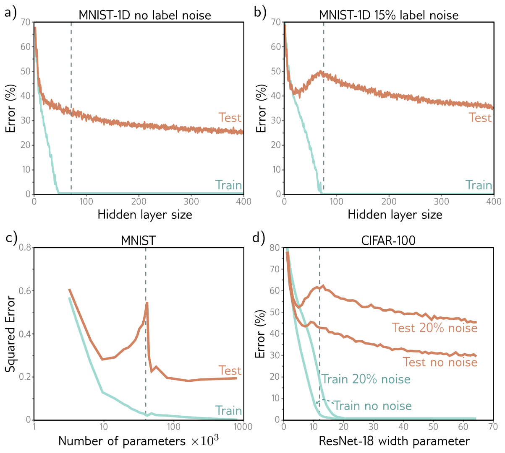{#fig-udl-8-10 width=82%}

On the original data (panel **a**), the training error drops quickly to zero —
well before the vertical dashed line where the parameter count equals the number
of training examples. The test error, however, never turns up as the trade-off
predicts. It just keeps decreasing.

Panel **b** repeats the experiment with 15% of the training labels randomized.
Memorizing these noisier data takes almost as many parameters as there are data
points. Now the test error does show the classical U: it falls, then rises as the
model approaches the capacity at which it can fit the training data exactly. But
then it does something unexpected. It falls *again*, and with enough capacity it
ends below the minimum of the first U.

This is **double descent** [@belkin2019]. It appears on unmodified MNIST
(panel **c**). For other datasets, such as MNIST-1D and CIFAR-100 (panel **d**,
from @nakkiran2021), it appears or becomes more pronounced when label noise is
added. The curve has three named regimes:

| Regime | Where | What happens to test error |
|:--|:--|:--|
| **Classical** (under-parameterized) | Left of the peak | The bias–variance U |
| **Critical** | Near the point where training error first reaches zero | Rises to a peak |
| **Modern** (over-parameterized) | Right of the peak | Falls again, often below the classical minimum |

: The three regimes of double descent, Prince §8.4, p. 129. {tbl-colwidths="[30,36,34]"}

### Explanation

*Prince §8.4.1, pp. 129–132; figures on pp. 131–132.*

Double descent is recent, unexpected, and only partly understood. It is the
combination of two effects. The first — test performance worsening when the model
has *just* enough capacity to memorize the data — is exactly what the
bias–variance trade-off predicts. The second is the puzzle: test performance
keeps improving with capacity *after* training performance is already perfect,
even though there are no longer enough data points to pin down the parameters
uniquely.

Here is the key observation. Once the model can drive the training loss to near
zero, extra capacity cannot help it fit the training data any better. Anything
extra capacity changes must happen *between* the training points. A model's
tendency to prefer one solution over another as it fills in those gaps is its
**inductive bias**.

What happens between the points matters a great deal, because in high dimensions
the training data are extremely sparse. MNIST-1D has 40 input dimensions.
Quantize each one into just 10 bins and there are $10^{40}$ cells, against
$10^4$ training examples: on average one occupied cell in every $10^{36}$. The way
the volume of a high-dimensional space overwhelms any feasible amount of data is
the **curse of dimensionality**.

::: {.callout-important}
## Intuition from low dimensions fails here
Prince warns that the 1D and 2D pictures in the book should be treated with
"healthy skepticism" (chapter notes, p. 135). In high dimensions, two random
Gaussian vectors are nearly orthogonal; samples from a standard normal all sit
at about the same distance from the origin, in a thin shell, even though the
density is highest at the center (figure 8.13); almost all of a hypersphere's
volume lies next to its surface; and the nearest and farthest neighbors of a
point are almost equally far away. Problems 8.6–8.9 ask for proofs, and the cell
below checks the claims numerically.
:::

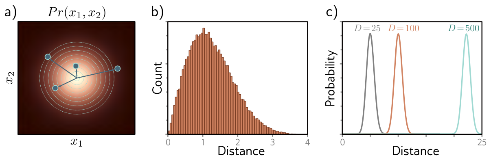{#fig-udl-8-13 width=86%}

```{python}
#| label: high-dimensions

rng = np.random.default_rng(774)
print(f"{'dim':>5}{'mean |x|':>10}{'sd |x|':>8}{'sqrt(dim)':>11}{'mean |cos|':>12}{'nearest/farthest':>18}")
for dim in [2, 10, 40, 100, 1000]:
    X = rng.standard_normal((1000, dim))                # 1,000 standard-normal samples
    r = np.linalg.norm(X, axis=1)                       # distance from the origin
    U = X / r[:, None]
    cos = U[:500] @ U[500:].T                           # angles between 250,000 random pairs
    d = np.linalg.norm(X - rng.standard_normal(dim), axis=1)   # distances to one new query point
    print(f"{dim:>5}{r.mean():>10.2f}{r.std():>8.2f}{np.sqrt(dim):>11.2f}"
          f"{np.abs(cos).mean():>12.3f}{d.min() / d.max():>18.3f}")
```

Read the columns from left to right. The distance from the origin grows like
$\sqrt{D}$, but its spread stays near 0.7 whatever the dimension: the samples
live in a shell. The typical $|\cos|$ between two random directions falls like
$1/\sqrt{D}$, so in 1,000 dimensions random vectors are within a couple of
degrees of perpendicular. And the ratio of nearest to farthest distance climbs
toward one, so "nearest neighbor" loses its meaning. At MNIST-1D's 40 dimensions
the nearest training example is already more than half as far away as the
farthest.

So real problems look like @fig-udl-8-11**a**: small islands of data with wide
gaps between them. The leading explanation of double descent is that, as we add
capacity, the model **interpolates between the data points more smoothly** — and
in the absence of any information about the gaps, smoothness is a sensible guess
that tends to generalize. @fig-udl-8-11**b**–**f** shows the smoothest function
that passes through every data point, for an increasing number of hidden units.
With barely enough parameters (panel **b**), the model must contort itself to hit
every point, and its predictions between the points are erratic. That is why the
peak of the double descent curve is so sharp. With more hidden units it can
afford to be smooth.

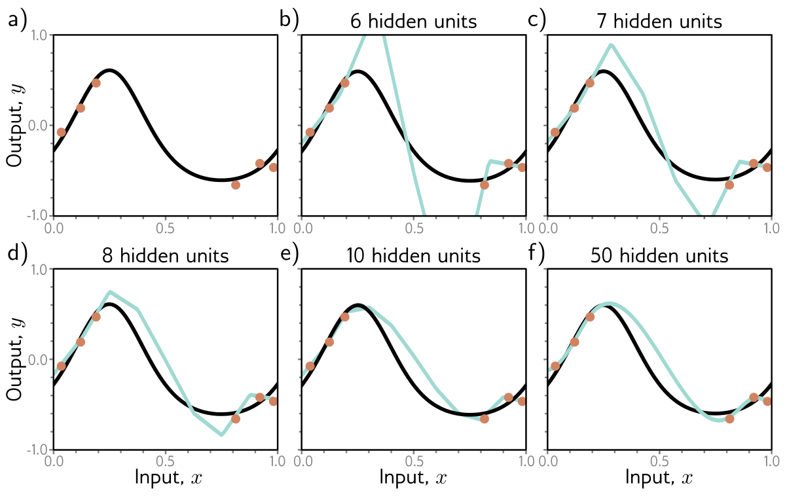{#fig-udl-8-11 width=86%}

That explains why big models *can* be smooth, not why they *are*. @fig-udl-8-12
shows three functions the 50-unit model can produce, all of which pass exactly
through the data and so have zero training loss. Something must steer training
toward panel **a** rather than panels **b** or **c**.

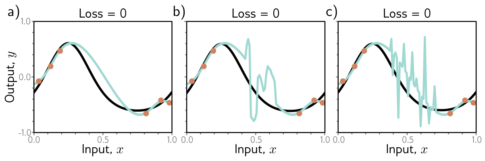{#fig-udl-8-12 width=86%}

Prince offers two candidates. The initialization may start the network among
smooth functions, and training may never leave them. Or the training algorithm
may itself "prefer" smooth solutions. Anything that biases the solution toward
some subset of equally good solutions is a **regularizer**, so the second
possibility says the optimizer acts as an **implicit regularizer** — the starting
point of Chapter 9.

For our simplified model, we can watch the second mechanism at work, because for
a model that is linear in its parameters the implicit regularizer is known
exactly. When $D + 1 > I$, infinitely many parameter vectors fit the data
perfectly. Gradient descent started from $\boldsymbol{\phi} = \mathbf{0}$ only
ever moves in directions spanned by the training feature vectors (each gradient
is a combination of them), so it converges to the interpolating solution of
**minimum norm** $\|\boldsymbol{\phi}\|^2$. That is also the solution
`np.linalg.lstsq` returns. In our model, the weight $\omega_d$ is the change of
slope at joint $d$, so a small norm means the bending is spread thinly over many
joints rather than concentrated in a few sharp kinks. In other words, the
optimizer prefers smooth interpolants, and more joints give it more room to be
smooth [@hastie2022].

```{python}
#| label: fig-double-descent
#| fig-cap: "Double descent in Prince's simplified model, fitted by minimum-norm least squares to 200 random training sets of $I = 15$ points. Left: median error against the true function over $[0, 1]$, with the interquartile range shaded (the mean is useless here: near the peak a few fits explode). The classical U bottoms out at $D = 4$. The error peaks sharply at $D = 14$–$15$, right at the interpolation threshold where the parameter count $D + 1$ first reaches $I$ (dashed); then it descends a second time and settles. Right: one training set, three capacities. $D = 4$ (blue) cannot interpolate but generalizes best. $D = 14$ (red) interpolates by contorting itself, like figure 8.11b. $D = 1000$ (green) also passes through every point, but bends smoothly between them."

I = 15
D_list = np.unique(np.r_[np.round(np.logspace(0, 3, 40)).astype(int), np.arange(10, 21)])
rng = np.random.default_rng(774)
datasets = [sample(I, rng) for _ in range(200)]
err = np.array([[np.mean((predict(fit(x, y, D), x_grid, D) - mu(x_grid)) ** 2) for x, y in datasets]
                for D in D_list])                       # rows: capacity; columns: training set
med = np.median(err, axis=1)
q1, q3 = np.percentile(err, [25, 75], axis=1)

fig, ax = plt.subplots(1, 2, figsize=(8, 3.2))
ax[0].fill_between(D_list, q1, q3, color=NDSU_GREEN, alpha=0.2, lw=0)
ax[0].plot(D_list, med, color=NDSU_GREEN)
ax[0].axvline(I - 1, ls="--", color="gray", lw=1)
ax[0].text(I - 1, ax[0].get_ylim()[1], " $D+1=I$", va="top", fontsize=8, color="gray")
ax[0].set(xscale="log", yscale="log", xlabel="Capacity $D$ (hidden units)", ylabel="Error vs. true function")

x, y = datasets[0]
ax[1].plot(x_grid, mu(x_grid), color="k", lw=2, label="true $\\mu[x]$")
for D, c in [(4, STEEL), (I - 1, ACCENT), (1000, NDSU_GREEN)]:
    ax[1].plot(x_grid, predict(fit(x, y, D), x_grid, D), color=c, lw=1.4, label=f"$D$ = {D}")
ax[1].plot(x, y, "o", color=NDSU_GOLD, mec="k", ms=5, zorder=5)
ax[1].set(ylim=(-1.2, 1.2), xlabel="Input, $x$", ylabel="Output, $y$")
ax[1].legend(fontsize=8, ncol=2, loc="lower left")
fig.tight_layout()
plt.show()

classical = D_list < I - 1
print(f"classical minimum: D = {D_list[classical][med[classical].argmin()]}, error {med[classical].min():.4f}")
print(f"peak:              D = {D_list[med.argmax()]}, error {med.max():.4f}")
print(f"modern regime:     D = {D_list[-1]}, error {med[-1]:.4f}")
```

The curve has all three regimes. Notice, though, that in this one-dimensional toy
the second descent does *not* reach below the first: the over-parameterized
model must still pass through every noisy point, and in one dimension the data
leave no wide gaps for smoothness to exploit. Prince's MNIST-1D and the CIFAR
results sit in 40 and 3,072 dimensions, where nearly everything is gap. Double
descent says that big models *can* generalize well; it does not promise that the
biggest model always wins.

One more consequence is genuinely strange (chapter notes, pp. 134–135). Suppose
a model sits in the modern regime and we *add training data* until the number of
examples matches its capacity. Now the model sits at the peak of the new curve,
and test performance can get *worse*. Nakkiran et al. also observe
**epoch-wise double descent**: for a fixed model, test error can fall, rise, and
fall again as training goes on. Effective capacity depends on the optimizer and
the training time as well as on the architecture [@nakkiran2021].

## Choosing Hyperparameters

*Prince §8.5, pp. 132–133; chapter notes, pp. 135–136.*

In the classical regime we cannot compute the bias (it needs the true function)
or the variance (it needs many independent training sets). In the modern regime
there is no way to know how much capacity to add before the test error stops
improving. So in practice, how do we choose?

For a deep network, capacity depends on the number of hidden layers, the units
per layer, and architectural choices still to come. The learning algorithm's
settings — learning rate, batch size, momentum, schedule — also affect test
performance. All of these are **hyperparameters**. Finding good ones is
**hyperparameter search**, or **neural architecture search** when the focus is on
the network's structure.

Hyperparameters are chosen empirically: train many models with different
settings on the same training data, measure each one, keep the best. The crucial
rule is *where* we measure them. **Not on the test set.** If we pick whichever
settings score best on the test set, those settings might just happen to suit
that particular test set, and the test score stops being an honest estimate of
performance on new data. Instead we hold out a third dataset:

::: {.callout-important}
## Three datasets, three jobs
- **Training set** — learns the parameters $\boldsymbol{\phi}$.
- **Validation set** — chooses the hyperparameters: train one model per setting on the training set and compare them here.
- **Test set** — touched **once**, at the end, to estimate the performance of the single model the validation set chose.
:::

How much the test-set rule matters is easy to underestimate, so the cell below
quantifies it. Imagine trying 50 hyperparameter settings that are, in truth,
*all equally good*: each has a 25% error rate. Score them on a 200-example test
set and report the best. Because each score is noisy, the best of 50 is mostly
the luckiest of 50.

```{python}
#| label: winners-curse

rng = np.random.default_rng(774)
n_settings, n_test, true_error, trials = 50, 200, 0.25, 5000
scores = rng.binomial(n_test, true_error, size=(trials, n_settings)) / n_test
best = scores.min(axis=1)                               # the setting we would report
fresh = rng.binomial(n_test, true_error, size=trials) / n_test

print(f"true error of every setting:                  {true_error:.3f}")
print(f"reported error of the best of {n_settings} (mean):       {best.mean():.3f}")
print(f"same model, scored on a fresh test set (mean): {fresh.mean():.3f}")
print(f"chance the reported error is below 20%:       {np.mean(best < 0.20):.2f}")
```

Reusing the test set to choose among 50 equally good models makes the winner look
about 7 percentage points better than it is, and most of the time the report would claim an
error under 20%. On a fresh test set the advantage vanishes, because there never
was one. The same thing happens, more slowly, when a team tunes against a
"test" set over months of experiments, or when a field tunes against a public
benchmark over years.

The search itself is hard. Prince lists the reasons in the chapter notes
(p. 135). Every evaluation means training a whole model, and the result is noisy,
because training is stochastic. There are no gradients with respect to the
hyperparameters. Many hyperparameters are discrete (the number of layers), and
some are conditional (the width of layer 10 matters only if there are at least
ten layers). And there are many local optima. The main strategies are these:

| Method | Idea | Notes |
|:--|:--|:--|
| Grid search | Try every combination of a few values per hyperparameter | Cost explodes with the number of hyperparameters |
| Random search | Sample settings at random [@bergstra2012] | Beats a grid when only a few hyperparameters matter, since it tries many more distinct values of each |
| Bayesian optimization | Model validation performance and its uncertainty with a Gaussian process; pick the next setting to explore or exploit [@snoek2012] | Best for a few continuous hyperparameters |
| SMAC; Tree-Parzen estimators | Random-forest or density models that handle discrete and conditional choices | TPE models $Pr(\text{hyperparameters} \mid \text{performance})$ instead |
| Hyperband | Start many random settings on a small budget; repeatedly keep the best fraction $\eta$ and multiply the budget by $1/\eta$ [@li2018hyperband] | Cheap, because bad settings are stopped early |
| BOHB | Hyperband with Tree-Parzen proposals instead of random ones | Combines both advantages |

: Hyperparameter search strategies from Prince's chapter notes, pp. 135–136. {tbl-colwidths="[18,50,32]"}

The explore/exploit balance in Bayesian optimization is the bandit problem we
met in Week 1's reinforcement learning example, applied to choosing experiments.

## Cross-Validation in Practice

*Prince, chapter notes, p. 134; the industrial material is ours.*

Splitting data three ways has a cost: every example in the validation or test set
is one the model never trains on. When data are scarce — and in manufacturing,
labeled defects usually are — a small training set means high variance.

**$k$-fold cross-validation** recovers some of that data. Merge the training and
validation data and partition them into $K$ disjoint folds. For each
hyperparameter setting, train $K$ times, each time holding out a different fold
for validation and training on the other $K - 1$, and average the $K$ validation
scores. Choose the setting with the best average. Prince describes estimating the
final test performance by averaging the predictions of the $K$ models on an
entirely separate test set. Retraining one model on all the non-test data with
the chosen setting is also common. Either way, the test set still plays no part
in the choice.

Below, five-fold cross-validation chooses the capacity of the simplified model
from a single dataset of 30 points, with no access to the truth. We then compare
its choice with the truth, and repeat over 200 datasets to see how reliable it is.

```{python}
#| label: fig-cross-validation
#| fig-cap: "Five-fold cross-validation choosing the capacity of the simplified model from one training set of $I = 30$ points. The training error (red) falls, not quite steadily, as capacity grows and would always choose a big model. The cross-validation estimate (blue) is computed from the training data alone, yet its minimum (marked) lands at the same capacity as the minimum of the true expected test loss (black), which we can compute only because we know the generating process. The cross-validation curve sits above the truth because each fold trains on just 24 points. For the same reason it explodes from about $D = 15$ onward: each fold's fit is approaching its own interpolation threshold, $D + 1 = 24$, and is climbing the double descent peak of @fig-double-descent."

I, K_folds = 30, 5
caps = np.arange(1, 21)
rng = np.random.default_rng(774)

def cv_error(x, y, D, folds):
    """Average validation MSE over the K folds."""
    errs = []
    for val in folds:
        trn = np.setdiff1d(np.arange(len(x)), val)
        errs.append(np.mean((predict(fit(x[trn], y[trn], D), x[val], D) - y[val]) ** 2))
    return np.mean(errs)

x, y = sample(I, rng)
folds = np.array_split(rng.permutation(I), K_folds)
cv    = np.array([cv_error(x, y, D, folds) for D in caps])
train = np.array([np.mean((predict(fit(x, y, D), x, D) - y) ** 2) for D in caps])
true  = np.array([np.mean((predict(fit(x, y, D), x_grid, D) - mu(x_grid)) ** 2) + SIGMA**2 for D in caps])

fig, ax = plt.subplots(figsize=(6.5, 3.4))
ax.plot(caps, train, color=ACCENT, label="training error")
ax.plot(caps, cv, color=STEEL, label="5-fold CV estimate")
ax.plot(caps, true, color="k", label="true expected test loss")
ax.plot(caps[cv.argmin()], cv.min(), "o", color=STEEL)
ax.plot(caps[true.argmin()], true.min(), "o", color="k")
ax.set(yscale="log", xlabel="Capacity $D$", ylabel="Mean squared error", xticks=caps[::2])
ax.legend()
fig.tight_layout()
plt.show()

# How reliable is the choice? Repeat over 200 fresh datasets.
picks, regret = [], []
for _ in range(200):
    x2, y2 = sample(I, rng)
    f2 = np.array_split(rng.permutation(I), K_folds)
    c = [cv_error(x2, y2, D, f2) for D in caps]
    t = [np.mean((predict(fit(x2, y2, D), x_grid, D) - mu(x_grid)) ** 2) for D in caps]
    picks.append(caps[np.argmin(c)]); regret.append(t[np.argmin(c)] - min(t))
picks = np.array(picks)
print(f"this dataset: CV chooses D = {caps[cv.argmin()]}, the truth prefers D = {caps[true.argmin()]}")
print(f"over 200 datasets: CV chooses D = 4 in {np.mean(picks == 4):.0%} of them and D = 3 to 7 in {np.mean((picks >= 3) & (picks <= 7)):.0%}")
print(f"median excess test error from CV's choice: {np.median(regret):.4f}  (noise alone is {SIGMA**2:.4f})")
```

Cross-validation is not perfect — its choice wanders from dataset to dataset —
but when it misses, it misses by little. That is the point: a model chosen
honestly with slightly the wrong capacity is far better than one chosen
dishonestly with an optimistic score.

::: {.callout-warning}
## Leakage: when the folds are not independent
Every split above assumes the examples are independent draws. Manufacturing data
rarely are. Images from the same production lot share lighting, material, and
fixture; sensor windows cut from the same machine run overlap in time; parts from
the same supplier batch share defects. Split such data *at random* and nearly
identical examples land on both sides of the split. The model is then tested on
data it has effectively already seen, and the score is optimistic in exactly the
way the cell above showed. **Split by the unit you will deploy to** — by lot, by
machine, by week, by supplier — so that validation and test data come from units
the model never trained on. scikit-learn's `GroupKFold` and `TimeSeriesSplit`
implement this.
:::

## When the Test Set Is Not the World

*Prince, chapter notes, p. 135.*

Everything so far assumes the test data come from the same distribution as the
data the model will meet after deployment. If they do not, the test score is not
a guide to real-world performance. And the world drifts: a model that was
accurate when deployed grows stale as the process changes. This is **data
drift**, and it is why deployed models must be monitored. Prince names three
ways it can happen [@moreno2012]:

| Shift | What changes | Manufacturing example |
|:--|:--|:--|
| **Covariate shift** | The input distribution $Pr(\mathbf{x})$ | A new camera, or a second shift with different lighting, feeds the defect classifier images unlike any it trained on |
| **Prior shift** | The output distribution $Pr(y)$ | A process improvement makes defects rare. A model that learned to call ambiguous parts "good" now misses most of the few defects there are, or, in reverse, floods inspectors with false alarms |
| **Concept shift** | The relationship $Pr(y \mid \mathbf{x})$ | The customer tightens the tolerance, so parts that were "good" last month are now "defective" with the same measurements |

: Three kinds of dataset shift, Prince chapter notes, p. 135. {tbl-colwidths="[18,22,60]"}

The practical response is the same in all three cases: keep a stream of labeled
production data, recompute the error on it on a schedule, and treat a rise as a
signal to retrain.

## Summary

*Prince §8.6, p. 133.*

We measure performance on a separate test set. How well performance holds up on
that set is **generalization**. Test error has three sources: noise, which
nothing can remove; bias, from a model too inflexible to represent the truth; and
variance, from fitting a particular, limited, noisy sample. For least squares
regression they add exactly, @eq-bias-variance. More data reduces the variance.
Below the point where the model can memorize the training data, more capacity
reduces bias but increases variance — the bias–variance trade-off — and there is
an optimal capacity, which grows with the amount of data.

Beyond that point the classical picture breaks. Test error can fall again as
capacity increases even when the parameters outnumber the data, and the two
effects together produce the double descent curve. The likely reason is that
over-parameterized models, steered by an implicit regularizer in initialization
or training, interpolate smoothly through the vast empty regions of a
high-dimensional input space, although what exactly drives this is still
unclear. To choose capacity and every other hyperparameter, we train candidate
models, compare them on a validation set (or by $k$-fold cross-validation), and
use the test set once, at the end. Even then, a test score speaks only for data
drawn the way the test set was drawn.

**Next:** Chapter 9 turns the observation that "something steers training toward
smooth solutions" into tools we control. **Regularization** — explicit penalties,
early stopping, ensembling, dropout, data augmentation, and the implicit
regularization of SGD itself — is how we reduce the variance term on purpose.
Week 9 is also midterm week.

---

## Exercises

::: {.callout-note appearance="minimal"}
Problem numbers refer to Prince, Chapter 8 (pp. 136–137). Starred UDL problems
have published answers on the [UDL website](https://udlbook.github.io/udlbook/).
The computational problems extend code that is already written for you — start
from the [Colab notebook](https://colab.research.google.com/github/harunpirim/IMSE774-NeuralNetworks/blob/main/notebooks/week08-measuring-performance.ipynb).
:::

**1. (UDL 8.1)** Will the multiclass cross-entropy training loss in
@fig-udl-8-2 ever reach exactly zero? Explain your answer, and compare it with
the final training loss printed under @fig-overconfident.

**2. (UDL 8.2 and 8.3\*)** Choose the first-layer weights and biases of the
three-unit model of @fig-udl-8-4**a** so that the hidden units respond as in
panels **b**–**d**. Then show how the output parameters $\{\beta, \omega_1,
\omega_2, \omega_3\}$ can be found in closed form under the least squares loss,
and match your answer to the `features` and `fit` functions of the
`decomposition-check` cell.

**3.** Fill in every step of @eq-model-split from @eq-model-expand. Which
property of $f_\mu[x]$ makes the cross term vanish? Then explain in a sentence
each why the variance term cannot be estimated from one training set, and why the
bias term cannot be estimated at all without knowing $\mu[x]$.

**4. (UDL 8.4)** Consider the curve in @fig-udl-8-10**b** at a hidden-layer size
of 200, which has 50,410 parameters. What do you predict will happen to the
training and test performance if the number of training examples rises from
10,000 to 50,410? Explain using the three regimes.

**5. (UDL 8.5)** Suppose the model capacity exceeds the number of training points
and the model can drive the training loss to zero. What does this imply for
fitting a *heteroscedastic* model, one that predicts its own noise variance
(Week 5)? Propose a way to fix the problem you identify.

**6. (UDL 8.6 and 8.9)** Show that two random points drawn from a 1,000-dimensional
standard normal distribution are nearly orthogonal, relative to the origin, with
high probability. Then sample from standard normals in 25, 100, and 500
dimensions, plot histograms of the distances from the origin, and name the
closed-form distribution they follow. Compare with the `high-dimensions` cell.

**7. (UDL 8.7 and 8.8\*)** The volume of a hypersphere of radius $r$ in $D$
dimensions is $\mathrm{Vol}[r] = r^D \pi^{D/2} / \Gamma[D/2 + 1]$. Use
Stirling's formula to show that the volume of a hypersphere of *diameter* one
goes to zero as $D$ grows. Then show that the fraction of a unit hypersphere's
volume lying in its outermost shell of thickness 0.01 goes to one.

**8. Leakage on the line.** A team trains a CNN to detect weld defects from
images collected across 40 production lots. A random 80/10/10 split gives 96%
test accuracy, but the first new lot after deployment scores 78%. (a) Explain the
gap using the leakage callout above. (b) Design a split that would have predicted
the 78%. (c) Which of the three dataset shifts could also contribute, and what
would you monitor to tell them apart?

**9. Classify the drift.** A predictive-maintenance model flags spindle bearings
likely to fail within 100 hours. For each event, name the shift (covariate,
prior, or concept) and say whether retraining on recent data alone is enough:
(a) the plant switches to a bearing supplier whose vibration signatures run
hotter; (b) a new preventive-maintenance policy makes failures half as frequent;
(c) "failure" is redefined from seizure to any vibration level above an ISO
threshold.

**10. Computational.** In the `fig-double-descent` cell, replace the
minimum-norm solution with ridge regression, $\boldsymbol{\phi} =
(\mathbf{X}^T\mathbf{X} + \lambda\mathbf{I})^{-1}\mathbf{X}^T\mathbf{y}$, for
$\lambda \in \{10^{-6}, 10^{-3}, 10^{-1}\}$. What happens to the peak? Then
return to $\lambda = 0$ and draw the $x_i$ uniformly over $[0, 1]$ instead of
one per segment. Does the peak move or change height? (This previews Chapter 9.)

**11. Computational.** Extend the `winners-curse` cell. (a) Plot the mean
optimism, true error minus reported error, against the number of settings tried
(1 to 500) for test sets of 200, 1,000, and 10,000 examples. (b) Give a rough
formula: the optimism should scale like the standard error
$\sqrt{p(1-p)/n}$ times a factor that grows slowly with the number of settings.
Which factor?

**12. Computational.** Return to @fig-overconfident. Hold out 100 of the 400
training examples as a validation set, train on the other 300, and stop training
at the step with the lowest *validation loss*. Report the test error and test
loss at that step and compare them with the final values. This is **early
stopping**, the first regularizer of Chapter 9.

---

## Textbook Reference Map {#sec-reference-map}

Every part of this page, mapped to Prince, *Understanding Deep Learning*
(MIT Press, 2024) [@prince2024]. Page numbers are those of the printed book.

| This page | Prince section | Pages | Figures used |
|:--|:--|:--:|:--|
| A Trained Model Is Not Yet a Good Model | Ch. 8 opening | 118 | — |
| Training a Simple Model | §8.1 | 118–120 | 8.1, 8.2 (p. 119) |
| Sources of Error | §8.2 | 120–122 | 8.3 (p. 120), 8.4 (p. 121) |
| — Noise, bias, and variance | §8.2.1 | 122–123 | 8.5 (p. 122) |
| — Mathematical formulation of test error | §8.2.2; notes | 123–124, 133–134 | — |
| Reducing Error | §8.3 | 124–125 | — |
| — Reducing variance | §8.3.1 | 125 | 8.6 (p. 126) |
| — Reducing bias | §8.3.2 | 125 | 8.7 (p. 127) |
| — The bias–variance trade-off | §8.3.3 | 125 | 8.8, 8.9 (p. 128) |
| — What "capacity" means | notes | 134 | — |
| Double Descent | §8.4 | 127–129 | 8.10 (p. 130) |
| — Explanation | §8.4.1; notes | 129–132, 134–135 | 8.11 (p. 131), 8.12 (p. 132), 8.13 (p. 137) |
| Choosing Hyperparameters | §8.5; notes | 132–133, 135–136 | — |
| Cross-Validation in Practice | notes; ours | 134 | — |
| When the Test Set Is Not the World | notes | 135 | — |
| Summary | §8.6 | 133 | — |
| Exercises 1, 2, 4–7 | Problems 8.1–8.9 | 136–137 | — |

: {tbl-colwidths="[38,22,14,26]"}

Equations on this page correspond to Prince as follows: @eq-mu is his (8.1),
@eq-loss-expand is (8.2), @eq-loss-noise is (8.3), @eq-fmu is (8.4),
@eq-model-expand is (8.5), @eq-model-split is (8.6), and @eq-bias-variance is
(8.7). The hypersphere volume in exercise 7 is his (8.8).

::: {.callout-note appearance="simple"}
## Figure credits
Figures 8.1–8.13 are reproduced unaltered from Prince, *Understanding Deep
Learning* (MIT Press, 2024), which is distributed under a Creative Commons
CC-BY-NC-ND license, and are used here for non-commercial classroom instruction.
Original sources credited within the figures: figure 8.1 is adapted from
Greydanus (2020); figure 8.10c shows results from Belkin et al. (2019) and figure
8.10d results from Nakkiran et al. (2021). All other figures on this page are
generated by the code in this week's notebook.
:::

---

## Further Reading

- Prince, *Understanding Deep Learning*, Chapter 8 [@prince2024] — the assigned reading. The chapter notes (pp. 133–136) cover capacity, double descent, the geometry of high-dimensional spaces, dataset shift, and hyperparameter search in more depth than this page.
- **[▶ UDL notebooks 8.1–8.4](https://github.com/udlbook/udlbook/tree/main/Notebooks/Chap08)** — Prince's own Colab notebooks for this chapter; links to each are at the top of this page.
- **[▶ This week's notebook](https://colab.research.google.com/github/harunpirim/IMSE774-NeuralNetworks/blob/main/notebooks/week08-measuring-performance.ipynb)** — every cell above, in one Colab file.
- Geman, Bienenstock & Doursat (1992) [@geman1992] — the paper that brought the bias–variance dilemma to neural networks.
- Zhang et al. (2017) [@zhang2017] — standard image classifiers fit completely *random* labels with zero training error, so parameter counts and classical capacity measures cannot explain why the same networks generalize on real labels.
- Belkin et al. (2019) [@belkin2019] — coined "double descent" and showed it for networks, random features, and other interpolating models.
- Nakkiran et al. (2021) [@nakkiran2021] — double descent across modern architectures and datasets, with label noise, and in training time (epoch-wise).
- Hastie et al. (2022) [@hastie2022] — an exact analysis of minimum-norm ("ridgeless") least squares interpolation, the mechanism behind @fig-double-descent.
- Greydanus (2020) [@greydanus2020] — MNIST-1D, the small dataset used throughout the chapter; it trains in seconds on a laptop.
- Bergstra & Bengio (2012) [@bergstra2012]; Snoek et al. (2012) [@snoek2012]; Li et al. (2018) [@li2018hyperband] — random search, Bayesian optimization, and Hyperband.
- Moreno-Torres et al. (2012) [@moreno2012] — a unifying taxonomy of dataset shift.
