::: {.lecture-meta}
**Reading** Prince, *Understanding Deep Learning*, Chapter 9 (pp. 138–160) &nbsp;·&nbsp;
**UDL notebooks** 9.1–9.5 &nbsp;·&nbsp;
**Next** Convolutional networks begin Thursday, October 29
:::

::: {.callout-note appearance="simple"}
## How to read the references in these notes
Every section below opens with the section number and page range it covers in
Prince, *Understanding Deep Learning* (MIT Press, 2024). Page numbers are those
of the printed book. Figures taken from the textbook are captioned with their
original figure number and page; figures generated by the code behind this page
are ours. A complete cross-reference table appears in @sec-reference-map.
:::

## Learning Objectives

By the end of this week you should be able to:

1. Define **regularization** in its strict sense — an extra term in the loss that favors some parameters over others — and in the broad sense the field uses, and say why the broad sense exists.
2. Read a regularized loss as a **maximum a posteriori** (MAP) criterion and translate between a penalty $\lambda\, g[\boldsymbol{\phi}]$ and a prior $Pr(\boldsymbol{\phi})$; derive $\lambda$ from the variance of the normal prior behind **L2 regularization**, the gradient it adds, and its equivalence to the **weight decay** update under SGD.
3. Explain what L2 regularization (**weight decay**) does to a network's function and why it trades variance for bias, and distinguish L2 regularization from the weight-decay update when the optimizer is Adam.
4. State what **implicit regularization** means, give the modified losses that gradient descent and SGD actually descend, and connect them to the empirical finding that large learning rates and small batches generalize better.
5. Explain how **early stopping**, **ensembling** (including bagging), **dropout**, **noise injection**, **label smoothing**, the **Bayesian approach**, **transfer**, **multi-task**, and **self-supervised learning**, and **data augmentation** each improve generalization, and place each in Prince's four mechanisms.
6. Derive the penalty that input noise adds to a regression loss, the finite logit gap that label smoothing asks for, and the weight-scaling rule for dropout at inference.
7. Choose a regularization strategy for a small, noisy industrial dataset and justify it.

::: {.callout-tip}
## The code lives in a notebook
This page shows the figures and results; the Python behind them is not printed
here. All of it — every cell, in the order the note uses it — is in a notebook
you can open in the browser with nothing to install:

- **[▶ Open the Week 9 notebook in Google Colab](https://colab.research.google.com/github/harunpirim/IMSE774-NeuralNetworks/blob/main/notebooks/week09-regularization.ipynb)** — all of this page's code, in order.
- **[▶ Open the live demo in molab](https://molab.marimo.io/github/harunpirim/IMSE774-NeuralNetworks/blob/main/notebooks/week09-regularization-live.py)** — the in-class marimo notebook: every idea on this page behind a slider, with the chapter's problems worked. A [browser-only version](https://marimo.app/github.com/harunpirim/IMSE774-NeuralNetworks/blob/main/notebooks/week09-regularization-live.py) runs without a server but skips the dropout section.
- **[▶ UDL notebook 9.1 — L2 regularization](https://colab.research.google.com/github/udlbook/udlbook/blob/main/Notebooks/Chap09/9_1_L2_Regularization.ipynb)** — the sweep of @fig-udl-9-2 on the simplified network.
- **[▶ UDL notebook 9.2 — Implicit regularization](https://colab.research.google.com/github/udlbook/udlbook/blob/main/Notebooks/Chap09/9_2_Implicit_Regularization.ipynb)** — the discrete and continuous paths of @fig-udl-9-3.
- **[▶ UDL notebook 9.3 — Ensembling](https://colab.research.google.com/github/udlbook/udlbook/blob/main/Notebooks/Chap09/9_3_Ensembling.ipynb)** — bagging as in @fig-udl-9-7.
- **[▶ UDL notebook 9.4 — Bayesian approach](https://colab.research.google.com/github/udlbook/udlbook/blob/main/Notebooks/Chap09/9_4_Bayesian_Approach.ipynb)** — the posterior over the simplified model's parameters, @fig-udl-9-11.
- **[▶ UDL notebook 9.5 — Augmentation](https://colab.research.google.com/github/udlbook/udlbook/blob/main/Notebooks/Chap09/9_5_Augmentation.ipynb)** — image transformations as in @fig-udl-9-13.

Colab gives you a Python environment with NumPy, matplotlib, and PyTorch
already installed. In Colab, run a cell with **Shift+Enter**. If you prefer to
work locally, `pip install -r requirements.txt` from the [course
repository](https://github.com/harunpirim/IMSE774-NeuralNetworks) gives you the
same environment.
:::

```{python}
#| label: setup
#| code-fold: true
#| code-summary: "Plotting setup (click to expand)"

import numpy as np
import matplotlib.pyplot as plt
import torch
import torch.nn as nn

torch.manual_seed(774)
np.random.seed(774)

plt.rcParams.update({
    "figure.figsize": (7, 4),
    "figure.dpi": 130,
    "axes.spines.top": False,
    "axes.spines.right": False,
    "axes.grid": True,
    "grid.alpha": 0.25,
    "font.size": 10,
    "axes.titlesize": 11,
    "axes.labelsize": 10,
    "legend.frameon": False,
})

NDSU_GREEN = "#005643"
NDSU_GOLD  = "#FFC72C"
ACCENT     = "#C1121F"
STEEL      = "#1864AB"

# The simplified network of Prince's figure 8.4, carried over from Week 8:
# a column of ones for the bias plus D slope-one ReLUs with joints at 0, 1/D, ..., (D-1)/D.
SIGMA = 0.15

def mu(x):
    return 0.5 * (np.exp(np.sin(2 * np.pi * x)) - 1.27)

def sample(I, rng):
    x = (np.arange(I) + rng.uniform(size=I)) / I
    return x, mu(x) + SIGMA * rng.standard_normal(I)

def features(x, D):
    joints = np.arange(D) / D
    return np.hstack([np.ones((len(x), 1)), np.maximum(x[:, None] - joints, 0)])

x_grid = np.linspace(0, 1, 501)
```

---

## Why Another Chapter on the Generalization Gap

*Prince, Chapter 9 opening, p. 138.*

Chapter 8 measured the gap between training and test performance and traced
it to two causes. The model may describe statistical peculiarities of the
training set that are not part of the true input–output mapping — that is
**overfitting**. And in regions of the input space with no training examples
the model is unconstrained, so what it does there is up to chance. This
chapter is about closing the gap.

Prince is careful about the word. Strictly, **regularization** means adding an
explicit term to the loss function that favors certain parameter values. In
machine learning the word has come to mean *any* strategy that improves
generalization, and the chapter uses it both ways. Prince starts with the
strict sense (§9.1), then shows that the optimizer itself quietly adds
regularizing terms we never wrote down (§9.2), and then surveys the heuristics
that practitioners rely on (§9.3). The closing picture, @fig-udl-9-14, sorts all
of them into four mechanisms, and it is worth keeping in view from the start:
make the function **smoother**, get **more data**, **combine models**, or find a
**wider minimum**.

::: {.callout-note appearance="simple"}
## How this page is weighted
The passages of Chapter 9 highlighted in the assigned reading get the most
space here: what the regularization term is and what it assumes (§9.1), and the
practitioner's toolkit of §9.3 — early stopping, ensembles, dropout, noise and
label smoothing, transfer and self-supervised learning, augmentation — with the
chapter's problems 9.1–9.5 worked out where they belong. The derivation of
implicit regularization (§9.2) and the Bayesian approach (§9.3.5) are kept
shorter; read them for the idea rather than the algebra.
:::

## Explicit Regularization

*Prince §9.1, pp. 138–139; figure on p. 139.*

Training a model $\mathrm{f}[\mathbf{x}, \boldsymbol{\phi}]$ on pairs
$\{\mathbf{x}_i, y_i\}$ means solving

$$
\hat{\boldsymbol{\phi}} = \underset{\boldsymbol{\phi}}{\operatorname{argmin}} \Big[ L[\boldsymbol{\phi}] \Big] = \underset{\boldsymbol{\phi}}{\operatorname{argmin}} \Big[ \sum_{i=1}^{I} \ell_i[\mathbf{x}_i, y_i] \Big],
$$ {#eq-unreg}

where each term $\ell_i$ measures the mismatch between the prediction and the
target. To bias the solution toward parameters we prefer, add a term:

$$
\hat{\boldsymbol{\phi}} = \underset{\boldsymbol{\phi}}{\operatorname{argmin}} \Big[ \sum_{i=1}^{I} \ell_i[\mathbf{x}_i, y_i] + \lambda \cdot g[\boldsymbol{\phi}] \Big].
$$ {#eq-reg}

The function $g[\boldsymbol{\phi}]$ returns a larger scalar for parameters we
like less, and $\lambda > 0$ sets how much the penalty counts against the data
term. The minima of the regularized loss are generally not those of the
original, so training ends somewhere else. @fig-udl-9-1 shows the effect on the
Gabor loss from Week 6: a bowl-shaped penalty centered on the origin is added
to the loss surface, the sum has fewer local minima, and the global minimum
has moved.

Three things to notice about @eq-reg before going further.

- **$\lambda$ is a dial between two objectives.** At $\lambda = 0$ we recover @eq-unreg and the data alone decide. As $\lambda \to \infty$ the data stop mattering and $\boldsymbol{\phi}$ goes to whatever minimizes $g$ alone — for the L2 penalty below, all zeros. Everything useful happens in between, and the right $\lambda$ is a **hyperparameter** chosen on a validation set exactly as in Chapter 8; it is never visible in the training loss, which the penalty can only make worse.
- **The scale of $\lambda$ depends on how the loss is written.** Prince sums the $I$ per-example losses, so the data term grows with $I$ and a fixed $\lambda$ matters less as the training set grows — more data needs less regularization, which is the right behaviour. PyTorch's losses *average* over the batch by default, so the $\lambda$ (or `weight_decay`) you read in a paper written for one convention does not transfer to the other without rescaling.
- **The penalty changes the minimum, not just the path.** Compare with §9.2 below, where the optimizer's implicit preferences bend the trajectory but leave the minima where they were. An explicit term is the only kind of regularization that actually relocates the solution the loss is asking for.

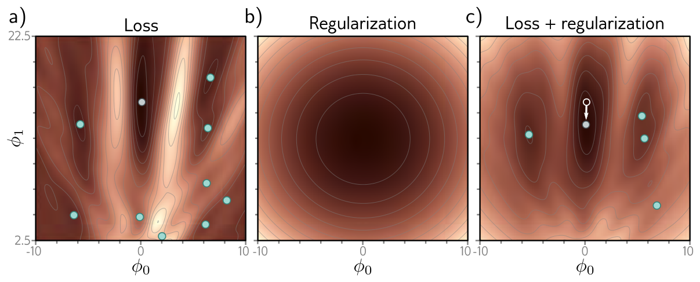{#fig-udl-9-1 width=88%}

### Probabilistic interpretation

*Prince §9.1.1, pp. 139–140.*

Week 5 built every loss from the maximum likelihood criterion,

$$
\hat{\boldsymbol{\phi}} = \underset{\boldsymbol{\phi}}{\operatorname{argmax}} \Big[ \prod_{i=1}^{I} Pr(y_i \mid \mathbf{x}_i, \boldsymbol{\phi}) \Big].
$$ {#eq-ml}

A regularizer has a natural reading in that language: it is a **prior**
$Pr(\boldsymbol{\phi})$, what we believe about the parameters before seeing
any data. Multiplying the likelihood by the prior gives the **maximum a
posteriori** or **MAP** criterion,

$$
\hat{\boldsymbol{\phi}} = \underset{\boldsymbol{\phi}}{\operatorname{argmax}} \Big[ \prod_{i=1}^{I} Pr(y_i \mid \mathbf{x}_i, \boldsymbol{\phi})\, Pr(\boldsymbol{\phi}) \Big].
$$ {#eq-map}

Take the negative log, as in Week 5. The log of a product is a sum of logs, so

$$
-\log\Big[\prod_{i=1}^{I} Pr(y_i \mid \mathbf{x}_i, \boldsymbol{\phi})\, Pr(\boldsymbol{\phi})\Big]
= \underbrace{\sum_{i=1}^{I} -\log Pr(y_i \mid \mathbf{x}_i, \boldsymbol{\phi})}_{\sum_i \ell_i[\mathbf{x}_i, y_i]} \; \underbrace{- \log Pr(\boldsymbol{\phi})}_{\lambda \cdot g[\boldsymbol{\phi}]},
$$ {#eq-map-loss}

and the regularized loss of @eq-reg appears with $\lambda \cdot g[\boldsymbol{\phi}]
= -\log Pr(\boldsymbol{\phi})$. Every penalty is a prior and every prior is a
penalty. The dictionary runs both ways, and it tells you what a given
regularizer is *assuming*: a penalty that grows with $|\phi_j|$ is the statement
"before seeing data, I believe large parameters are improbable."

::: {.callout-important}
## Worked: a normal prior is L2 regularization (problem 9.1)
Suppose each parameter independently has a zero-mean normal prior with variance
$\sigma^2_\phi$, $Pr(\boldsymbol{\phi}) = \prod_{j} \mathrm{Norm}_{\phi_j}[0,
\sigma^2_\phi]$. Its negative log is
$$
-\log Pr(\boldsymbol{\phi}) = \sum_j \Big[ \tfrac{1}{2}\log(2\pi\sigma^2_\phi) + \frac{\phi_j^2}{2\sigma^2_\phi} \Big] = \frac{1}{2\sigma^2_\phi} \sum_j \phi_j^2 + \text{const}.
$$ {#eq-normal-prior}
The constant does not depend on $\boldsymbol{\phi}$ and drops out of the
argmin, leaving exactly the L2 term of @eq-l2 with
$$
\lambda = \frac{1}{2\sigma^2_\phi}.
$$ {#eq-lambda-sigma}
So the regularization strength *is* the prior's tightness: a prior that only
believes in small parameters (small $\sigma^2_\phi$) is a large $\lambda$, and
a vague prior ($\sigma^2_\phi \to \infty$) is no regularization at all. The
same calculation with a Laplace prior, $Pr(\phi_j) \propto e^{-|\phi_j|/b}$,
gives the L1 penalty $\sum_j |\phi_j| / b$ of the chapter notes, which pushes
some parameters to exactly zero.
:::

### L2 regularization

*Prince §9.1.2, pp. 140–141; figure on p. 141.*

Neural networks are used for so many things that the prior can only express
very generic preferences. By far the most common is the **L2 norm**, which
penalizes the sum of the squared parameters:

$$
\hat{\boldsymbol{\phi}} = \underset{\boldsymbol{\phi}}{\operatorname{argmin}} \Big[ \sum_{i=1}^{I} \ell_i[\mathbf{x}_i, y_i] + \lambda \sum_j \phi_j^2 \Big].
$$ {#eq-l2}

Other names for the same thing are **Tikhonov regularization**, **ridge
regression**, and, for weight matrices, **Frobenius norm regularization** (the
Frobenius norm of a matrix is the square root of the sum of its squared
entries, so penalizing it squared is the same sum). As the callout above showed,
it is the normal prior with $\lambda = 1/(2\sigma^2_\phi)$.

**Weights, not biases.** For networks the penalty is normally applied to the
weights $\boldsymbol{\Omega}_k$ and not the biases $\boldsymbol{\beta}_k$, and
is then called a **weight decay** term. The reason is what each kind of
parameter does. A weight multiplies an activation, so its size sets how steeply
the function can change; a bias only shifts where a ReLU's joint sits or where
the output is centred. Shrinking biases toward zero would not make the function
smoother, it would just drag every joint toward the origin and the output
toward zero — a preference with no justification.

**What the gradient sees (problem 9.2).** Adding $\lambda\sum_j \phi_j^2$ to the
loss adds $2\lambda\phi_j$ to every component of the gradient:
$$
\frac{\partial}{\partial \boldsymbol{\phi}} \Big[ L[\boldsymbol{\phi}] + \lambda \sum_j \phi_j^2 \Big] = \frac{\partial L}{\partial \boldsymbol{\phi}} + 2\lambda\boldsymbol{\phi},
$$ {#eq-l2-gradient}
so a gradient descent step becomes
$$
\boldsymbol{\phi} \longleftarrow \boldsymbol{\phi} - \alpha\Big(\frac{\partial L}{\partial \boldsymbol{\phi}} + 2\lambda\boldsymbol{\phi}\Big) = (1 - 2\alpha\lambda)\,\boldsymbol{\phi} - \alpha\frac{\partial L}{\partial \boldsymbol{\phi}}.
$$ {#eq-l2-step}
Every iteration first multiplies the parameters by a number slightly below one
and then takes the usual step. That is where the name *weight decay* comes
from, and @eq-l2-step is problem 9.5 read backwards: the decay update
$\boldsymbol{\phi} \leftarrow (1 - \lambda')\boldsymbol{\phi} - \alpha\,\partial
L/\partial\boldsymbol{\phi}$ is a plain gradient step on the L2-regularized loss
with $\lambda = \lambda'/(2\alpha)$. Note also what @eq-l2-gradient says about
*which* parameters are affected most: the pull toward zero is proportional to
the parameter itself, so large weights are shrunk hard and weights already near
zero are barely touched.

**Why smaller weights mean a smoother function.** The output of a network is a
weighted sum of the last hidden layer's activations; smaller weights mean the
output varies less when those activations change. The same argument applies to
the pre-activations of the last hidden layer in terms of the layer before, and
so on back through the network. Week 3 makes this concrete for a ReLU network:
the slope of the output in any linear region is a sum of products of weights
along the active paths, so bounding the weights bounds every slope the function
can have. Push the weights all the way to zero and no path carries anything;
the network outputs a constant, its final bias. L2 regularization therefore
makes the function **smoother**, and $\lambda$ sets how much smoothness we buy
at the expense of fitting the data. @fig-udl-9-2 shows the trade on the simplified
network of Week 8: at small $\lambda$ the fit passes through every noisy point;
at intermediate $\lambda$ it is smoother and closer to the truth; at large
$\lambda$ it is smoother than the truth and the fit is worse.

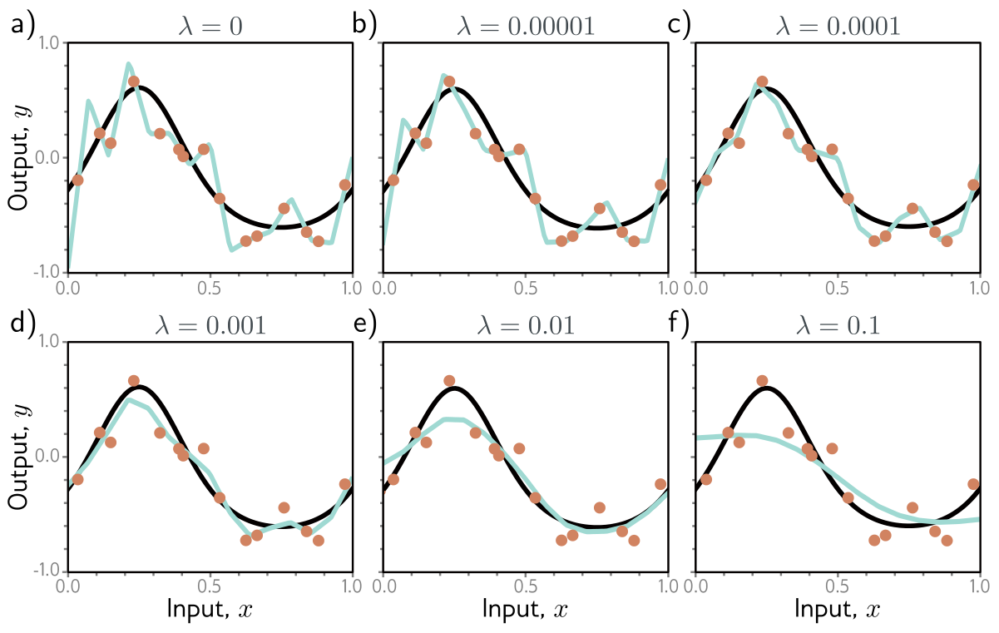{#fig-udl-9-2 width=86%}

Prince gives two reasons this can improve test performance, and they map onto
the two causes of the generalization gap. If the model is overfitting, the
penalty forces it to trade "slavish adherence to the data" against smoothness,
which in the language of Chapter 8 reduces **variance** (the model need not pass
through every point) at the cost of some **bias** (it can only describe smooth
functions). If the model is over-parameterized, some of its capacity describes
regions with no data at all, and there the penalty favors smooth interpolation
between the nearest points — a sensible default when nothing else is known.

The simplified model is linear in its parameters, so the L2-regularized fit has
a closed form, $(\mathbf{X}^T\mathbf{X} + \lambda\mathbf{P})^{-1}\mathbf{X}^T\mathbf{y}$
with $\mathbf{P}$ the identity except for a zero in the bias position. That
lets us sweep $\lambda$ over seven orders of magnitude and watch the
variance-for-bias trade happen.

```{python}
#| label: fig-l2-sweep
#| fig-cap: "Our version of figure 9.2, quantified. The simplified network with $D = 14$ hidden units is fit by L2-regularized least squares to 200 random training sets of $I = 15$ points. Left: median error against the true function, with the interquartile range shaded, as $\\lambda$ runs from $10^{-6}$ to $10$. At the left end the model interpolates the data (train MSE 0, error 0.07 — the critical regime of Week 8); at the right it is a nearly straight line. The minimum, near $\\lambda = 3 \\times 10^{-3}$, is a ninth of the unregularized error. Right: one training set, three values of $\\lambda$, with the squared norm of the fitted weights. The penalty does its work by shrinking the weights by orders of magnitude, and the function smooths accordingly."

def fit_l2(x, y, D, lam):
    """Equation (9.5) in closed form for the simplified model; the bias is not penalized."""
    X = features(x, D)
    P = np.eye(D + 1); P[0, 0] = 0
    return np.linalg.solve(X.T @ X + lam * P, X.T @ y)

I, D = 15, 14
rng = np.random.default_rng(774)
datasets = [sample(I, rng) for _ in range(200)]
lams = np.logspace(-6, 1, 29)
err = np.array([[np.mean((features(x_grid, D) @ fit_l2(x, y, D, lam) - mu(x_grid)) ** 2) for x, y in datasets]
                for lam in lams])
med = np.median(err, axis=1); q1, q3 = np.percentile(err, [25, 75], axis=1)

fig, ax = plt.subplots(1, 2, figsize=(8.5, 3.3))
ax[0].fill_between(lams, q1, q3, color=NDSU_GREEN, alpha=0.2, lw=0)
ax[0].plot(lams, med, color=NDSU_GREEN)
ax[0].plot(lams[med.argmin()], med.min(), "o", color=NDSU_GREEN)
ax[0].set(xscale="log", yscale="log", xlabel="$\\lambda$", ylabel="Error vs. true function")

x, y = datasets[0]
ax[1].plot(x_grid, mu(x_grid), "k", lw=2, label="true $\\mu[x]$")
for lam, c in [(1e-6, ACCENT), (3e-3, NDSU_GREEN), (1.0, STEEL)]:
    phi = fit_l2(x, y, D, lam)
    ax[1].plot(x_grid, features(x_grid, D) @ phi, color=c, lw=1.4,
               label=f"$\\lambda$ = {lam:g}, $\\|\\mathbf{{w}}\\|^2$ = {np.sum(phi[1:] ** 2):.3g}")
ax[1].plot(x, y, "o", color=NDSU_GOLD, mec="k", ms=5, zorder=5)
ax[1].set(ylim=(-1.2, 1.2), xlabel="Input, $x$", ylabel="Output, $y$")
ax[1].legend(fontsize=7.5, loc="lower left")
fig.tight_layout()
plt.show()

print(f"best lambda {lams[med.argmin()]:.1e}: error {med.min():.4f};  lambda -> 0: {med[0]:.4f};  lambda = 10: {med[-1]:.4f}")
```

::: {.callout-important}
## L2 regularization is not weight decay when the optimizer is Adam
*Prince, chapter notes, pp. 155–156.* The two names are used interchangeably,
but they are different algorithms. L2 regularization adds $\lambda \sum_j
\phi_j^2$ to the loss, so the gradient gains a term $2\lambda\boldsymbol{\phi}$
(problem 9.2). **Weight decay** [@hanson1988] instead shrinks the parameters
before each gradient step,
$$
\boldsymbol{\phi} \longleftarrow (1 - \lambda')\,\boldsymbol{\phi} - \alpha\, \frac{\partial L}{\partial \boldsymbol{\phi}}.
$$ {#eq-weight-decay}
For plain SGD the two coincide with $\lambda = \lambda' / (2\alpha)$ (problem
9.5). For Adam they do not: Adam rescales each coordinate's gradient — including
the $2\lambda\phi_j$ term — by its own running statistics, so parameters with
large gradients are barely regularized. **AdamW** [@loshchilov2019] applies the
decay directly to the parameters as in @eq-weight-decay, and `torch.optim.AdamW`
is what the `weight_decay` argument should mean when you use Adam. In
`torch.optim.SGD` and `torch.optim.Adam`, `weight_decay` adds the L2 gradient
term instead.
:::

## Implicit Regularization

*Prince §9.2, p. 141.*

Here is the chapter's most surprising idea. Neither gradient descent nor SGD
moves *neutrally* to the minimum of the loss. Each prefers some solutions to
others, and the preference can be written as an extra term in the loss — a
regularizer nobody added. This is **implicit regularization**.

### Implicit regularization in gradient descent

*Prince §9.2.1, pp. 141–142; figure on p. 142.*

Imagine gradient descent with an infinitesimal step. The parameters then
follow the differential equation

$$
\frac{\partial \boldsymbol{\phi}}{\partial t} = -\frac{\partial L}{\partial \boldsymbol{\phi}},
$$ {#eq-gradient-flow}

called **gradient flow**. Real gradient descent approximates it with discrete
steps of size $\alpha$,

$$
\boldsymbol{\phi}_{t+1} = \boldsymbol{\phi}_t - \alpha \frac{\partial L[\boldsymbol{\phi}_t]}{\partial \boldsymbol{\phi}},
$$ {#eq-gd}

and the discretization makes the path deviate from the continuous one. On a
loss with a whole line of global minima (@fig-udl-9-3**a**) the two paths end at
different points on that line.

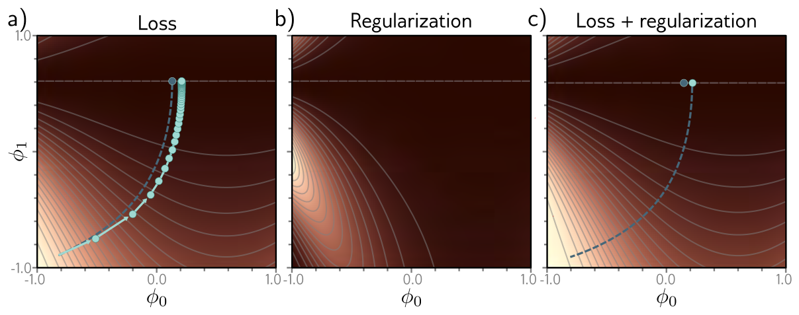{#fig-udl-9-3 width=90%}

The deviation can be understood by asking a backwards question: on what
*modified* loss $\tilde{L}$ would the continuous flow arrive where the discrete
steps on $L$ arrived? The chapter notes (pp. 156–157) derive the answer by
backward error analysis, keeping terms to second order in $\alpha$:

$$
\tilde{L}_{\text{GD}}[\boldsymbol{\phi}] = L[\boldsymbol{\phi}] + \frac{\alpha}{4} \left\| \frac{\partial L}{\partial \boldsymbol{\phi}} \right\|^2.
$$ {#eq-implicit-gd}

Discrete gradient descent behaves like continuous descent on a loss that
**penalizes the squared gradient norm**. The trajectory is repelled from places
where the surface is steep. This does not move the minima — the gradient is
zero there anyway — but it changes the loss everywhere else, bends the
trajectory, and can send it to a different minimum (@fig-udl-9-3**c**). Since
the penalty is proportional to $\alpha$, a larger learning rate regularizes
harder, which is one candidate explanation for the observation that full-batch
gradient descent generalizes better with larger steps (@fig-udl-9-5**a**).

The derivation is first-order in $\alpha$, so it should match best for small
steps. The cell below checks that, on a loss with a line of minima like
Prince's: it runs discrete gradient descent, the continuous flow (approximated
by very small steps), and the continuous flow on @eq-implicit-gd, and reports
how much of the discrete path's deviation the modified loss accounts for.

```{python}
#| label: fig-implicit-gd
#| fig-cap: "Our version of figure 9.3 on the loss $L = (\\phi_1 - 0.61)^2 (1 + \\phi_0^2)$, whose global minima form the line $\\phi_1 = 0.61$. Left: from the same start, continuous gradient flow (dashed) and discrete gradient descent with $\\alpha = 0.05$ (dots) reach different points on the line of minima. Right: continuous flow on the modified loss of equation 9.8 (solid green) ends close to where the discrete path did. The table gives the endpoints for four step sizes: the modified loss explains about 90% of the deviation at $\\alpha = 0.02$ and progressively less as $\\alpha$ grows, because the derivation keeps only the first correction in $\\alpha$."

def L_toy(p):  return (p[1] - 0.61) ** 2 * (1 + p[0] ** 2)
def g_toy(p):  return np.array([2 * p[0] * (p[1] - 0.61) ** 2, 2 * (p[1] - 0.61) * (1 + p[0] ** 2)])
def H_toy(p):
    a = p[1] - 0.61
    return np.array([[2 * a ** 2, 4 * p[0] * a], [4 * p[0] * a, 2 * (1 + p[0] ** 2)]])

def descend(grad, alpha, n, p0=(-1.5, -1.0)):
    p, path = np.array(p0, float), [np.array(p0, float)]
    for _ in range(n):
        p = p - alpha * grad(p); path.append(p.copy())
    return np.array(path)

flow = descend(g_toy, 5e-4, 60000)                                  # gradient flow, equation (9.6)
rows = []
for alpha in (0.02, 0.05, 0.1, 0.2):
    disc = descend(g_toy, alpha, int(60 / alpha))                    # gradient descent, equation (9.7)
    g_mod = lambda p, a=alpha: g_toy(p) + (a / 2) * H_toy(p) @ g_toy(p)   # gradient of L + (a/4) ||dL/dphi||^2
    mod = descend(g_mod, 5e-4, 60000)                                # gradient flow on equation (9.8)
    rows.append((alpha, disc, mod, (mod[-1, 0] - flow[-1, 0]) / (disc[-1, 0] - flow[-1, 0])))

P0, P1 = np.meshgrid(np.linspace(-1.8, 0.4, 200), np.linspace(-1.2, 1.0, 200))
LL = np.log(L_toy([P0, P1]) + 1e-3)
alpha, disc, mod, _ = rows[1]
fig, ax = plt.subplots(1, 2, figsize=(8.5, 3.6), sharey=True)
for a in ax:
    a.contourf(P0, P1, LL, levels=24, cmap="Greys_r", alpha=0.75)
    a.axhline(0.61, ls="--", color="gray", lw=1)
    a.plot(flow[:, 0], flow[:, 1], "--", color="k", lw=1.2, label="gradient flow")
    a.set(xlabel="$\\phi_0$")
ax[0].plot(disc[:, 0], disc[:, 1], "o-", color=NDSU_GOLD, mec="k", ms=3, lw=0.8, label=f"gradient descent, $\\alpha$ = {alpha}")
ax[1].plot(mod[:, 0], mod[:, 1], "-", color=NDSU_GREEN, lw=2, label="flow on the modified loss")
ax[1].plot(disc[-1, 0], disc[-1, 1], "o", color=NDSU_GOLD, mec="k", ms=6, label="where descent ended")
ax[0].set(ylabel="$\\phi_1$", title="Original loss"); ax[1].set(title="Loss + $\\frac{\\alpha}{4}\\|\\partial L/\\partial \\phi\\|^2$")
ax[0].legend(fontsize=8, loc="lower right"); ax[1].legend(fontsize=8, loc="lower right")
fig.tight_layout()
plt.show()

print(f"{'alpha':>6}{'descent ends at':>17}{'flow ends at':>14}{'modified flow':>15}{'deviation explained':>21}")
for alpha, disc, mod, frac in rows:
    print(f"{alpha:>6}{disc[-1, 0]:>17.4f}{flow[-1, 0]:>14.4f}{mod[-1, 0]:>15.4f}{frac:>20.0%}")
```

### Implicit regularization in stochastic gradient descent

*Prince §9.2.2, p. 144; figure on p. 143.*

The same analysis for SGD asks for a modified loss on which the continuous flow
lands where the *average* over the possible random SGD updates lands. The
result adds a second term:

$$
\tilde{L}_{\text{SGD}}[\boldsymbol{\phi}] = \tilde{L}_{\text{GD}}[\boldsymbol{\phi}] + \frac{\alpha}{4B} \sum_{b=1}^{B} \left\| \frac{\partial L_b}{\partial \boldsymbol{\phi}} - \frac{\partial L}{\partial \boldsymbol{\phi}} \right\|^2
= L[\boldsymbol{\phi}] + \frac{\alpha}{4} \left\| \frac{\partial L}{\partial \boldsymbol{\phi}} \right\|^2 + \frac{\alpha}{4B} \sum_{b=1}^{B} \left\| \frac{\partial L_b}{\partial \boldsymbol{\phi}} - \frac{\partial L}{\partial \boldsymbol{\phi}} \right\|^2.
$$ {#eq-implicit-sgd}

Here $L_b$ is the loss of the $b$th of the $B$ batches in an epoch, and both
$L$ and $L_b$ are now *means* over their examples:

$$
L = \frac{1}{I} \sum_{i=1}^{I} \ell_i[\mathbf{x}_i, y_i] \qquad\text{and}\qquad L_b = \frac{1}{|\mathcal{B}|} \sum_{i \in \mathcal{B}_b} \ell_i[\mathbf{x}_i, y_i].
$$ {#eq-means}

The new term is the **variance of the batch gradients**. SGD implicitly prefers
places where all the batches agree about the slope. Like the gradient-descent
term, it bends the trajectory (@fig-udl-9-4) without necessarily moving the
global minimum: an over-parameterized model that fits every training point has
all batch gradients equal to zero there.

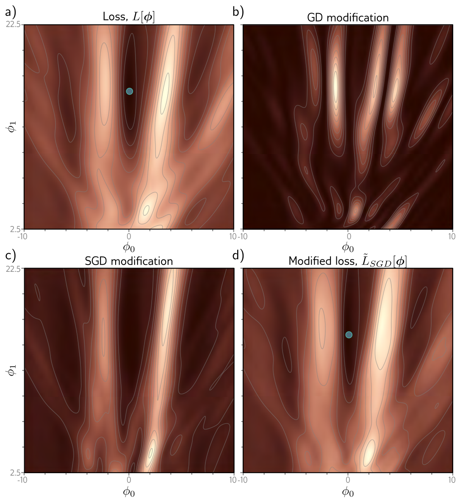{#fig-udl-9-4 width=70%}

Empirically, SGD generalizes better than gradient descent, and smaller batches
generally beat larger ones (@fig-udl-9-5**b**). Week 6 offered one explanation,
that the noise lets the optimizer reach different parts of the surface. Implicit
regularization offers another: SGD is drawn to solutions where *all* the data
fit well — low batch variance — rather than solutions where some examples fit
extremely well and others poorly at the same total loss. The former are the
ones likely to generalize.

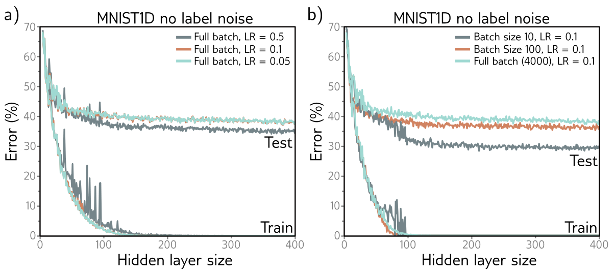{#fig-udl-9-5 width=86%}

## Heuristics to Improve Performance

*Prince §9.3, p. 144.*

Explicit terms and the optimizer's implicit ones both steer training by
changing the loss. The rest of the chapter is a catalog of other devices that
improve generalization. Each is simple to state; the interesting part is *why*
it works, and @fig-udl-9-14 at the end is the map.

### Early stopping

*Prince §9.3.1, p. 145; figure on p. 146.*

**Early stopping** means halting training before it converges. If the model
has already captured the coarse shape of the function but has not yet had time
to fit the noise, stopping there reduces overfitting (@fig-udl-9-6). Two ways to
see why. First, the weights start small (Week 7) and simply do not have time to
grow large, so early stopping acts like L2 regularization — the chapter notes
make this exact for a quadratic loss started from zero, with an effective
$\lambda \approx 1/(\tau\alpha)$ for stopping time $\tau$ [@goodfellow2016].
Second, it reduces the *effective* capacity, moving the model back down the
bias–variance curve from the critical region of Chapter 8.

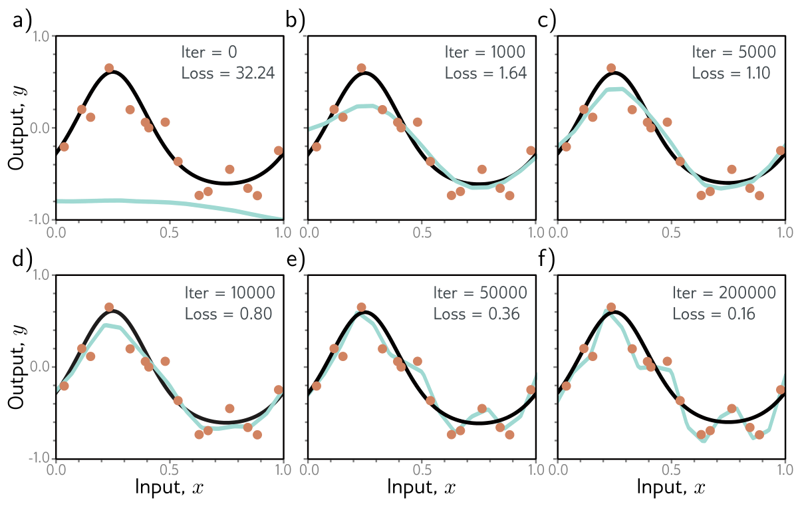{#fig-udl-9-6 width=86%}

"Reduces the effective complexity" deserves a concrete picture. Training from
small initial weights, gradient descent fits the *stiff* directions of the loss
first — the broad features of the function that many data points agree on —
and the *soft* directions, which encode fine wiggles supported by one or two
noisy points, only after many more iterations. At any finite stopping time the
soft components are still close to their initial value of zero. The model is
behaving as if it had fewer free parameters than it has, which is precisely what
a small $\lambda$ in L2 regularization does by shrinking those same components.
The figure below puts the two on one axis.

Early stopping has one hyperparameter, the stopping time, chosen on a
validation set as usual — but unlike every other hyperparameter it does not
require training many models.

::: {.callout-note}
## The early-stopping procedure
1. Split off a validation set, as in Chapter 8.
2. Train once. Every $T$ iterations, evaluate the validation loss and **save a copy** of the current parameters (a "checkpoint").
3. Continue until the validation loss has clearly stopped improving — in practice, until it has not improved for a fixed number of checks, the **patience**.
4. Discard the final model and **restore the checkpoint** with the best validation loss.

One training run yields every candidate stopping time at once; the validation
curve is the hyperparameter sweep. In PyTorch this is a few lines around the
training loop: `best = copy.deepcopy(model.state_dict())` when the validation
loss improves, `model.load_state_dict(best)` at the end.
:::

For our simplified model the whole training trajectory of full-batch gradient
descent has a closed form (it is a linear least squares problem, so the flow
@eq-gradient-flow can be solved exactly through the eigenvectors of
$\mathbf{X}^T\mathbf{X}$). That makes it possible to plot test error against
training time without training anything, and to put it on the same axis as L2
regularization.

```{python}
#| label: fig-early-stopping
#| fig-cap: "Early stopping and L2 regularization on the same axis. The simplified network ($D = 14$, $I = 15$) is trained by gradient flow from $\\boldsymbol{\\phi} = \\mathbf{0}$, solved in closed form. Green, bottom axis: error against the true function as a function of training time $t$. It falls, bottoms out near $t \\approx 60$, and then rises as the model interpolates the noise; at $t \\to \\infty$ the training error is zero and the test error is about twelve times its minimum. Blue, top axis: the L2-regularized solution as a function of $\\lambda$, plotted with $\\lambda = 1/(2t)$ so that the two axes line up. The curves are not identical but track each other: stopping at time $t$ shrinks the components of the solution along low-curvature directions in nearly the same way as a penalty of $1/(2t)$. The dashed line is the training error of the early-stopped model, which keeps decreasing throughout."

rng = np.random.default_rng(774)
x, y = sample(I, rng)
X, Xg = features(x, D), features(x_grid, D)
s, V = np.linalg.eigh(X.T @ X)                     # X^T X = V diag(s) V^T
c = V.T @ (X.T @ y)

def phi_at_time(t):
    """Gradient flow on sum_i (f - y_i)^2 from phi(0) = 0: each eigen-component approaches
    its least squares value with rate 2 s_k, so phi(t) = V diag((1 - exp(-2 s t)) / s) V^T X^T y."""
    return V @ ((1 - np.exp(-2 * s * t)) / s * c)

def phi_ridge(lam):
    """L2 regularization on every parameter: phi = V diag(1 / (s + lam)) V^T X^T y."""
    return V @ (c / (s + lam))

ts = np.logspace(-2, 5, 141)
test_t  = np.array([np.mean((Xg @ phi_at_time(t) - mu(x_grid)) ** 2) for t in ts])
train_t = np.array([np.mean((X  @ phi_at_time(t) - y) ** 2) for t in ts])
test_l  = np.array([np.mean((Xg @ phi_ridge(1 / (2 * t)) - mu(x_grid)) ** 2) for t in ts])

fig, ax = plt.subplots(figsize=(7, 3.6))
ax.plot(ts, test_t, color=NDSU_GREEN, lw=2, label="early stopping at time $t$: error vs. truth")
ax.plot(ts, train_t, "--", color=NDSU_GREEN, lw=1, label="early stopping: training error")
ax.plot(ts, test_l, color=STEEL, lw=2, label="L2 with $\\lambda = 1/(2t)$: error vs. truth")
ax.plot(ts[test_t.argmin()], test_t.min(), "o", color=NDSU_GREEN)
ax.set(xscale="log", yscale="log", xlabel="training time $t$ of gradient flow", ylabel="Mean squared error", ylim=(1e-4, 1))
top = ax.secondary_xaxis("top", functions=(lambda t: 1 / (2 * t), lambda l: 1 / (2 * l)))
top.set_xlabel("$\\lambda$")
ax.legend(fontsize=8, loc="lower left")
fig.tight_layout()
plt.show()

print(f"best stopping time t = {ts[test_t.argmin()]:.0f}: error {test_t.min():.4f}, training error there {train_t[test_t.argmin()]:.4f}")
print(f"trained to convergence:  error {test_t[-1]:.4f}, training error {train_t[-1]:.1e}")
```

### Ensembling

*Prince §9.3.2, pp. 145–147; figure on p. 147.*

Build several models and average their predictions: an **ensemble**. This
reliably improves test performance — it is the most dependable trick in the
chapter — at the cost of training and storing several models and running all of
them at inference.

**How to combine.** For regression, average the outputs. For classification,
Prince averages the *pre-softmax activations* (the logits) rather than the
probabilities. Both work; averaging logits amounts to a geometric mean of the
models' probability vectors, which keeps a confident model's relative
preferences intact, whereas averaging probabilities is an arithmetic mean that
lets confident and unsure models contribute equally to each class. Taking the
**median** output, or the **most frequent** predicted class, is a more robust
variant: one model that goes badly wrong on an input cannot drag the ensemble
with it.

**Why it works, and when it does not.** The premise is that the models' errors
are independent and cancel. If $M$ models each have error variance $\sigma^2$
and the errors of any two are correlated with coefficient $\rho$, the variance
of their average is

$$
\operatorname{Var}\Big[\frac{1}{M}\sum_{m=1}^{M} e_m\Big] = \sigma^2\Big(\rho + \frac{1-\rho}{M}\Big).
$$ {#eq-ensemble-variance}

With independent errors ($\rho = 0$) the variance falls like $1/M$. With
correlated errors it never falls below $\rho\sigma^2$ however many models we add.
So an ensemble is only as good as the *diversity* of its members: ten copies of
the same model trained on the same data from the same start are one model. (The
bias of each model is untouched by averaging; ensembling is a variance
reduction, the third of the four mechanisms.)

**Where diversity comes from.** The simplest source is **different random
initializations**. This helps most in regions far from the training data, where
each model is unconstrained, the models disagree, and their average is more
moderate than any one of them. A second source is **bagging** — bootstrap
aggregating [@breiman1996]: draw $I$ examples *with replacement* from the $I$
training points to make a new training set, repeat to make several, and train
one model on each (@fig-udl-9-7). A bootstrap sample contains about 63% of the
original points, some of them more than once, and omits the other 37% — the
sizes of the orange dots in the figure show the counts. A point left out of one
resample is interpolated from its neighbors by that model, so an outlier's
influence is diluted and the average is smoother than any single fit. Other
sources of diversity are different hyperparameters, models stored at different
times during one training run, or entirely different model families.

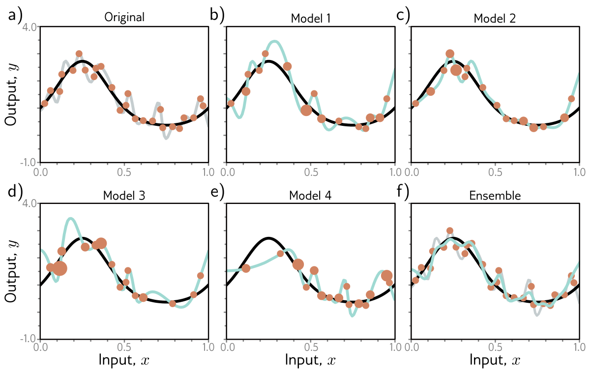{#fig-udl-9-7 width=86%}

```{python}
#| label: bagging

rng = np.random.default_rng(774)
single, bagged = [], []
for _ in range(200):
    x, y = sample(I, rng)
    f_single = Xg @ fit_l2(x, y, D, 1e-4)                            # one model on all the data
    f_bag = np.mean([Xg @ fit_l2(x[idx], y[idx], D, 1e-4)             # 20 models on bootstrap resamples
                     for idx in (rng.integers(0, I, I) for _ in range(20))], axis=0)
    single.append(np.mean((f_single - mu(x_grid)) ** 2)); bagged.append(np.mean((f_bag - mu(x_grid)) ** 2))
print(f"error vs. true function, median over 200 training sets:  single model {np.median(single):.4f}   bagged ensemble of 20 {np.median(bagged):.4f}")
print(f"the ensemble is better on {np.mean(np.array(bagged) < np.array(single)):.0%} of the training sets")

unique_frac = np.mean([len(np.unique(rng.integers(0, I, I))) / I for _ in range(2000)])
print(f"a bootstrap resample of {I} points contains on average {unique_frac:.0%} distinct points (the limit is 1 - 1/e = {1 - np.exp(-1):.0%})")
```

### Dropout

*Prince §9.3.3, pp. 147–149; figures on pp. 148–149.*

**Dropout** randomly clamps a subset of hidden units — typically half — to zero
at every SGD iteration (@fig-udl-9-8). Clamping a unit to zero is the same as
temporarily removing it: its incoming weights receive no gradient and its
outgoing weights contribute nothing, so each step trains a slightly different,
thinner network, and the next step a different one again.

Two consequences follow. First, the network **cannot rely on any particular
unit**, because that unit may be absent when the loss is computed. A feature
that is only useful in combination with three specific other units — a
"co-adaptation" — is fragile under dropout, so the training pressure favours
units that are individually useful. Second, the **weights are pushed smaller**:
when a unit disappears, the function changes by the size of that unit's
contribution, and the loss penalizes large swings, so the network learns to
spread its function over many small contributions rather than a few large
ones. That is the same smoothness L2 regularization buys, obtained by a
different route.

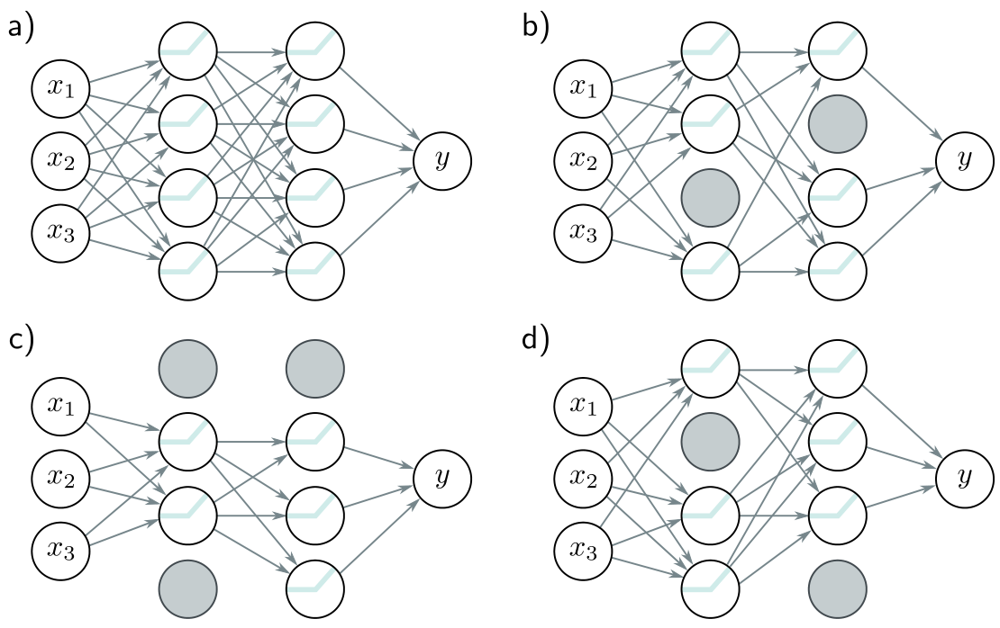{#fig-udl-9-8 width=74%}

Prince's mechanism for *why* this generalizes is worth following closely
(@fig-udl-9-9). Suppose three hidden units become active one after another along
the input axis. The first raises the slope sharply, the second lowers it, the
third cancels the decrease and returns the curve to its path. Together they make
a kink between two data points that contributes nothing to the training loss —
the model already fits the data as well as it can — so gradient descent will
never remove it, yet it is unlikely to reflect the truth. Now drop the middle
unit. Without its decrease, everything to the right of that joint swings upward
and the loss jumps; the next gradient step compensates, and over many iterations
these conspiracies between units are dismantled. Dropout removes large,
unnecessary changes between training points even though they cost nothing.

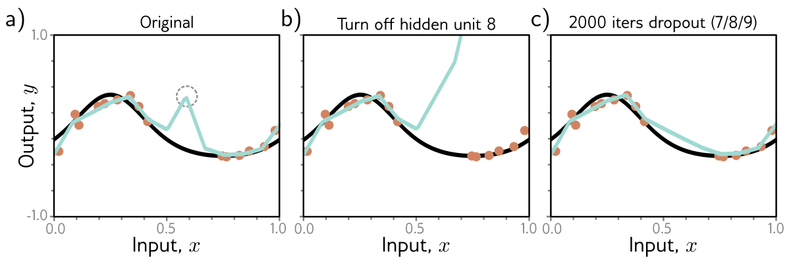{#fig-udl-9-9 width=88%}

At test time there are two options.

**Weight scaling inference rule.** Run the full network with every unit on. But
the next layer was trained on inputs where each unit was present only a fraction
$1 - p$ of the time: during training the *expected* contribution of unit $j$ to
a downstream pre-activation was $(1 - p)\,\omega_j h_j$. With every unit present
the contribution is $\omega_j h_j$, larger by $1/(1 - p)$, and the pre-activations
would be systematically too big. So multiply the weights by $1 - p$ at inference
(with $p = 0.5$, halve them) to restore the expectation the network was trained
under. This is a single deterministic pass and costs nothing.

**Monte Carlo dropout** [@gal2016]. Alternatively, keep dropout *on* at test
time, run the network several times with different random subsets of units
clamped to zero, and average the results. Every random thinning is a different
model, so this is an ensemble — but one whose members share a single set of
weights and so never had to be trained or stored separately. The spread of the
passes is a rough measure of the model's uncertainty, which the single
deterministic pass cannot give.

::: {.callout-note}
## Dropout in PyTorch
`nn.Dropout(p)` zeroes each input with probability `p` and multiplies the
survivors by $1/(1-p)$ during training (the *inverted* form of the scaling rule,
so that no rescaling is needed later). `model.eval()` turns it off for inference;
`model.train()` turns it back on, which is how Monte Carlo dropout is done.
Forgetting `model.eval()` before testing is a classic bug.
:::

```{python}
#| label: fig-dropout
#| fig-cap: "Dropout on a 1–100–100–1 ReLU network fit to 15 noisy points with Adam for 4,000 full-batch steps. Left: without dropout the network interpolates every point and its error against the true function is 0.035. Right: with $p = 0.5$ on both hidden layers, evaluated in `eval()` mode, the fit is smoother, misses the noisiest points, and its error is 0.013, almost three times smaller. The shaded band spans $\\pm 2$ standard deviations of 30 Monte Carlo dropout passes of the same network; it is widest where the data are sparsest, which is the uncertainty estimate that comes free with dropout."

rng = np.random.default_rng(774)
x, y = sample(15, rng)
X_t = torch.tensor(x, dtype=torch.float32)[:, None]; Y_t = torch.tensor(y, dtype=torch.float32)[:, None]
Xg_t = torch.tensor(x_grid, dtype=torch.float32)[:, None]

def dropout_net(p):
    return nn.Sequential(nn.Linear(1, 100), nn.ReLU(), nn.Dropout(p),
                         nn.Linear(100, 100), nn.ReLU(), nn.Dropout(p),
                         nn.Linear(100, 1))

fig, ax = plt.subplots(1, 2, figsize=(8.5, 3.3), sharey=True)
results = {}
for a, p in zip(ax, (0.0, 0.5)):
    torch.manual_seed(774)
    net = dropout_net(p)
    opt = torch.optim.Adam(net.parameters(), lr=0.01)
    for _ in range(4000):
        opt.zero_grad(); loss = ((net(X_t) - Y_t) ** 2).mean(); loss.backward(); opt.step()
    net.eval()
    with torch.no_grad():
        f = net(Xg_t).squeeze().numpy()
    net.train()                                                      # Monte Carlo dropout: keep the masks on
    with torch.no_grad():
        mc = torch.stack([net(Xg_t).squeeze() for _ in range(30)]).numpy()
    results[p] = (np.mean((f - mu(x_grid)) ** 2), np.mean((mc.mean(0) - mu(x_grid)) ** 2))
    if p > 0:
        a.fill_between(x_grid, mc.mean(0) - 2 * mc.std(0), mc.mean(0) + 2 * mc.std(0),
                       color=NDSU_GREEN, alpha=0.18, lw=0, label="Monte Carlo dropout, $\\pm 2$ sd of 30 passes")
    a.plot(x_grid, mu(x_grid), "k", lw=2, label="true $\\mu[x]$")
    a.plot(x_grid, f, color=ACCENT if p == 0 else NDSU_GREEN, lw=2, label="network, eval mode")
    a.plot(x, y, "o", color=NDSU_GOLD, mec="k", ms=5, zorder=5)
    a.set(title=f"dropout p = {p}", xlabel="Input, $x$", ylim=(-1.2, 1.2))
ax[0].set(ylabel="Output, $y$"); ax[1].legend(fontsize=7.5, loc="upper right")
fig.tight_layout()
plt.show()

for p, (e_eval, e_mc) in results.items():
    print(f"p = {p}: error vs. truth {e_eval:.4f} (eval mode), {e_mc:.4f} (mean of 30 Monte Carlo passes)")
```

### Applying noise

*Prince §9.3.4, pp. 149–150; figure on p. 150.*

Dropout is multiplicative Bernoulli noise on the activations. Once you see it
that way, noise can be applied anywhere in the network during training, and in
each place it buys a different kind of robustness.

**Noise on the inputs** smooths the learned function (@fig-udl-9-10). At each
SGD step, each input $\mathbf{x}_i$ in the batch is replaced by $\mathbf{x}_i +
\boldsymbol{\epsilon}_i$ with fresh Gaussian noise of variance $\sigma^2_x$. The
model can no longer pin a prediction to one exact input; it has to predict
about the same thing across a small neighbourhood, which is what "smooth"
means. For regression this is equivalent to adding a penalty on the derivatives
of the output with respect to the input [@bishop1995], and for a straight line
the equivalence is exact.

::: {.callout-important}
## Worked: input noise on a line is an L2 penalty on the slope (problem 9.3)
For $y = \phi_0 + \phi_1 x$ with the least squares loss, add noise $\epsilon_i
\sim \mathrm{Norm}[0, \sigma^2_x]$ to each input. One term of the loss is
$$
\big(\phi_0 + \phi_1(x_i + \epsilon_i) - y_i\big)^2 = \big(\phi_0 + \phi_1 x_i - y_i\big)^2 + 2\phi_1\epsilon_i\big(\phi_0 + \phi_1 x_i - y_i\big) + \phi_1^2\epsilon_i^2.
$$
Taking the expectation over the noise kills the middle term ($\mathbb{E}[\epsilon_i] = 0$)
and turns the last into $\phi_1^2\sigma^2_x$. Summed over the $I$ examples,
$$
\mathbb{E}_{\epsilon}\big[L_{\text{noisy}}[\boldsymbol{\phi}]\big] = L[\boldsymbol{\phi}] + I\sigma^2_x\,\phi_1^2,
$$ {#eq-input-noise}
the original loss plus an L2 penalty on the slope $\phi_1 = \partial y / \partial x$
— the derivative of the output with respect to the input — with $\lambda =
I\sigma^2_x$. The intercept is not penalized, because shifting the line up or
down does not change how sensitive it is to the input. The expected gradient
update is therefore the usual one plus $2 I \sigma^2_x \phi_1$ on the slope
alone. For a nonlinear network the same calculation holds locally: input noise
penalizes $\|\partial \mathrm{f} / \partial \mathbf{x}\|^2$ averaged over the
training inputs.
:::

```{python}
#| label: input-noise

rng = np.random.default_rng(774)
I_n, sigma_x = 20, 0.3
x_n = rng.uniform(-1, 1, I_n); y_n = 0.5 + 1.5 * x_n + rng.normal(0, 0.2, I_n)
phi = np.array([0.3, 0.9])                                               # any parameter setting

def loss_line(xs):
    return np.sum((phi[0] + phi[1] * xs - y_n) ** 2)

noisy = np.mean([loss_line(x_n + rng.normal(0, sigma_x, I_n)) for _ in range(100000)])
print(f"expected loss with input noise (Monte Carlo):   {noisy:.4f}")
print(f"L + I sigma_x^2 phi_1^2, equation (input noise): {loss_line(x_n) + I_n * sigma_x ** 2 * phi[1] ** 2:.4f}")
```

The extreme version is **adversarial training**, in which the optimizer does
not sample the perturbation at random but actively *searches* for the small
$\boldsymbol{\epsilon}_i$ that most increases the loss — the worst-case noise —
and trains against that.

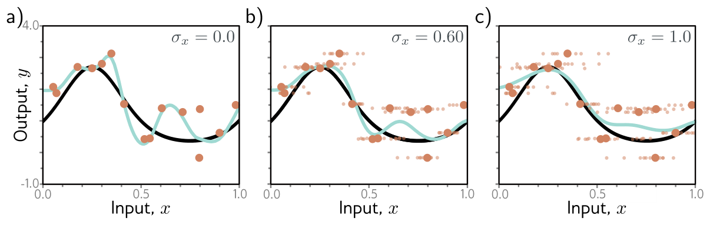{#fig-udl-9-10 width=88%}

**Noise on the weights** asks the network to predict sensibly even when its
parameters are slightly wrong. Picture two minima of the loss with the same
depth: one at the bottom of a narrow, sharp valley, one in the middle of a
wide, flat basin. Perturb the parameters by a small random amount and the loss
at the sharp minimum jumps, while the loss at the flat one barely moves.
Training on the *expected* loss under weight noise — to second order,
$L[\boldsymbol{\phi}] + \tfrac{1}{2}\sigma^2_\phi\,\mathrm{tr}[\mathbf{H}]$, a penalty
on the curvature — therefore steers toward **wide, flat minima**, where the
individual weights do not matter much. Such solutions are robust to the
estimation error in every weight, which is the fourth of the four mechanisms.

**Noise on the labels.** The multiclass cross-entropy wants to predict the
correct class with *certainty*, which drives the pre-softmax activations toward
$\pm\infty$ (Week 8's overconfidence). Suppose instead that a fraction $\rho$ of
the labels are wrong and belong, with equal probability, to one of the other
classes. One could flip labels at random each iteration; the same effect comes
from changing the *target* of the cross-entropy to a distribution with $1 - \rho$
on the true class and $\rho/(K-1)$ on each of the others. This is **label
smoothing** [@szegedy2016], and it helps across many tasks, although the
mechanism is not fully understood; it does improve the calibration of the
predicted probabilities [@muller2019].

Writing the smoothed loss out (problem 9.4) shows what it does. With $K$ classes,
predicted probabilities $p_k$ from the softmax, true class $y$, and a target
that puts $1 - \rho$ on $y$ and $\rho / (K - 1)$ on each other class, the
cross-entropy between target and prediction is

$$
\ell = -(1 - \rho)\log p_y - \frac{\rho}{K - 1}\sum_{k \neq y} \log p_k
= (1 - \rho)\,\underbrace{\big[-\log p_y\big]}_{\text{usual loss}} + \rho\,\underbrace{\Big[-\frac{1}{K-1}\sum_{k \neq y}\log p_k\Big]}_{\text{keeps every class alive}}.
$$ {#eq-label-smoothing}

The first term is the ordinary cross-entropy of Chapter 5, down-weighted by
$1 - \rho$. The second term is new: it grows without bound if any wrong class's
probability is driven to zero, so the network is penalized for being certain.
The smoothed target cannot be matched by an infinitely confident prediction,
and the logits stop growing — and we can say exactly where.

```{python}
#| label: label-smoothing

K, rho = 10, 0.1
target = np.full(K, rho / (K - 1)); target[0] = 1 - rho              # the smoothed target distribution

def smoothed_ce(gap):
    """Cross-entropy between the smoothed target and a softmax whose correct-class logit
    exceeds the K - 1 others (all equal) by `gap`."""
    z = np.zeros(K); z[0] = gap
    log_p = z - (z.max() + np.log(np.exp(z - z.max()).sum()))
    return -(target * log_p).sum()

gaps = np.linspace(0, 15, 15001)
losses = np.array([smoothed_ce(g) for g in gaps])
best = gaps[losses.argmin()]
entropy = -(target * np.log(target)).sum()

print(f"K = {K} classes, rho = {rho}: the smoothed cross-entropy is minimized at a logit gap of {best:.3f}")
print(f"closed form log[(1 - rho)(K - 1) / rho] = {np.log((1 - rho) * (K - 1) / rho):.3f}")
print(f"minimum loss {losses.min():.4f} = entropy of the target {entropy:.4f}  (not zero: the target is not one-hot)")
print(f"with rho = 0 the loss keeps falling as the gap grows: gap 15 gives {-np.log(1 / (1 + (K - 1) * np.exp(-15))):.2e}, gap 30 gives {-np.log(1 / (1 + (K - 1) * np.exp(-30))):.2e}")
```

With ten classes and $\rho = 0.1$, the loss is minimized when the correct logit
exceeds the others by $\log 81 \approx 4.4$ and no further — a probability of
0.9 on the true class, exactly the target. Problem 9.4 asks for the general
loss.

### Bayesian inference

*Prince §9.3.5, pp. 150–151; figure on p. 151.*

Maximum likelihood is overconfident by construction: it picks the single most
likely parameter vector and predicts as if it were certainly right, when many
other parameter vectors are nearly as compatible with the data. The **Bayesian
approach** treats the parameters as unknown and computes a whole distribution
over them given the training data, by Bayes' rule:

$$
Pr(\boldsymbol{\phi} \mid \{\mathbf{x}_i, y_i\}) = \frac{\prod_{i=1}^{I} Pr(y_i \mid \mathbf{x}_i, \boldsymbol{\phi})\, Pr(\boldsymbol{\phi})}{\int \prod_{i=1}^{I} Pr(y_i \mid \mathbf{x}_i, \boldsymbol{\phi})\, Pr(\boldsymbol{\phi})\, d\boldsymbol{\phi}}.
$$ {#eq-posterior}

The numerator is the MAP objective of @eq-map; the denominator normalizes it
into a probability. Prediction for a new input then integrates over every
parameter setting, weighting each by its posterior probability:

$$
Pr(y \mid \mathbf{x}, \{\mathbf{x}_i, y_i\}) = \int Pr(y \mid \mathbf{x}, \boldsymbol{\phi})\, Pr(\boldsymbol{\phi} \mid \{\mathbf{x}_i, y_i\})\, d\boldsymbol{\phi}.
$$ {#eq-predictive}

This is an **infinite ensemble**, weighted by prior plausibility and agreement
with the data, and it returns a predictive *distribution* — a mean and an
uncertainty — rather than a point (@fig-udl-9-11). The prior variance plays the
role of $\lambda$: a tight prior gives smoother sampled functions.

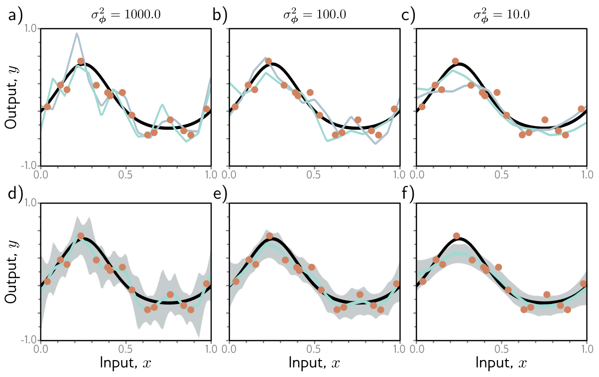{#fig-udl-9-11 width=86%}

For the simplified network the posterior is a Gaussian and @eq-predictive can be
computed exactly. For a deep network there is no practical way to represent a
distribution over millions of parameters or to integrate over it; every working
method approximates, by a simpler distribution (variational Bayes) or by samples
(MCMC), and adds considerable complexity. Monte Carlo dropout can be read as a
cheap approximation of this kind.

### Transfer learning and multi-task learning

*Prince §9.3.6, pp. 151–152; figure on p. 153.*

When labeled data for the task are scarce, use someone else's data. In
**transfer learning** (@fig-udl-9-12**a**) the network is first **pre-trained**
on a related *secondary* task for which data are plentiful — a million labeled
photographs, say, or every image on the web with its caption. Then the last
layer, which produced the secondary task's outputs, is removed, and one or more
new layers that produce the outputs we actually want are added in its place.
From here there are two choices:

- **Freeze and train the head.** Keep every pre-trained parameter fixed and train only the new layers. The pre-trained network becomes a fixed feature extractor; the new head is a small model, often a single linear layer, that cannot overfit much even on a few hundred examples.
- **Fine-tune.** Train the whole network on the new task, usually with a small learning rate so that the pre-trained parameters move only a little. This fits better when there are enough new data to justify the extra freedom, and when the new inputs differ from the pre-training inputs — thermal images instead of photographs, for instance.

The premise is that the secondary task teaches a good **internal
representation** of the data: the early layers of an image network learn edges,
textures, and parts that are useful for almost any image task, and only the
last layers are specific to the labels they were trained on. Equivalently,
pre-training initializes most of the parameters in a part of parameter space
from which a good solution is reachable — Chapter 7's view of initialization,
extended from "keep the variances level" to "start from a network that already
sees." The cell below shows the mechanics on a standard image network.

```{python}
#| label: transfer-head

import torchvision

net = torchvision.models.resnet18(weights=None)           # the architecture of Chapter 11; weights="DEFAULT" would load ImageNet pre-training
n_total = sum(p.numel() for p in net.parameters())
print(f"ResNet-18: {n_total:,} parameters; its last layer is {net.fc}")

for p in net.parameters():                                 # freeze everything that was pre-trained
    p.requires_grad = False
net.fc = nn.Linear(net.fc.in_features, 4)                   # a new head for a four-class inspection task
n_head = sum(p.numel() for p in net.parameters() if p.requires_grad)
print(f"frozen backbone + new head: {n_head:,} trainable parameters ({n_head / n_total:.2%} of the model)")

for p in net.layer4.parameters():                           # fine-tune the last block as well
    p.requires_grad = True
n_ft = sum(p.numel() for p in net.parameters() if p.requires_grad)
print(f"also fine-tuning the last residual block: {n_ft:,} trainable parameters")
```

With the backbone frozen, a four-class classifier has two thousand free
parameters — a model a few hundred labeled images can constrain — sitting on
top of eleven million that were constrained by someone else's million images.
That is the sense in which transfer learning "increases the data."

**Multi-task learning** (@fig-udl-9-12**b**) trains one network on several tasks
at once — segment the scene, estimate depth, caption the image — with a shared
trunk and one output head per task, and a loss that is a weighted sum of the
tasks' losses. The grounds are that all of the tasks require understanding the
image, so each task's labels constrain the shared representation and each may
improve the others. Where transfer learning borrows a dataset, multi-task
learning borrows *labels* for the same inputs.

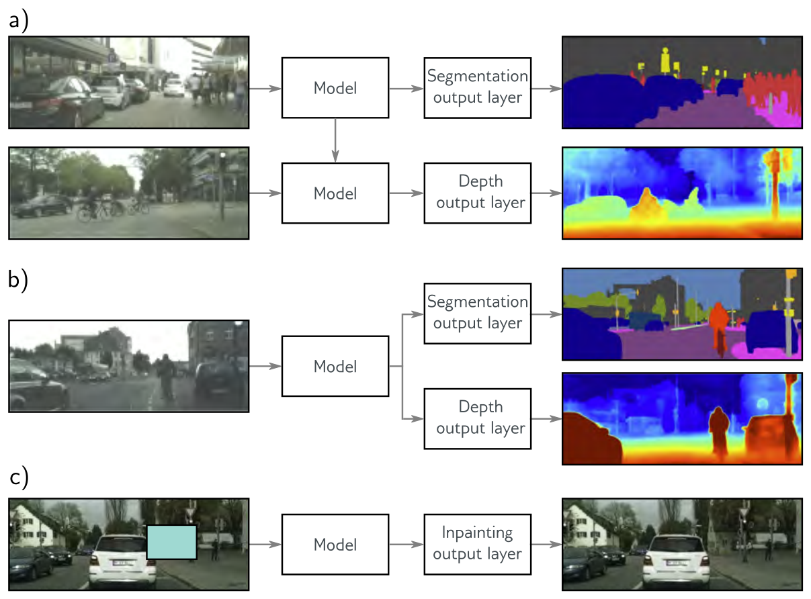{#fig-udl-9-12 width=82%}

### Self-supervised learning

*Prince §9.3.7, p. 152.*

Transfer learning needs a secondary task *with labels*. **Self-supervised
learning** manufactures them from unlabeled data, and there are two families. In
**generative** self-supervision part of each example is masked and the task is
to predict it: inpaint a missing patch of an image (@fig-udl-9-12**c**), or
predict masked words in a text corpus — which is how the language models of
Chapter 12 are pre-trained [@devlin2019]. In **contrastive** self-supervision
the task is to tell whether two examples are related: two transformed views of
the same image versus views of different images [@chen2020simclr], or two
sentences that did or did not follow one another in a document.

The point in both families is that the labels are *free*: they are manufactured
from the data itself, so the secondary task can use every unlabeled example we
have. The network trained on it is then transferred exactly as above — head
removed, new head added, frozen or fine-tuned. For an industrial sensor stream
the generative version is natural: mask one channel, or one time window, and
train the network to predict it from the rest; what it learns about how the
channels relate is then a starting point for the fault-detection task with its
few hundred labels.

### Augmentation

*Prince §9.3.8, pp. 152–154; figure on p. 154.*

Transfer learning borrows a dataset; multi-task learning borrows labels; **data
augmentation** expands the dataset we have. Many inputs can be transformed in
ways that leave the label unchanged: rotate, flip, crop, blur, or recolor an
image of a bird and it is still a bird (@fig-udl-9-13); substitute synonyms in a
sentence or translate it to another language and back; amplify or attenuate
frequency bands of an audio clip. The augmented examples teach the model to be
indifferent to these irrelevant transformations. AlexNet [@krizhevsky2012]
multiplied its training set by 2,048 this way.

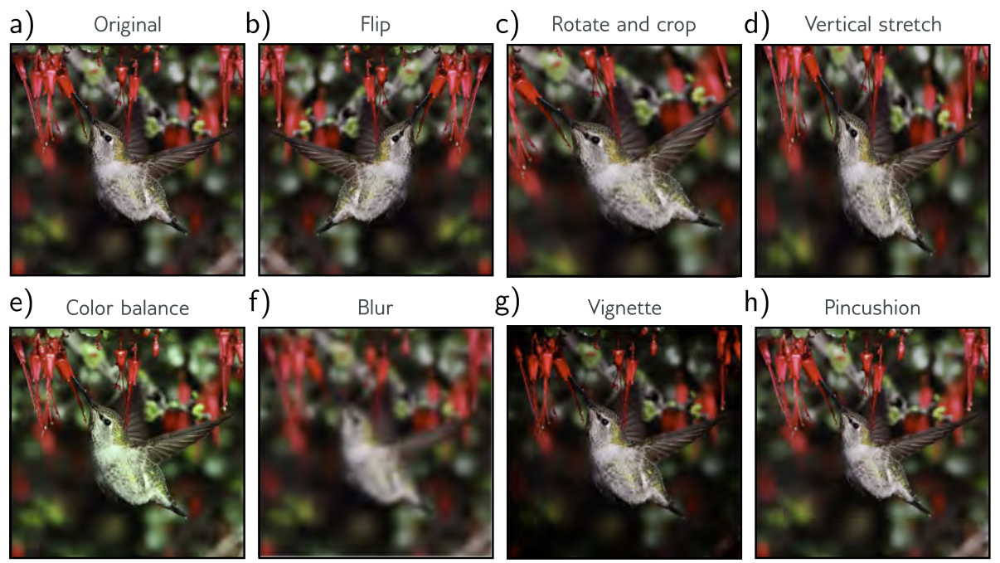{#fig-udl-9-13 width=86%}

::: {.callout-warning}
## Augment only with transformations the label survives
In a manufacturing image task the right augmentations depend on the physics. A
part on a conveyor may appear at any rotation, so rotations are safe; but a
horizontal flip of a part with a chirality — a left-hand versus right-hand
bracket — changes its class. A brightness shift mimics a change of lighting; a
blur may erase exactly the fine scratch the inspector is looking for. For
sensor time series, time-shifting a window is usually safe while time-reversing
it rarely is. Write down what each transformation assumes before you use it.
:::

## Four Mechanisms

*Prince §9.4, pp. 154–155; figure on p. 155.*

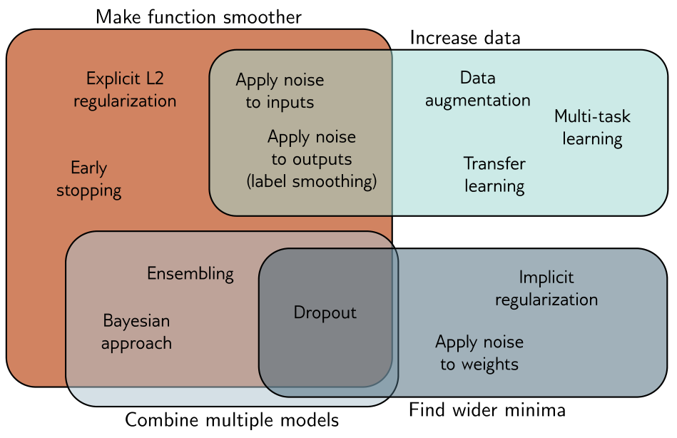{#fig-udl-9-14 width=64%}

Prince's summary diagram places every method in this chapter in one or more of
four regions. The reasons they work are not as varied as the methods.

| Mechanism | What it changes | Methods |
|:--|:--|:--|
| **Make the function smoother** | Reduces variance; favors smooth interpolation where there is no data | L2 regularization, early stopping, input noise, label smoothing |
| **Increase the data** | Constrains the function in more of the input space | Data augmentation, transfer learning, multi-task learning |
| **Combine multiple models** | Averages out errors that differ between fits | Ensembling, bagging, Bayesian inference, dropout |
| **Find wider minima** | Makes the solution robust to errors in the parameters | Weight noise, dropout, implicit regularization of SGD |

: The four mechanisms of Prince's figure 9.14. {tbl-colwidths="[24,40,36]"}

One more lever sits outside this chapter: choose an **architecture** that suits
the task. In image segmentation, sharing parameters across positions means the
network need not learn what a tree looks like separately at every pixel. The
cell below says how large that saving is.

```{python}
#| label: parameter-sharing

H, W, C = 224, 224, 3                                      # a small colour image
dense = H * W * C * 1000                                   # one fully connected layer to 1,000 hidden units
conv = 3 * 3 * C * 64 + 64                                 # one 3x3 convolution producing 64 channels, applied at every position
print(f"fully connected layer, every pixel to 1,000 units: {dense:>12,} weights")
print(f"3x3 convolution with 64 channels, shared everywhere: {conv:>12,} parameters")
print(f"ratio: {dense / conv:,.0f} to 1")
```

A convolution is a fully connected layer with two constraints built in: each
unit looks only at a small patch, and every position uses the *same* weights.
Those constraints are a prior — "what matters is local, and it matters the same
way everywhere in the image" — enforced by the architecture rather than by a
penalty, and they remove tens of thousands of parameters per unit that would
otherwise have to be constrained by data. Chapters 10–13 are about such
architectural choices, and the next of them, convolution, is the biggest
regularizer in computer vision.

::: {.callout-tip}
## A default recipe for a small, noisy industrial dataset
Start from a **pre-trained** model if one exists for your modality, and
fine-tune. Use **augmentations** that the physics permits. Train with SGD or
AdamW, **weight decay** on, with a **validation set** monitored for **early
stopping**. Add **dropout** before the output layer if the training–validation
gap is still large. If you can afford it, **ensemble** a few seeds; if you cannot,
use Monte Carlo dropout to get an uncertainty estimate. Label-smooth a
classifier whose probabilities will be *used* (thresholded, ranked) rather than
just argmax-ed. Every one of these is a hyperparameter chosen on validation data,
never on the test set.
:::

## Summary

*Prince §9.4, p. 154.*

Explicit regularization adds a term to the loss that moves its minimum; read as
a prior over the parameters, L2 regularization is a zero-mean normal prior and
makes the function smoother, trading variance for bias. Gradient descent with a
finite step does not descend the loss we wrote: to first order it descends the
loss plus $\frac{\alpha}{4}$ times the squared gradient norm, and SGD adds a
penalty on the variance of the batch gradients — implicit regularization that
favors flat regions where all the data agree, and that grows with the learning
rate and shrinks with the batch size. Beyond these, a family of heuristics
improves generalization: early stopping (which mimics L2), ensembling and
bagging, dropout (which dismantles conspiracies between units and is an ensemble
in disguise), noise on inputs, weights, or labels, the Bayesian approach (an
infinite ensemble), transfer, multi-task and self-supervised learning, and data
augmentation. All of them act through four mechanisms: a smoother function, more
data, combined models, or a wider minimum.

**Next:** Chapter 10 changes the architecture. Convolutional networks build
translation invariance into the model itself, so that a pattern learned at one
position in an image is recognized everywhere — the most consequential
regularizer in computer vision, and the first architecture designed around the
structure of the data.

---

## Exercises

::: {.callout-note appearance="minimal"}
Problem numbers refer to Prince, Chapter 9 (p. 160). Starred UDL problems have
published answers on the [UDL website](https://udlbook.github.io/udlbook/). The
computational problems extend code that is already written for you — start from
the [Colab notebook](https://colab.research.google.com/github/harunpirim/IMSE774-NeuralNetworks/blob/main/notebooks/week09-regularization.ipynb).
:::

**1. (UDL 9.1)** The prior over the parameters is $Pr(\boldsymbol{\phi}) =
\prod_{j=1}^{J} \mathrm{Norm}_{\phi_j}[0, \sigma^2_\phi]$. Show that maximizing
$\prod_i Pr(y_i \mid \mathbf{x}_i, \boldsymbol{\phi})\, Pr(\boldsymbol{\phi})$
gives a loss equivalent to L2 regularization, and express $\lambda$ in terms of
$\sigma^2_\phi$. Which way does $\lambda$ move when the prior gets tighter?

**2. (UDL 9.2 and 9.5)** How does the gradient of the loss change when the L2
term of @eq-l2 is added? Then show that the weight decay update
@eq-weight-decay on the original loss equals a plain gradient step on
$\tilde{L}[\boldsymbol{\phi}] = L[\boldsymbol{\phi}] + \frac{\lambda'}{2\alpha}
\sum_k \phi_k^2$. Why does this equivalence fail for Adam?

**3. (UDL 9.3\*)** For linear regression $y = \phi_0 + \phi_1 x$ with a least
squares loss, Gaussian noise of variance $\sigma^2_x$ is added to each input at
every training iteration. Compute the expected gradient update and identify the
regularization term it implies.

**4. (UDL 9.4\*)** Derive the loss for multiclass classification with label
smoothing, when the target puts 0.9 on the correct class and spreads 0.1 over
the other $D_o - 1$ classes. Then use the `label-smoothing` cell to find the
optimal logit gap for $D_o = 3$ and compare with the closed form.

**5. (UDL 9.6)** For $\boldsymbol{\phi} = [\phi_0, \phi_1]^T$, sketch the
$L_0$, $L_{1/2}$, and $L_1$ regularization terms $\sum_d |\phi_d|^P$ in the style
of @fig-udl-9-1**b**. Using the chapter notes (p. 156), explain why $L_1$
produces sparser solutions than $L_2$ and why $L_0$ is hard to optimize.

**6.** Equation @eq-implicit-gd says gradient descent penalizes the squared
gradient norm, with a coefficient proportional to $\alpha$. (a) Why does this
not change the location of any minimum? (b) Using @fig-udl-9-5**a**, explain
the sense in which a large learning rate "regularizes". (c) The table under
@fig-implicit-gd shows the modified loss explaining 90% of the deviation at
$\alpha = 0.02$ but only a small fraction at $\alpha = 0.2$. Why?

**7.** Dropout, bagging, and Monte Carlo dropout all appear under "combine
multiple models" in @fig-udl-9-14. For each, say what the individual models
are, how many of them are *trained*, how many are *stored*, and how the
combination is formed at inference. Which one also appears under "find wider
minima", and why?

**8. Choosing a strategy.** A plant has 600 labeled thermal images of welds
(80 defective) and wants a classifier. (a) Rank, with reasons, the first three
regularization techniques you would try. (b) Which augmentations are safe for
thermal weld images and which are not? (c) The team reports 99% training
accuracy and 84% validation accuracy, and asks whether to add more layers or
remove some. What do you answer, and which of the four mechanisms are you
invoking?

**9. Computational.** In the `fig-l2-sweep` cell, the bias is excluded from
the penalty. Include it, and compare the sweep. Then replace the L2 penalty by
an L1 penalty (you will need an iterative solver; `scipy.optimize.minimize`
on the regularized loss is enough) and count how many of the 14 weights are
exactly zero (below $10^{-6}$) at the best $\lambda$.

**10. Computational.** Extend the `fig-dropout` cell: (a) sweep $p \in \{0.1,
0.3, 0.5, 0.7\}$ and plot error against $p$; (b) implement the weight-scaling
rule by hand — train with `nn.Dropout` replaced by your own Bernoulli mask with
*no* rescaling, then multiply the weights of the following layer by $1 - p$ at
inference — and verify it agrees with `eval()` mode on the PyTorch version.

**11. Computational.** Early stopping in practice: return to the Week 8
`fig-overconfident` experiment, hold out 100 of the 400 training examples as a
validation set, and stop at the step with the lowest validation *loss*. Report
test error and test loss at that step and at the end of training. Then add
`weight_decay=1e-3` to the optimizer and `nn.Dropout(0.5)` after each hidden
layer and repeat. Which of the three interventions most reduced the test loss,
and which the test error?

---

## Textbook Reference Map {#sec-reference-map}

Every part of this page, mapped to Prince, *Understanding Deep Learning*
(MIT Press, 2024) [@prince2024]. Page numbers are those of the printed book.

| This page | Prince section | Pages | Figures used |
|:--|:--|:--:|:--|
| Why Another Chapter on the Generalization Gap | Ch. 9 opening | 138 | — |
| Explicit Regularization | §9.1 | 138–139 | 9.1 (p. 139) |
| — Probabilistic interpretation | §9.1.1 | 139–140 | — |
| — L2 regularization | §9.1.2; notes | 140–141, 155–156 | 9.2 (p. 141) |
| Implicit Regularization | §9.2 | 141 | — |
| — in gradient descent | §9.2.1; notes | 141–142, 156–157 | 9.3 (p. 142) |
| — in stochastic gradient descent | §9.2.2 | 144 | 9.4 (p. 143), 9.5 (p. 145) |
| Heuristics to Improve Performance | §9.3 | 144 | — |
| — Early stopping | §9.3.1; notes | 145, 157 | 9.6 (p. 146) |
| — Ensembling | §9.3.2; notes | 145–147, 158 | 9.7 (p. 147) |
| — Dropout | §9.3.3; notes | 147–149, 158 | 9.8 (p. 148), 9.9 (p. 149) |
| — Applying noise | §9.3.4; notes | 149–150, 158 | 9.10 (p. 150) |
| — Bayesian inference | §9.3.5; notes | 150–151, 159 | 9.11 (p. 151) |
| — Transfer learning and multi-task learning | §9.3.6; notes | 151–152, 159 | 9.12 (p. 153) |
| — Self-supervised learning | §9.3.7; notes | 152, 159 | — |
| — Augmentation | §9.3.8; notes | 152–154, 159–160 | 9.13 (p. 154) |
| Four Mechanisms | §9.4 | 154–155 | 9.14 (p. 155) |
| Summary | §9.4 | 154 | — |
| Exercises 1–5 | Problems 9.1–9.6 | 160 | — |

: {tbl-colwidths="[38,22,16,24]"}

Equations on this page correspond to Prince as follows: @eq-unreg is his
(9.1), @eq-reg is (9.2), @eq-ml is (9.3), @eq-map is (9.4), @eq-l2 is (9.5),
@eq-gradient-flow is (9.6), @eq-gd is (9.7), @eq-implicit-gd is (9.8),
@eq-implicit-sgd is (9.9), @eq-means is (9.10), @eq-posterior is (9.11),
@eq-predictive is (9.12), and @eq-weight-decay is (9.13). Equations
@eq-map-loss, @eq-normal-prior and @eq-lambda-sigma work problem 9.1,
@eq-l2-gradient and @eq-l2-step work problems 9.2 and 9.5, @eq-input-noise works
problem 9.3, @eq-label-smoothing works problem 9.4, and @eq-ensemble-variance is
ours.

::: {.callout-note appearance="simple"}
## Figure credits
Figures 9.1–9.14 are reproduced unaltered from Prince, *Understanding Deep
Learning* (MIT Press, 2024), which is distributed under a Creative Commons
CC-BY-NC-ND license, and are used here for non-commercial classroom
instruction. Original sources credited within the figures: the images in figure
9.12 are from Cordts et al. (2016), the Cityscapes dataset, and figure 9.13 is
adapted from Wu et al. (2015a). All other figures on this page are generated by
the code in this week's notebook.
:::

---

## Further Reading

- Prince, *Understanding Deep Learning*, Chapter 9 [@prince2024] — the assigned reading. The chapter notes (pp. 155–160) derive the implicit regularization of gradient descent and survey the literature on every heuristic in the chapter.
- **[▶ UDL notebooks 9.1–9.5](https://github.com/udlbook/udlbook/tree/main/Notebooks/Chap09)** — Prince's own Colab notebooks for this chapter; links to each are at the top of this page.
- **[▶ This week's notebook](https://colab.research.google.com/github/harunpirim/IMSE774-NeuralNetworks/blob/main/notebooks/week09-regularization.ipynb)** — every cell above, in one Colab file.
- Kukačka, Golkov & Cremers (2017) [@kukacka2017] — a taxonomy of regularization methods in deep learning, more detailed than figure 9.14.
- Barrett & Dherin (2021) [@barrett2021] — the backward-error-analysis derivation of @eq-implicit-gd; Smith et al. (2021) [@smith2021] extend it to SGD, @eq-implicit-sgd.
- Srivastava et al. (2014) [@srivastava2014] — the dropout paper, with the weight-scaling inference rule; Gal & Ghahramani (2016) [@gal2016] — Monte Carlo dropout as approximate Bayesian inference.
- Loshchilov & Hutter (2019) [@loshchilov2019] — why L2 regularization and weight decay differ under Adam, and the AdamW fix.
- Breiman (1996) [@breiman1996] — bagging; Lakshminarayanan et al. (2017) [@lakshminarayanan2017] — deep ensembles from different seeds improve accuracy, calibration, and robustness.
- Szegedy et al. (2016) [@szegedy2016] — label smoothing; Müller, Kornblith & Hinton (2019) [@muller2019] — when it helps and why.
- Zhang et al. (2017) [@zhang2017] — standard networks fit random labels perfectly, so explicit regularizers cannot be the whole story of generalization; the motivation for §9.2.
- Shorten & Khoshgoftaar (2019) [@shorten2019] — a survey of image data augmentation.
