::: {.lecture-meta}
**Reading** Prince, *Understanding Deep Learning*, Chapters 10–11 (pp. 161–206) &nbsp;·&nbsp;
**UDL notebooks** 10.1–10.5, 11.1–11.3 &nbsp;·&nbsp;
**Next** Transformers, Thursday, November 5
:::

::: {.callout-note appearance="simple"}
## How to read the references in these notes
Every section below opens with the section number and page range it covers in
Prince, *Understanding Deep Learning* (MIT Press, 2024). Page numbers are those
of the printed book. Figures taken from the textbook are captioned with their
original figure number and page; figures generated by the code behind this page
are ours. A complete cross-reference table appears in @sec-reference-map.
:::

## Learning Objectives

By the end of these two sessions you should be able to:

1. State the three properties of images that make fully connected networks a poor fit, and define **invariance** and **equivariance** to a transformation.
2. Write the 1D and 2D **convolution** operations, and compute the output size of a convolutional layer from its kernel size, **stride**, **padding**, and **dilation**.
3. Explain why a convolutional layer is a fully connected layer with a sparse, repeated weight matrix, count the parameters of a layer with $C_i$ input and $C_o$ output **channels**, and compute **receptive fields** through a stack of layers.
4. Describe the three ways to **downsample** a representation and the four ways to **upsample** it, and explain what a **1×1 convolution** does.
5. Trace an image through AlexNet and VGG, and say what the output of an object detector and a semantic segmentation network looks like.
6. Explain the **shattered gradients** conjecture for why very deep sequential networks fail to train, and how **residual connections** turn a deep network into an ensemble of shallow paths.
7. Show why activations in a residual network grow exponentially with depth, and how **batch normalization** replaces that with linear growth; state what BatchNorm computes at training and at test time.
8. Sketch the ResNet, bottleneck, DenseNet, and U-Net blocks, and build and train a small convolutional classifier in PyTorch.

::: {.callout-tip}
## The code lives in a notebook
This page shows the figures and results; except in the PyTorch section near the
end, the Python behind them is not printed here. All of it — every cell, in the
order the note uses it — is in a notebook you can open in the browser with
nothing to install:

- **[▶ Open the Week 10 notebook in Google Colab](https://colab.research.google.com/github/harunpirim/IMSE774-NeuralNetworks/blob/main/notebooks/week10-convolutional-networks.ipynb)** — all of this page's code, in order.
- **[▶ UDL notebook 10.1 — 1D convolution](https://colab.research.google.com/github/udlbook/udlbook/blob/main/Notebooks/Chap10/10_1_1D_Convolution.ipynb)** — build the weight matrices of @fig-udl-10-4 by hand.
- **[▶ UDL notebook 10.2 — Convolution for MNIST-1D](https://colab.research.google.com/github/udlbook/udlbook/blob/main/Notebooks/Chap10/10_2_Convolution_for_MNIST_1D.ipynb)** — the experiment of @fig-udl-10-8.
- **[▶ UDL notebook 10.3 — 2D convolution](https://colab.research.google.com/github/udlbook/udlbook/blob/main/Notebooks/Chap10/10_3_2D_Convolution.ipynb)** — @fig-udl-10-9 and @fig-udl-10-10 in code.
- **[▶ UDL notebook 10.4 — Downsampling and upsampling](https://colab.research.google.com/github/udlbook/udlbook/blob/main/Notebooks/Chap10/10_4_Downsampling_and_Upsampling.ipynb)** — @fig-udl-10-11 to @fig-udl-10-13.
- **[▶ UDL notebook 10.5 — Convolution for MNIST](https://colab.research.google.com/github/udlbook/udlbook/blob/main/Notebooks/Chap10/10_5_Convolution_For_MNIST.ipynb)** — a 2D convolutional classifier on real digit images.
- **[▶ UDL notebook 11.1 — Shattered gradients](https://colab.research.google.com/github/udlbook/udlbook/blob/main/Notebooks/Chap11/11_1_Shattered_Gradients.ipynb)** — the experiment behind @fig-udl-11-3.
- **[▶ UDL notebook 11.2 — Residual networks](https://colab.research.google.com/github/udlbook/udlbook/blob/main/Notebooks/Chap11/11_2_Residual_Networks.ipynb)** — the variance growth of @fig-udl-11-6.
- **[▶ UDL notebook 11.3 — Batch normalization](https://colab.research.google.com/github/udlbook/udlbook/blob/main/Notebooks/Chap11/11_3_Batch_Normalization.ipynb)** — the forward and backward pass of @eq-bn-stats to @eq-bn-affine.

Colab gives you a Python environment with NumPy, matplotlib, and PyTorch
already installed. In Colab, run a cell with **Shift+Enter**. If you prefer to
work locally, `pip install -r requirements.txt` from the [course
repository](https://github.com/harunpirim/IMSE774-NeuralNetworks) gives you the
same environment.
:::

```{python}
#| label: setup
#| code-fold: true
#| code-summary: "Plotting setup (click to expand)"

import numpy as np
import matplotlib.pyplot as plt
import torch
import torch.nn as nn
import torch.nn.functional as F

torch.manual_seed(774)
np.random.seed(774)

plt.rcParams.update({
    "figure.figsize": (7, 4),
    "figure.dpi": 130,
    "axes.spines.top": False,
    "axes.spines.right": False,
    "axes.grid": True,
    "grid.alpha": 0.25,
    "font.size": 10,
    "axes.titlesize": 11,
    "axes.labelsize": 10,
    "legend.frameon": False,
})

NDSU_GREEN = "#005643"
NDSU_GOLD  = "#FFC72C"
ACCENT     = "#C1121F"
STEEL      = "#1864AB"

def n_params(model):
    return sum(p.numel() for p in model.parameters())
```

---

## Why Images Need Their Own Layers

*Prince, Chapter 10 opening, p. 161.*

Every network so far has been **fully connected**: each hidden unit sees every
input, and there is a single path from input to output. Chapters 10 to 13
introduce components with sparser connections, shared weights, and parallel
paths, and this chapter's component — the **convolutional layer** — is the one
built for images. Prince gives three reasons a fully connected network is the
wrong tool for an image.

- **Images are high-dimensional.** A 224×224 RGB image has 150,528 input
  values. Hidden layers are usually at least as wide as the input, so one fully
  connected layer would need more than $150{,}528^2 \approx 22$ billion weights.
- **Nearby pixels are related.** A fully connected network has no notion of
  "nearby". If you permuted the pixels of every training and test image in the
  same way, it would train exactly as well. Convolution builds the neighborhood
  structure in.
- **The interpretation is stable under geometric transformations.** A photo of
  a tree shifted three pixels to the left is still a tree, but every input to a
  fully connected network has changed, so it must learn the pattern "tree"
  separately at every position.

A convolutional layer processes each local region with the *same* parameters,
shared across the whole image. It therefore has far fewer parameters, exploits
the spatial relationships between pixels, and learns each pattern once. A
network built mostly from such layers is a **convolutional neural network**
(CNN). The first cell makes the parameter argument concrete.

```{python}
#| label: dense-cost

D_in = 224 * 224 * 3
dense = D_in * D_in + D_in            # one fully connected layer as wide as its input
conv  = 3 * 64 * 3 * 3 + 64           # one 3x3 convolutional layer, 3 -> 64 channels

print(f"{'Input dimensions (224 x 224 x 3)':42s}{D_in:>16,}")
print(f"{'Fully connected layer, width D_in':42s}{dense:>16,} parameters  "
      f"({dense * 4 / 1e9:,.0f} GB in float32)")
print(f"{'3x3 convolution, 3 -> 64 channels':42s}{conv:>16,} parameters")
print(f"{'Ratio':42s}{dense / conv:>16,.0f} : 1")
```

The convolutional layer's parameter count does not depend on the image size at
all. It would be the same 1,792 for a 4K frame from an inspection camera. That
is the practical reason CNNs took over computer vision, and the rest of this
chapter explains the structural one.

## Invariance and Equivariance

*Prince §10.1, pp. 161–162; figure on p. 162.*

Saying that "a tree is still a tree after a shift" can be made precise. A
function $f[\mathbf{x}]$ of an image $\mathbf{x}$ is **invariant** to a
transformation $t[\mathbf{x}]$ if

$$
f\big[t[\mathbf{x}]\big] = f[\mathbf{x}],
$$ {#eq-invariance}

so the output is the same whether or not the transformation was applied. An
image *classifier* should be invariant to translation, rotation, flips, and
mild warps (@fig-udl-10-1**a–b**). A function is **equivariant** (or
covariant) to the transformation if

$$
f\big[t[\mathbf{x}]\big] = t\big[f[\mathbf{x}]\big],
$$ {#eq-equivariance}

so the output changes in the same way as the input. A *segmentation* network,
which labels every pixel, should be equivariant: shift the image and the label
map should shift with it (@fig-udl-10-1**c–f**).

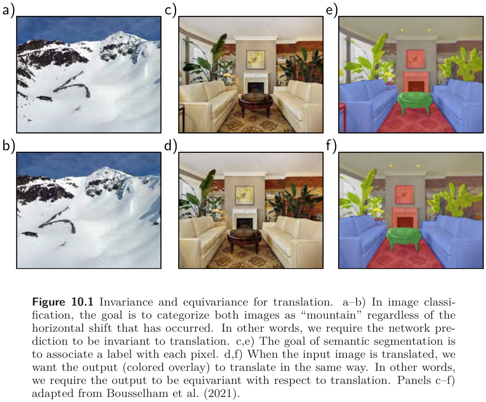{#fig-udl-10-1 width=80%}

Convolutional layers are equivariant to translation by construction, and the
pooling operations of @sec-downsampling add partial invariance. The next cell
checks both properties on a 1D signal, and shows that a fully connected layer
has neither.

```{python}
#| label: fig-equivariance
#| fig-cap: "Translation equivariance, checked numerically. Left: a 1D signal and a copy shifted right by 12 positions. Center: the convolution of each with a 3-tap kernel; shifting the input shifts the output by the same 12 positions, so the solid curve and the dashed curve coincide. Right: a fully connected layer with random weights applied to the same two inputs gives unrelated outputs. The table below reports the largest discrepancy in each case, and adds a global max pool after the convolution, which makes the result invariant."

rng = np.random.default_rng(774)
L = 60
pos = np.arange(L)
x = np.exp(-0.5 * ((pos - 18) / 3.0) ** 2) + 0.4 * np.exp(-0.5 * ((pos - 30) / 2.0) ** 2)
x = x + 0.05 * rng.standard_normal(L)
shift = 12
translate = lambda v, s: np.roll(v, s)       # circular shift, so no edge effects spoil the check

w = torch.tensor([[[-1.0, 0.0, 1.0]]])       # kernel of size 3, shape (C_out, C_in, K)
def conv(v):
    t = torch.tensor(v, dtype=torch.float32).view(1, 1, -1)
    return F.conv1d(F.pad(t, (1, 1), mode="circular"), w).view(-1).numpy()

W = rng.standard_normal((L, L)) / np.sqrt(L)   # a fully connected layer with random weights
dense = lambda v: W @ v

x_t = translate(x, shift)
z, z_t = conv(x), conv(x_t)
h, h_t = dense(x), dense(x_t)

fig, axes = plt.subplots(1, 3, figsize=(10, 3))
axes[0].plot(pos, x, color=NDSU_GREEN, label="input $\\mathbf{x}$")
axes[0].plot(pos, x_t, color=ACCENT, label="shifted input $t[\\mathbf{x}]$")
axes[0].set_title("input"); axes[0].legend(fontsize=8)
axes[1].plot(pos, translate(z, shift), color=NDSU_GREEN, lw=2.5, label="$t[\\,f[\\mathbf{x}]\\,]$")
axes[1].plot(pos, z_t, "--", color=NDSU_GOLD, lw=1.5, label="$f[\\,t[\\mathbf{x}]\\,]$")
axes[1].set_title("convolution: equivariant"); axes[1].legend(fontsize=8)
axes[2].plot(pos, translate(h, shift), color=NDSU_GREEN, lw=2.5, label="$t[\\,f[\\mathbf{x}]\\,]$")
axes[2].plot(pos, h_t, "--", color=NDSU_GOLD, lw=1.5, label="$f[\\,t[\\mathbf{x}]\\,]$")
axes[2].set_title("fully connected: not equivariant"); axes[2].legend(fontsize=8)
for ax in axes:
    ax.set_xlabel("position")
plt.tight_layout()
plt.show()

rows = [("convolution, f[t[x]] vs t[f[x]]",      np.abs(z_t - translate(z, shift)).max()),
        ("fully connected, f[t[x]] vs t[f[x]]",  np.abs(h_t - translate(h, shift)).max()),
        ("convolution + global max pool, f[t[x]] vs f[x]", abs(z_t.max() - z.max()))]
print(f"{'operation':50s}{'max |difference|':>18s}")
for name, d in rows:
    print(f"{name:50s}{d:>18.2e}")
```

::: {.callout-note}
## Notation
Prince writes a vector input as $\mathbf{x}$ with elements $x_i$, the kernel
as $\boldsymbol{\omega}$ with elements $\omega_j$, a layer's output as
$\mathbf{z}$ before the activation and $\mathbf{h}$ after it, and the
activation function as $\mathrm{a}[\bullet]$. A 2D input is a matrix
$\mathbf{X}$ with elements $x_{ij}$; a stack of channels is a 3D tensor. A
kernel is also called a **filter**, and a channel a **feature map**. Square
brackets denote function application throughout.
:::

## Convolutional Networks for 1D Inputs

*Prince §10.2, pp. 163–170.*

Convolutional networks consist of a series of convolutional layers, each
equivariant to translation, usually with pooling in between to induce partial
invariance. Prince develops everything in 1D first, where it can be drawn, and
then lets the 2D case follow in one step.

### The 1D convolution operation

*Prince §10.2.1, p. 163; figure on p. 163.*

A 1D convolution turns an input vector $\mathbf{x}$ into an output vector
$\mathbf{z}$ in which every output is a weighted sum of nearby inputs, with the
*same* weights at every position. The weights are the **convolution kernel**
(or **filter**), and the number of inputs combined is the **kernel size**. For
kernel size three,

$$
z_i = \omega_1 x_{i-1} + \omega_2 x_i + \omega_3 x_{i+1},
$$ {#eq-conv1d}

where $\boldsymbol{\omega} = [\omega_1, \omega_2, \omega_3]^T$
(@fig-udl-10-2). Shift the input by one position and every $z_i$ moves with
it, which is exactly the equivariance we just checked numerically.

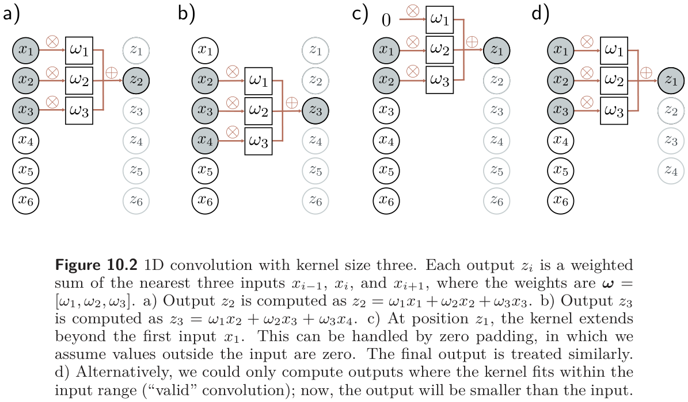{#fig-udl-10-2 width=82%}

::: {.callout-note}
## Strictly, this is cross-correlation
In signal processing, a convolution flips the kernel: it would pair $\omega_1$
with $x_{i+1}$ and $\omega_3$ with $x_{i-1}$. Equation @eq-conv1d is a
*cross-correlation*. Machine learning calls it a convolution anyway, because
the kernel is learned and the flip is immaterial, and every deep learning
library (`torch.nn.Conv1d` included) follows that convention. Prince notes
this in a footnote on p. 163.
:::

::: {.callout-tip}
## Worked: convolution is translation-equivariant (problem 10.1)
Let $t[\mathbf{x}]$ shift the input by one position, so the new input is
$x'_i = x_{i-1}$. Apply @eq-conv1d to it:
$$
z'_i = \omega_1 x'_{i-1} + \omega_2 x'_i + \omega_3 x'_{i+1}
     = \omega_1 x_{i-2} + \omega_2 x_{i-1} + \omega_3 x_{i}
     = z_{i-1}.
$$
The output is the original output shifted by the same amount:
$f[t[\mathbf{x}]] = t[f[\mathbf{x}]]$. The argument uses only that the same
weights appear at every position, which is why it fails for a fully connected
layer, where @eq-fc-layer below gives each position its own weights.
:::

### Padding

*Prince §10.2.2, p. 164.*

Equation @eq-conv1d needs $x_{i-1}$ for the first output and $x_{i+1}$ for the
last, and neither exists. There are two conventions. **Zero padding** treats the
input as zero outside its range (@fig-udl-10-2**c**); other choices wrap the
signal around or reflect it at the ends. A **valid** convolution instead
computes only the outputs where the kernel fits entirely inside the input
(@fig-udl-10-2**d**). Valid convolution invents no values at the edges, but the
representation shrinks by $K - 1$ positions per layer, which is why most modern
networks pad.

### Stride, kernel size, and dilation

*Prince §10.2.3, pp. 164–165; figure on p. 164.*

Equation @eq-conv1d is one member of a family. The **stride** is how far the
kernel moves between outputs; with stride two there are roughly half as many
outputs as inputs (@fig-udl-10-3**a–b**). The **kernel size** can grow to
integrate over a wider region (@fig-udl-10-3**c**), and it is usually odd so
that the kernel is centered on the current position; the cost is more weights.
A **dilated** (or atrous) convolution gets a wide view without the weights by
interspersing zeros in the kernel: a kernel of size five with its second and
fourth entries fixed at zero covers five positions with three parameters
(@fig-udl-10-3**d**). The number of zeros between weights sets the **dilation
rate**.

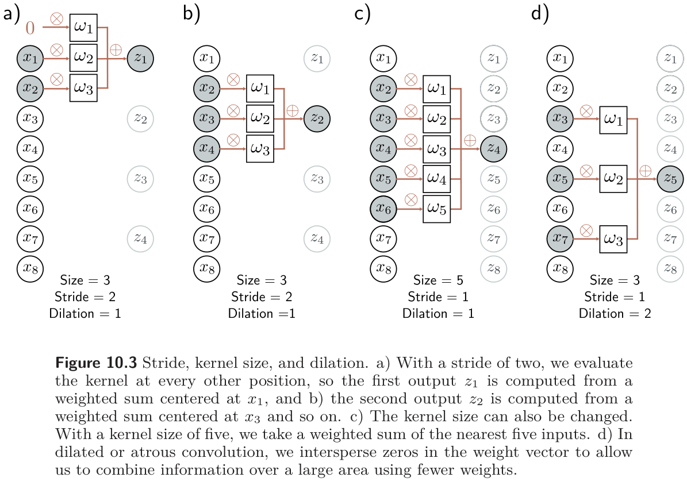{#fig-udl-10-3 width=82%}

The book does not state the output-size formula, but you will use it
constantly. For an input of length $D$, kernel size $K$, stride $s$, padding
$p$ on each side, and dilation $d$, the number of outputs is

$$
D_{\text{out}} = \left\lfloor \frac{D + 2p - d\,(K-1) - 1}{s} \right\rfloor + 1,
$$ {#eq-output-size}

where $d\,(K-1) + 1$ is the *effective* kernel size. The cell checks the
formula against PyTorch for the network of @fig-udl-10-7 and a few other
settings.

```{python}
#| label: shape-calculator

def conv_out(D, K, stride=1, pad=0, dil=1):
    """Output length of a 1D convolution: the output-size formula on this page."""
    return (D + 2 * pad - dil * (K - 1) - 1) // stride + 1

cases = [("figure 10.7, layer 1  (valid, stride 2)",  40, 3, 2, 0, 1),
         ("figure 10.7, layer 2",                      19, 3, 2, 0, 1),
         ("figure 10.7, layer 3",                       9, 3, 2, 0, 1),
         ("kernel 3, 'same' zero padding",             40, 3, 1, 1, 1),
         ("kernel 3, stride 2, zero padding",          40, 3, 2, 1, 1),
         ("kernel 3, dilation 2, padding 2",           40, 3, 1, 2, 2),
         ("kernel 7, dilation 3, stride 3 (problem 10.4)", 40, 7, 3, 0, 3)]

print(f"{'setting':48s}{'D_in':>5s}{'formula':>9s}{'PyTorch':>9s}")
for name, D, K, s, p, d in cases:
    got = nn.Conv1d(1, 1, K, stride=s, padding=p, dilation=d)(torch.zeros(1, 1, D)).shape[-1]
    print(f"{name:48s}{D:>5d}{conv_out(D, K, s, p, d):>9d}{got:>9d}")
```

### Convolutional layers

*Prince §10.2.4, p. 165; figure on p. 166.*

A **convolutional layer** convolves the input, adds a bias $\beta$, and passes
the result through an activation function. With kernel size three, stride one,
and dilation one, the $i$th hidden unit is

$$
h_i = \mathrm{a}\big[\beta + \omega_1 x_{i-1} + \omega_2 x_i + \omega_3 x_{i+1}\big]
    = \mathrm{a}\Big[\beta + \sum_{j=1}^{3} \omega_j\, x_{i+j-2}\Big],
$$ {#eq-conv-layer}

with zero padding where the index runs off the end. Compare the fully connected
layer of Chapter 4,

$$
h_i = \mathrm{a}\Big[\beta_i + \sum_{j=1}^{D} \omega_{ij}\, x_j\Big].
$$ {#eq-fc-layer}

With $D$ inputs and $D$ hidden units, @eq-fc-layer has $D^2$ weights and $D$
biases; @eq-conv-layer has three weights and one bias. The convolutional layer
is a *special case* of the fully connected one: set most of the weights in
$\boldsymbol{\Omega}$ to zero and constrain the rest to repeat along the
diagonals (@fig-udl-10-4). A fully connected network can therefore represent
anything a convolutional network can. Whether it *finds* that solution is the
question @sec-mnist1d answers.

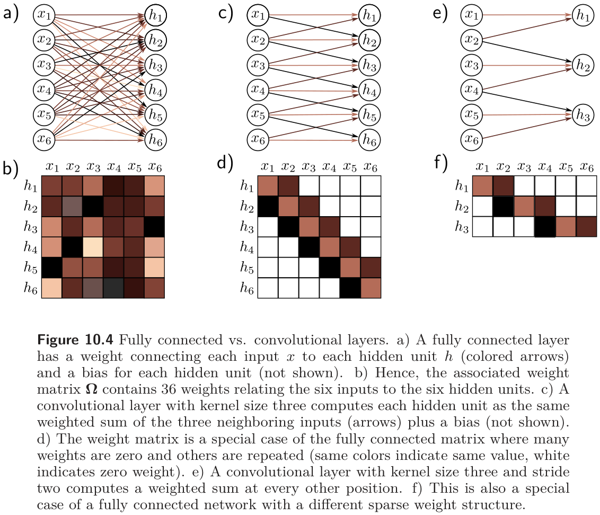{#fig-udl-10-4 width=66%}

The next figure builds the weight matrices of @fig-udl-10-4**d** and
@fig-udl-10-4**f** directly, by pushing each basis vector $\mathbf{e}_j$
through `conv1d` and reading off a column. It also answers problem 10.5 for
the kernel-five and dilated cases.

```{python}
#| label: fig-weight-matrices
#| fig-cap: "The weight matrix of a 1D convolutional layer on eight inputs, in the style of figure 10.4d. Colours mark the kernel entries $\\omega_1, \\omega_2, \\ldots$ (white is zero). (a) Kernel size three, stride one, zero padding: each row is the kernel, shifted one place. (b) Stride two keeps every other row. (c) Kernel size five widens each row. (d) Dilation two spreads the three weights over five positions with zeros between them. All four are fully connected layers with most weights fixed at zero and the rest tied."

from matplotlib.colors import ListedColormap

def conv_matrix(D, K, stride=1, pad=0, dil=1):
    """Rows are outputs, columns are inputs; entry j of the kernel is the value j."""
    w = torch.arange(1, K + 1, dtype=torch.float32).view(1, 1, K)
    cols = []
    for j in range(D):
        e = torch.zeros(1, 1, D); e[0, 0, j] = 1.0
        cols.append(F.conv1d(e, w, stride=stride, padding=pad, dilation=dil).view(-1))
    return torch.stack(cols, dim=1).numpy()

cases = [("(a) kernel 3, stride 1",   dict(K=3, pad=1)),
         ("(b) kernel 3, stride 2",   dict(K=3, stride=2, pad=1)),
         ("(c) kernel 5, stride 1",   dict(K=5, pad=2)),
         ("(d) kernel 3, dilation 2", dict(K=3, pad=2, dil=2))]
cmap = ListedColormap(["white", "#f3dfbf", NDSU_GOLD, "#d98b2b", ACCENT, NDSU_GREEN])

fig, axes = plt.subplots(1, 4, figsize=(10.5, 3.1))
for ax, (title, kw) in zip(axes, cases):
    M = conv_matrix(8, **kw)
    ax.imshow(M, cmap=cmap, vmin=-0.5, vmax=5.5)
    ax.set_title(title, fontsize=10)
    ax.set_xticks(range(8)); ax.set_xticklabels([f"$x_{j}$" for j in range(1, 9)], fontsize=8)
    ax.set_yticks(range(M.shape[0])); ax.set_yticklabels([f"$h_{i}$" for i in range(1, M.shape[0] + 1)], fontsize=8)
    ax.grid(False)
    for s in ax.spines.values():
        s.set_visible(True)
plt.tight_layout()
plt.show()
```

### Channels

*Prince §10.2.5, pp. 165–167; figure on p. 166.*

A single convolution loses information: it averages neighbors, and the ReLU
clips everything negative. So several convolutions are computed in parallel,
each with its own kernel and bias, and each producing its own set of hidden
units called a **channel** or **feature map** (@fig-udl-10-5**a–b**). The
hidden layer is then a 2D array $\mathbf{H}_1$ of positions × channels. The
next layer's kernels take a weighted sum over *all* input channels at the
nearest $K$ positions (@fig-udl-10-5**c**).

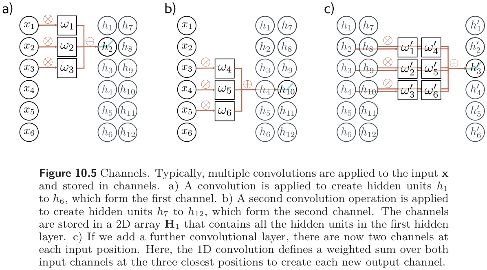{#fig-udl-10-5 width=82%}

The parameter count follows directly. If the incoming layer has $C_i$ channels,
the kernel size is $K$, and there are $C_o$ output channels, each output channel
needs a weight for every (input channel, kernel position) pair plus one bias, so
the layer has

$$
\boldsymbol{\Omega} \in \mathbb{R}^{C_i \times C_o \times K} \quad\text{weights and}\quad
\boldsymbol{\beta} \in \mathbb{R}^{C_o} \quad\text{biases},
$$ {#eq-conv-params}

a total of $C_i C_o K + C_o$ parameters, and in 2D $C_i C_o K^2 + C_o$. The
cell checks the formula against `nn.Conv1d` and `nn.Conv2d` for the layers in
problems 10.8 and 10.14.

```{python}
#| label: param-count

layers = [("1D, 3 -> 4 channels, kernel 3    (problem 10.8, layer 1)",  nn.Conv1d(3, 4, 3),   3 * 4 * 3,    4),
          ("1D, 4 -> 10 channels, kernel 5   (problem 10.8, layer 2)",  nn.Conv1d(4, 10, 5),  4 * 10 * 5,   10),
          ("2D, 3 -> 10 channels, kernel 5x5 (problem 10.14)",          nn.Conv2d(3, 10, 5),  3 * 10 * 25,  10),
          ("2D, 3 -> 64 channels, kernel 3x3",                          nn.Conv2d(3, 64, 3),  3 * 64 * 9,   64)]

print(f"{'layer':58s}{'weights':>9s}{'biases':>8s}{'PyTorch':>9s}")
for name, layer, nw, nb in layers:
    print(f"{name:58s}{nw:>9,}{nb:>8,}{n_params(layer):>9,}")
```

### Receptive fields

*Prince §10.2.6, p. 167; figure on p. 168.*

The **receptive field** of a hidden unit is the region of the original input
that feeds into it. With kernel size three, a unit in the first layer sees three
inputs. A unit in the second layer sees three first-layer units, each of which
sees three inputs, so its receptive field is five. Each layer adds two, and
information from across the input is integrated gradually (@fig-udl-10-6).
Stride accelerates this: after a stride-two layer, every later kernel position
is two input positions apart, so the same kernel covers twice the input.

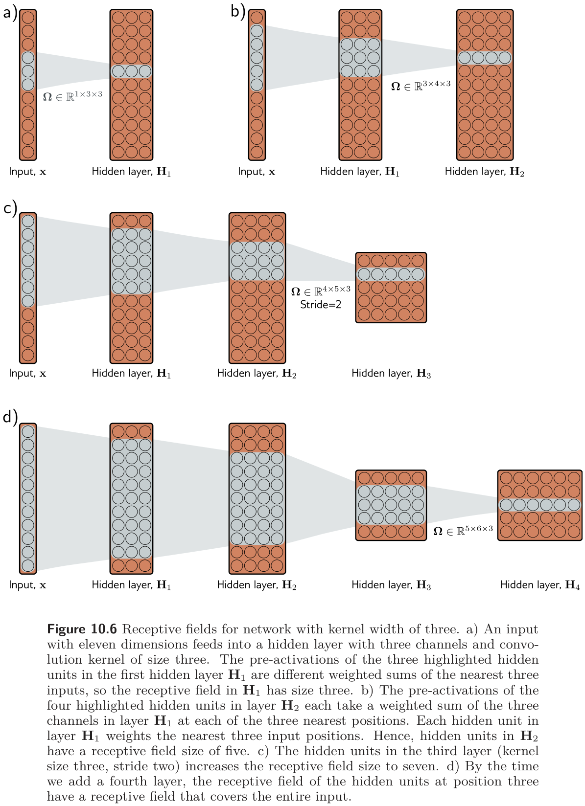{#fig-udl-10-6 width=66%}

The general rule, which is not in the book but is worth having, is that layer
$\ell$ with kernel size $K_\ell$ and dilation $d_\ell$ enlarges the receptive
field by

$$
R_\ell = R_{\ell-1} + d_\ell\,(K_\ell - 1) \prod_{m<\ell} s_m,
\qquad R_0 = 1,
$$ {#eq-receptive-field}

where the product of the earlier strides is the spacing, in input positions,
between adjacent units of layer $\ell - 1$. The cell measures receptive fields
empirically — by differentiating one output unit with respect to the input and
seeing which inputs have nonzero gradient — and compares with
@eq-receptive-field for the two networks in problems 10.9 and 10.11.

```{python}
#| label: fig-receptive-field
#| fig-cap: "Receptive fields measured by automatic differentiation. Each row marks the inputs on which the central unit of that layer depends. Top: three layers with kernel size three and stride one grow the receptive field by two per layer, to 3, 5, 7 (problem 10.9). Bottom: kernel five with stride two, then kernel three, then kernel five with dilation two (problem 10.11) grow it to 5, 9, 25, because after the stride-two layer every kernel tap is two input positions apart, and dilation doubles the spacing again."

def receptive_fields(specs, L=81):
    """specs: list of (kernel, stride, dilation). Returns one boolean mask over the input per layer."""
    x = torch.zeros(1, 1, L, requires_grad=True)
    h, masks = x, []
    for K, s, d in specs:
        h = F.conv1d(h, torch.ones(1, 1, K), stride=s, padding=d * (K - 1) // 2, dilation=d)
        g, = torch.autograd.grad(h[0, 0, h.shape[-1] // 2], x, retain_graph=True)
        masks.append(g[0, 0].numpy() != 0)
    return masks

def receptive_formula(specs):
    R, jump, out = 1, 1, []
    for K, s, d in specs:
        R += d * (K - 1) * jump
        jump *= s
        out.append(R)
    return out

chains = {"kernel 3, stride 1, three times (problem 10.9)":                  [(3, 1, 1)] * 3,
          "kernel 5 stride 2; kernel 3; kernel 5 dilation 2 (problem 10.11)": [(5, 2, 1), (3, 1, 1), (5, 1, 2)]}

fig, axes = plt.subplots(2, 1, figsize=(9, 3.6))
for ax, (title, specs) in zip(axes, chains.items()):
    masks = receptive_fields(specs)
    ax.imshow(np.array(masks), cmap=ListedColormap(["white", NDSU_GREEN]), aspect="auto", interpolation="nearest")
    ax.set_yticks(range(len(specs))); ax.set_yticklabels([f"layer {i + 1}" for i in range(len(specs))])
    ax.set_title(title, fontsize=10); ax.grid(False)
    for i, (m, r) in enumerate(zip(masks, receptive_formula(specs))):
        ax.text(81.5, i, f"measured {int(m.sum())}, formula {r}", va="center", fontsize=8)
    ax.set_xlim(-0.5, 100)
axes[-1].set_xlabel("input position")
plt.tight_layout()
plt.show()
```

### Example: MNIST-1D {#sec-mnist1d}

*Prince §10.2.7, pp. 167–170; figures on p. 169.*

Prince's running example from Week 8 returns. The MNIST-1D input is a
40-dimensional vector and the output a 10-dimensional vector of class
activations. @fig-udl-10-7 is the network: three convolutional layers, each
with fifteen channels, kernel size three, stride two, and valid padding, so the
representation shrinks 40 → 19 → 9 → 4 positions (exactly as the shape
calculator above computed), then the 4×15 = 60 hidden units are flattened and
mapped by a fully connected layer to the ten outputs.

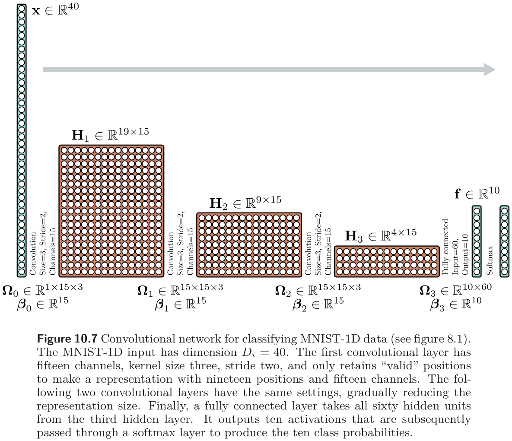{#fig-udl-10-7 width=66%}

The comparison network is fully connected with the same number of layers and
hidden units per layer — 285, 135, and 60. The convolutional network has
**2,050** parameters; the fully connected one has **59,065**. Both fit the
training data perfectly, but the convolutional network reaches about 17% test
error and the fully connected network about 40% (@fig-udl-10-8).

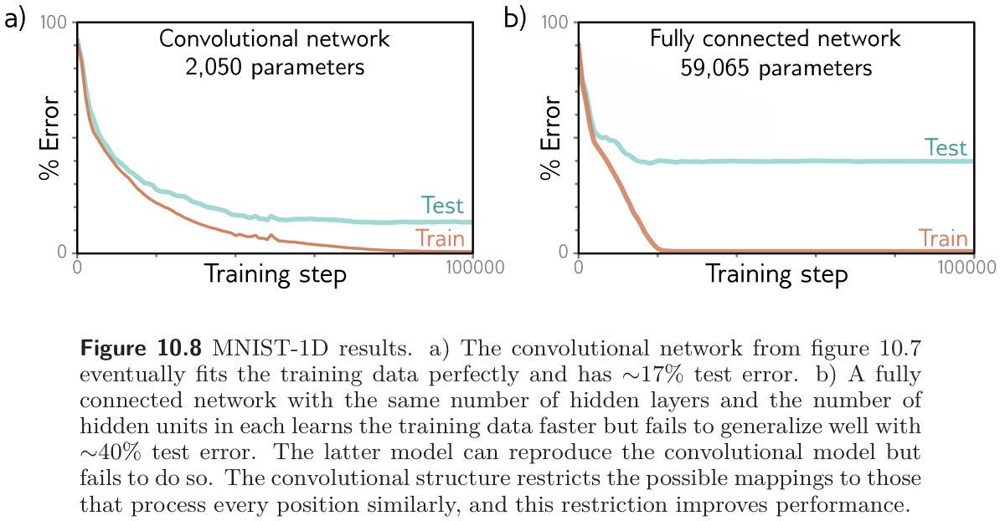{#fig-udl-10-8 width=82%}

The explanation is *not* the parameter count — Chapter 8 showed that
overparameterization generally helps. The fully connected network could
reproduce the convolutional one exactly (@fig-udl-10-4) and fails to. The
convolutional architecture has a better **inductive bias**: we know the data
were generated by translating a template, so forcing every position to be
processed the same way restricts the search to a smaller family of plausible
mappings. Prince offers two equivalent readings. The convolutional network
searches a smaller family of input-to-output functions, all of which are
plausible; or, the convolutional structure is a regularizer that applies an
*infinite penalty* to most of the solutions the fully connected network can
express. Either way it is the Week 9 story — a prior over functions — built into
the architecture rather than added to the loss.

We can run the experiment ourselves. The cell generates an MNIST-1D-style
dataset (ten fixed templates, randomly stretched, randomly placed in a
40-sample window, plus noise), builds both networks with exactly the parameter
counts above, and trains them with SGD.

```{python}
#| label: fig-mnist1d-conv-vs-fc
#| fig-cap: "Our version of figure 10.8. The same two architectures on an MNIST-1D-style dataset of 4,000 training examples: ten templates, each randomly stretched and placed somewhere in the 40-sample window, with Gaussian noise. Left: the convolutional network of figure 10.7 (2,050 parameters). Right: the fully connected network with the same layer widths (59,065 parameters). The fully connected network drives its training error to zero faster, but its test error is about twice that of the convolutional network, which has to learn each template only once rather than at every position."

def make_mnist1d(n, rng, L=40, T=12):
    """Ten fixed random templates of length T, each stretched to 12-24 samples, placed at a random
    offset in a window of length L, with Gaussian noise. Labels are the template index."""
    tr = np.random.default_rng(0)
    templates = np.cumsum(tr.standard_normal((10, T)), axis=1)
    templates -= templates.mean(1, keepdims=True)
    templates /= templates.std(1, keepdims=True)
    y = rng.integers(0, 10, n)
    x = np.zeros((n, L))
    for i in range(n):
        length = rng.integers(T, 2 * T + 1)
        curve = np.interp(np.linspace(0, T - 1, length), np.arange(T), templates[y[i]])
        start = rng.integers(0, L - length + 1)
        x[i, start:start + length] = curve
    x += 0.3 * rng.standard_normal((n, L))
    return torch.tensor(x, dtype=torch.float32), torch.tensor(y)

rng = np.random.default_rng(774)
x_train, y_train = make_mnist1d(4000, rng)
x_test,  y_test  = make_mnist1d(1000, rng)

torch.manual_seed(774)
conv_net = nn.Sequential(nn.Unflatten(1, (1, 40)),                 # (batch, 40) -> (batch, 1 channel, 40)
                         nn.Conv1d(1, 15, 3, stride=2), nn.ReLU(),  # 40 -> 19 positions, 15 channels
                         nn.Conv1d(15, 15, 3, stride=2), nn.ReLU(), # 19 -> 9
                         nn.Conv1d(15, 15, 3, stride=2), nn.ReLU(), # 9 -> 4
                         nn.Flatten(), nn.Linear(60, 10))           # 4 x 15 = 60 -> 10
fc_net = nn.Sequential(nn.Linear(40, 285), nn.ReLU(),
                       nn.Linear(285, 135), nn.ReLU(),
                       nn.Linear(135, 60), nn.ReLU(),
                       nn.Linear(60, 10))

def train(model, steps=3000, batch=100, lr=0.01):
    opt = torch.optim.SGD(model.parameters(), lr=lr, momentum=0.9)
    g = torch.Generator().manual_seed(774)
    log = []
    for step in range(1, steps + 1):
        idx = torch.randint(0, len(x_train), (batch,), generator=g)
        loss = F.cross_entropy(model(x_train[idx]), y_train[idx])
        opt.zero_grad(); loss.backward(); opt.step()
        if step == 1 or step % 100 == 0:
            with torch.no_grad():
                err_tr = 100 * (model(x_train).argmax(1) != y_train).float().mean().item()
                err_te = 100 * (model(x_test).argmax(1) != y_test).float().mean().item()
            log.append((step, err_tr, err_te))
    return np.array(log)

results = {"Convolutional network": (conv_net, train(conv_net)),
           "Fully connected network": (fc_net, train(fc_net))}

fig, axes = plt.subplots(1, 2, figsize=(9, 3.4), sharey=True)
for ax, (name, (model, log)) in zip(axes, results.items()):
    ax.plot(log[:, 0], log[:, 1], color=NDSU_GOLD, lw=2, label="train")
    ax.plot(log[:, 0], log[:, 2], color=NDSU_GREEN, lw=2, label="test")
    ax.set_title(f"{name}\n{n_params(model):,} parameters", fontsize=10)
    ax.set_xlabel("training step"); ax.set_ylim(0, 60); ax.legend()
axes[0].set_ylabel("% error")
plt.tight_layout()
plt.show()

for name, (model, log) in results.items():
    print(f"{name:26s} final train error {log[-1, 1]:5.1f}%   final test error {log[-1, 2]:5.1f}%")
```

## Convolutional Networks for 2D Inputs

*Prince §10.3, pp. 170–171; figures on pp. 171–172.*

1D convolutional networks are used for audio, financial time series, text, and
— in the manufacturing literature — vibration and current signals for bearing
and tool-wear diagnosis. But the main use of convolution is on images, and the
step from 1D to 2D is only notational. A 3×3 kernel $\boldsymbol{\Omega} \in
\mathbb{R}^{3\times 3}$ applied to an input with elements $x_{ij}$ gives

$$
h_{ij} = \mathrm{a}\Big[\beta + \sum_{m=1}^{3}\sum_{n=1}^{3} \omega_{mn}\, x_{i+m-2,\; j+n-2}\Big],
$$ {#eq-conv2d}

a weighted sum over a square 3×3 region, with the kernel translated both
horizontally and vertically across the input (@fig-udl-10-9).

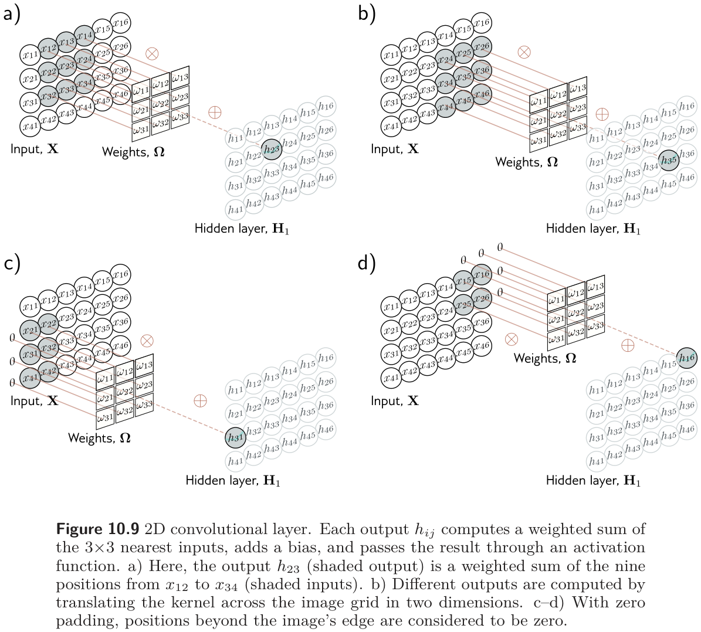{#fig-udl-10-9 width=66%}

An RGB image is a 2D signal with three channels, so a 3×3 kernel on it has
3×3×3 weights, applied at every position to produce one 2D output channel
the same size as the input (with zero padding). More output channels come from
more kernels, stacked into a 3D tensor (@fig-udl-10-10). In general, with
kernel size $K \times K$, $C_i$ input channels, and $C_o$ output channels, each
output channel is a weighted sum of $C_i \times K \times K$ quantities plus a
bias, so the layer has $C_i C_o K^2$ weights and $C_o$ biases — the 2D form of
@eq-conv-params, which the parameter-count cell above already verified.

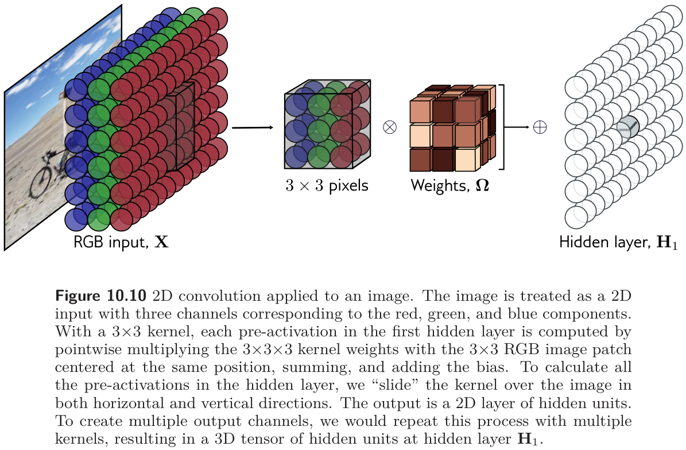{#fig-udl-10-10 width=82%}

Before the kernels are learned, it helps to see what hand-designed ones do. The
cell builds a synthetic inspection image — a bright machined plate on a darker
background with three bolt holes and a thin diagonal scratch — and convolves it
with four classic 3×3 kernels.

```{python}
#| label: fig-2d-kernels
#| fig-cap: "Four 3×3 kernels applied to a synthetic 96×96 inspection image (a plate with three holes and a diagonal scratch). The Sobel kernels respond to vertical and horizontal intensity edges, with sign indicating direction; the box blur suppresses the sensor noise; the sharpening kernel accentuates the scratch. A trained first layer of a CNN learns a bank of kernels much like these — edge, blob, and texture detectors at several orientations — and later layers compose them."

rng = np.random.default_rng(774)
S = 96
yy, xx = np.mgrid[0:S, 0:S]
img = np.full((S, S), 0.35)
img[12:84, 10:86] = 0.75                                      # the plate
for cx, cy in [(30, 30), (66, 30), (48, 66)]:
    img[(xx - cx) ** 2 + (yy - cy) ** 2 < 7 ** 2] = 0.15     # bolt holes
scratch = (np.abs((yy - 20) - 0.6 * (xx - 20)) < 1.0) & (xx > 20) & (xx < 80)
img[scratch] = 0.95                                           # a diagonal scratch
img += 0.02 * rng.standard_normal(img.shape)

kernels = {"vertical edges (Sobel)":   [[-1, 0, 1], [-2, 0, 2], [-1, 0, 1]],
           "horizontal edges (Sobel)": [[-1, -2, -1], [0, 0, 0], [1, 2, 1]],
           "box blur":                 (np.ones((3, 3)) / 9).tolist(),
           "sharpen":                  [[0, -1, 0], [-1, 5, -1], [0, -1, 0]]}

x2d = torch.tensor(img, dtype=torch.float32).view(1, 1, S, S)
fig, axes = plt.subplots(1, 5, figsize=(12, 2.9))
axes[0].imshow(img, cmap="gray", vmin=0, vmax=1); axes[0].set_title("input image", fontsize=10)
for ax, (name, k) in zip(axes[1:], kernels.items()):
    w2d = torch.tensor(k, dtype=torch.float32).view(1, 1, 3, 3)
    out = F.conv2d(x2d, w2d, padding=1)[0, 0].numpy()
    if "edge" in name:
        ax.imshow(out, cmap="RdBu_r", vmin=-1.5, vmax=1.5)
    else:
        ax.imshow(out, cmap="gray", vmin=0, vmax=1)
    ax.set_title(name, fontsize=10)
for ax in axes:
    ax.set_xticks([]); ax.set_yticks([]); ax.grid(False)
plt.tight_layout()
plt.show()
```

## Downsampling and Upsampling {#sec-downsampling}

*Prince §10.4, pp. 171–174; figures on pp. 173–175.*

The network of @fig-udl-10-7 grew its receptive fields by shrinking the
representation with stride-two convolutions. This section collects the ways to
scale a 2D representation down (**downsampling**), scale it back up
(**upsampling**, needed when the output is itself an image), and change the
number of channels without touching the spatial size.

### Downsampling

*Prince §10.4.1, pp. 171–172; figure on p. 173.*

There are three common ways to halve each spatial dimension
(@fig-udl-10-11). **Subsampling** keeps every other position; a stride-two
convolution does this implicitly, without ever computing the discarded values
(panel **a**). **Max pooling** keeps the maximum of each 2×2 block (panel
**b**). It induces some invariance to translation: shift the input by one
pixel and many of the maxima are unchanged. **Mean** (or average) **pooling**
averages each block (panel **c**). All three act on each channel separately,
so the output has half the width and height and the same number of channels.

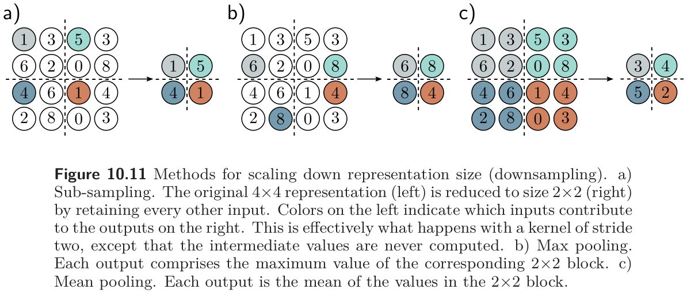{#fig-udl-10-11 width=82%}

The cell tests the invariance claim on the kind of map pooling usually sees:
the sparse output of a detector, a few sharp peaks where some feature was found
and near-zero elsewhere. It shifts the map by one pixel, pools both versions,
and measures two things: how much the pooled map changes, and how much of each
peak's height survives pooling.

```{python}
#| label: fig-pooling-invariance
#| fig-cap: "What pooling does to a sparse detector map under a one-pixel shift. Top row: a 40×40 map with twelve sharp peaks, and the same map shifted one pixel right. Middle row: 2×2 subsampling of each. Bottom row: 2×2 max pooling of each. Subsampling keeps a peak only when it lands on an even row and column, so shifting the input makes peaks appear and disappear. Max pooling keeps every peak at full height, wherever it falls. The table gives the averages over one-pixel shifts in all four directions."

g = torch.Generator().manual_seed(774)
yy, xx = torch.meshgrid(torch.arange(40.0), torch.arange(40.0), indexing="ij")
centres = torch.randint(3, 37, (12, 2), generator=g)
fmap = sum(torch.exp(-((yy - a) ** 2 + (xx - b) ** 2) / (2 * 0.6 ** 2)) for a, b in centres).view(1, 1, 40, 40)

ops = {"subsample": lambda t: t[..., ::2, ::2],
       "max pool":  lambda t: F.max_pool2d(t, 2),
       "mean pool": lambda t: F.avg_pool2d(t, 2)}

shifted = torch.roll(fmap, shifts=1, dims=3)
fig, axes = plt.subplots(3, 2, figsize=(5.6, 8.2))
rows = [("input", lambda t: t), ("subsampled", ops["subsample"]), ("max pooled", ops["max pool"])]
for r, (name, op) in enumerate(rows):
    for c, (t, tag) in enumerate([(fmap, "original"), (shifted, "shifted 1 px right")]):
        axes[r, c].imshow(op(t)[0, 0], cmap="viridis", vmin=0, vmax=1)
        axes[r, c].set_title(f"{name}, {tag}", fontsize=9)
        axes[r, c].set_xticks([]); axes[r, c].set_yticks([]); axes[r, c].grid(False)
plt.tight_layout()
plt.show()

def peak_heights(pooled_map, centres, stride=2):
    """Largest pooled value in the 2x2 pooled neighbourhood of each peak."""
    out = []
    for a, b in centres:
        i, j = int(a) // stride, int(b) // stride
        out.append(pooled_map[0, 0, max(i - 1, 0):i + 2, max(j - 1, 0):j + 2].max().item())
    return np.array(out)

shifts = [(0, 1), (0, -1), (1, 0), (-1, 0)]
print(f"{'downsampling':12s}{'change in pooled map':>24s}{'peak height kept (mean)':>26s}{'(worst)':>9s}")
for name, op in ops.items():
    change, kept = [], []
    for dy, dx in shifts:
        moved = torch.roll(fmap, shifts=(dy, dx), dims=(2, 3))
        change.append(((op(moved) - op(fmap)).norm() / op(fmap).norm()).item())
        kept.append(peak_heights(op(moved), centres + torch.tensor([dy, dx])))
    kept = np.concatenate(kept)
    print(f"{name:12s}{100 * np.mean(change):>23.0f}%{100 * kept.mean():>25.0f}%{100 * kept.min():>8.0f}%")
```

The table supports a modest version of Prince's claim. A one-pixel shift still
changes all three pooled maps, so pooling only gives *partial* invariance. But
max pooling changes the map least, and it is the only method that never loses a
detection. Every peak survives at full height. A sharp feature that falls
between the sample points of subsampling can vanish altogether, and mean
pooling dilutes it.

### Upsampling

*Prince §10.4.2, pp. 172–174; figures on p. 173.*

Four ways to double the resolution (@fig-udl-10-12 and @fig-udl-10-13). The
simplest **duplicates** every value into a 2×2 block. **Max unpooling** is the
inverse of an earlier max pooling: each value goes back to the position its
maximum came from, and the rest are zero. **Bilinear interpolation** fills in
smoothly between the known samples. The fourth is the **transposed
convolution**, the mirror image of a stride-two convolution: where
downsampling made each output a weighted sum of three inputs, upsampling makes
each input contribute three weighted values to the output, which has twice as
many positions. Its weight matrix is literally the transpose of the
downsampling matrix (@fig-udl-10-13**b, d**), hence the name.

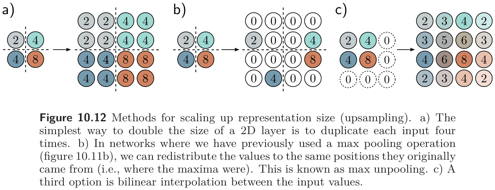{#fig-udl-10-12 width=82%}

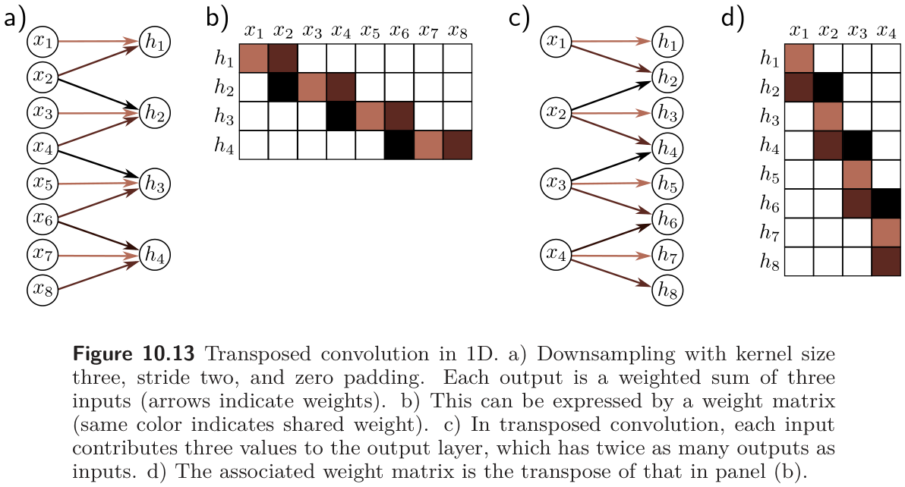{#fig-udl-10-13 width=82%}

```{python}
#| label: fig-transposed-conv
#| fig-cap: "Our version of figure 10.13b and d, read off from PyTorch. Left: the 4×8 weight matrix of a stride-two, kernel-three, zero-padded convolution on eight inputs. Right: the 8×4 weight matrix of `conv_transpose1d` with the same kernel and stride. The second is the transpose of the first, to machine precision."

def matrix_of(op, D_in):
    cols = []
    for j in range(D_in):
        e = torch.zeros(1, 1, D_in); e[0, 0, j] = 1.0
        cols.append(op(e).view(-1))
    return torch.stack(cols, dim=1).numpy()

w = torch.tensor([[[1.0, 2.0, 3.0]]])
down = lambda t: F.conv1d(t, w, stride=2, padding=1)
up   = lambda t: F.conv_transpose1d(t, w, stride=2, padding=1, output_padding=1)
M_down, M_up = matrix_of(down, 8), matrix_of(up, 4)

fig, axes = plt.subplots(1, 2, figsize=(8, 3.2), gridspec_kw={"width_ratios": [2, 1]})
for ax, M, title in [(axes[0], M_down, "stride-2 convolution (4 × 8)"),
                     (axes[1], M_up,   "transposed convolution (8 × 4)")]:
    ax.imshow(M, cmap=cmap, vmin=-0.5, vmax=5.5)
    ax.set_title(title, fontsize=10); ax.grid(False)
    ax.set_xticks(range(M.shape[1])); ax.set_yticks(range(M.shape[0]))
    for s in ax.spines.values():
        s.set_visible(True)
plt.tight_layout()
plt.show()

print(f"max |M_up - M_down^T| = {np.abs(M_up - M_down.T).max():.1e}")
```

::: {.callout-important}
## Transposed convolution is not deconvolution
Older papers, and @fig-udl-10-19 below, call the transposed convolution a
"deconvolution". It does not invert a convolution; it is a learned linear
upsampling whose connectivity pattern is the transpose of a strided
convolution's. Prince also notes (p. 181) that transposed convolutions can
produce checkerboard artifacts, which is why many modern decoders upsample by
interpolation and then apply an ordinary convolution.
:::

### Changing the number of channels

*Prince §10.4.3, p. 174; figure on p. 175.*

Sometimes we need to change the channel count without pooling, typically so a
representation can be added to another branch of the network (the residual
connections of Chapter 11). A convolution with kernel size one does this: each
output is a weighted sum of all channels *at the same position*
(@fig-udl-10-14), repeated with different weights for each of the $C_o$ output
channels, so the weights have size $1 \times 1 \times C_i \times C_o$. With a
bias and activation, a **1×1 convolution** is the same fully connected network
run on the channel vector at every position. The cell confirms it.

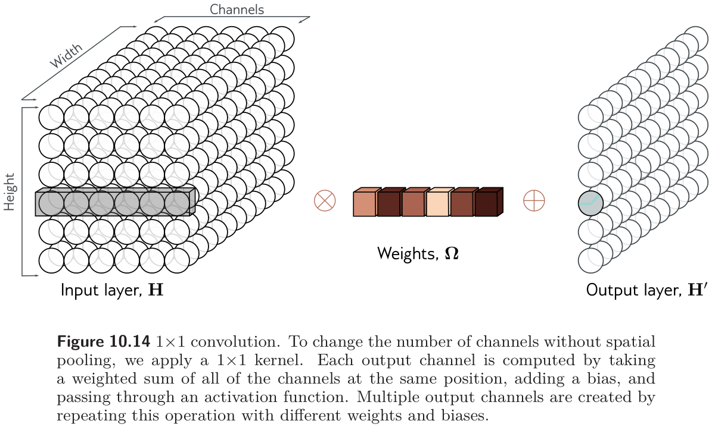{#fig-udl-10-14 width=66%}

```{python}
#| label: one-by-one

conv1x1 = nn.Conv2d(8, 5, kernel_size=1)
linear  = nn.Linear(8, 5)
linear.weight.data = conv1x1.weight.data.view(5, 8).clone()     # same 40 weights
linear.bias.data   = conv1x1.bias.data.clone()                   # same 5 biases

t = torch.randn(1, 8, 6, 6)                                      # 8 channels on a 6x6 grid
via_conv   = conv1x1(t)
via_linear = linear(t.permute(0, 2, 3, 1)).permute(0, 3, 1, 2)  # apply the linear map at every position
print(f"1x1 convolution == per-position fully connected layer: "
      f"{torch.allclose(via_conv, via_linear, atol=1e-6)}   "
      f"(parameters: {n_params(conv1x1)} vs {n_params(linear)})")
```

## Applications

*Prince §10.5, pp. 174–179.*

Prince closes the chapter with three computer-vision tasks, which also serve
as a short history of the field.

### Image classification

*Prince §10.5.1, pp. 174–176; figures on pp. 175–177.*

The pioneering work targeted **ImageNet** (@fig-udl-10-15): 1,281,167 training
images, 50,000 validation and 100,000 test images, each labeled with one of
1,000 categories. The standard input is a 224×224 RGB image, and the output a
distribution over the 1,000 classes. In 2011, before deep networks, the best
method had about 25% top-5 error (the correct class is not among the five most
probable). Five years later, the best deep networks beat human performance.

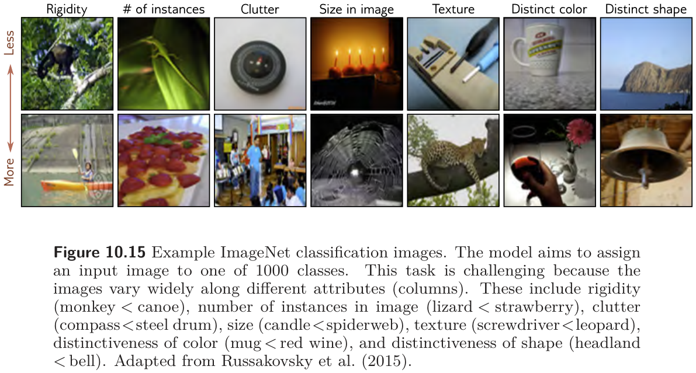{#fig-udl-10-15 width=82%}

**AlexNet** (2012, @fig-udl-10-16) was the first convolutional network to do
well on this task [@krizhevsky2012]. It has eight hidden layers with ReLU
activations: five convolutional and three fully connected. It begins by
downsampling with an 11×11 kernel at stride four to make 96 channels, max
pools, applies a 5×5 convolution to make 256 channels, max pools again, applies
three 3×3 convolutions, and ends at a 13×13 representation with 256 channels
that is flattened into a vector of length 43,264 and passed through fully
connected layers of 4,096, 4,096, and 1,000 units, then a softmax. It has about
60 million parameters, most of them in the fully connected layers at the end.
Training used every Week 9 trick available at the time: the dataset was
augmented by a factor of 2,048 with spatial transformations and intensity
changes, five cropped and mirrored versions of each test image were averaged,
dropout was applied in the fully connected layers, and an L2 penalty was used.
It reached 16.4% top-5 and 38.1% top-1 error, a result Prince credits with
kick-starting the modern era of AI research.

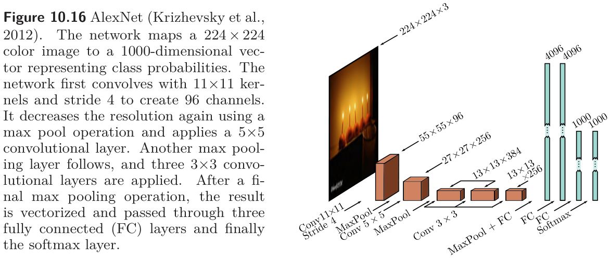{#fig-udl-10-16 width=84%}

**VGG** (@fig-udl-10-17) reached 6.8% top-5 and 23.7% top-1 error
[@simonyan2015]. Structurally it is the same recipe — convolutions interspersed
with max pooling, spatial size falling while the channel count rises, three
fully connected layers at the end — and it, too, was trained with augmentation,
weight decay, and dropout. The important difference was *depth*: 19 hidden
layers and 144 million parameters. For several years performance on ImageNet
improved as networks got deeper, which Prince takes as evidence that depth
matters.

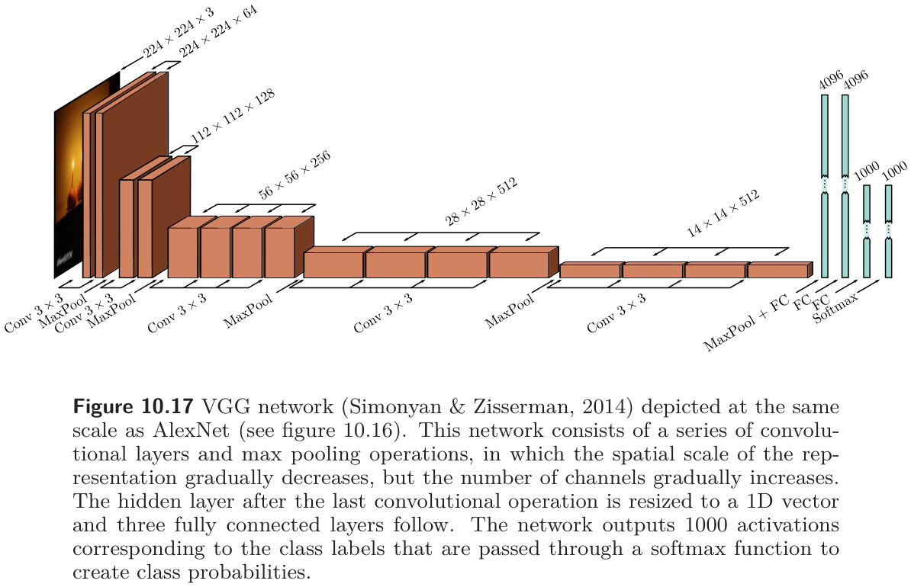{#fig-udl-10-17 width=84%}

The cell walks through torchvision's implementations of both networks, listing
the shape and parameter count of every weighted layer (problems 10.16 and
10.18). Note that torchvision's AlexNet is the single-GPU variant with 64, 192,
384, 256, and 256 channels rather than the paper's 96, 256, 384, 384, and 256,
so its total differs slightly from the book's figure.

```{python}
#| label: architecture-tables

from torchvision.models import alexnet, vgg19

def describe(model, show_layers=True):
    total, conv_total, fc_total, n_conv, n_fc = 0, 0, 0, 0, 0
    for name, m in model.named_modules():
        if isinstance(m, nn.Conv2d):
            n = n_params(m); conv_total += n; n_conv += 1
            desc = f"conv {m.in_channels:>4d} -> {m.out_channels:<4d} kernel {m.kernel_size[0]}x{m.kernel_size[1]}, stride {m.stride[0]}"
        elif isinstance(m, nn.Linear):
            n = n_params(m); fc_total += n; n_fc += 1
            desc = f"fully connected {m.in_features:>6,} -> {m.out_features:<5,}"
        else:
            continue
        total += n
        if show_layers:
            print(f"  {desc:52s}{n:>13,}")
    print(f"  {'convolutional layers':20s}{n_conv:>3d}{conv_total:>42,}")
    print(f"  {'fully connected layers':20s}{n_fc:>3d}{fc_total:>42,}")
    print(f"  {'total':65s}{total:>13,}")

print("AlexNet (torchvision variant)")
describe(alexnet(weights=None))
print("\nVGG-19")
describe(vgg19(weights=None), show_layers=False)
```

### Object detection

*Prince §10.5.2, p. 177; figure on p. 178.*

**Object detection** identifies and localizes multiple objects in an image.
**YOLO** ("You Only Look Once", @fig-udl-10-18) [@redmon2016] passes a 448×448
image through 24 convolutional layers, VGG-style, down to a 7×7 representation
with 1,024 channels, then two fully connected layers. The output encodes, for
each cell of a 7×7 grid, the most likely class and a fixed number of bounding
boxes, each described by five numbers: the $x$ and $y$ position of its center,
its height and width, and a confidence that estimates the overlap with the
true box. The network is trained with momentum, weight decay, dropout, and
augmentation, and uses transfer learning: it is first trained to classify
ImageNet and then fine-tuned for detection. A heuristic post-processing step
removes low-confidence boxes and suppresses duplicate boxes for the same
object.

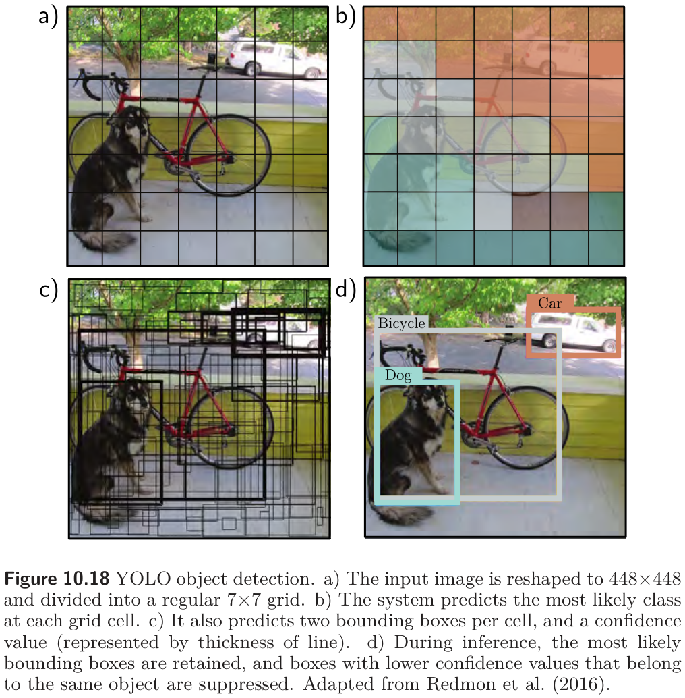{#fig-udl-10-18 width=70%}

### Semantic segmentation

*Prince §10.5.3, pp. 178–179; figures on pp. 179–180.*

**Semantic segmentation** assigns a class label to every pixel. The early
network of @fig-udl-10-19 [@noh2015] maps a 224×224 image to a 224×224×21
array of class probabilities. Its first half is a smaller VGG (thirteen
convolutional layers) that shrinks the representation to 14×14, then 7×7, then
two fully connected layers of size 4,096 that no longer have any spatial
layout — they integrate information from the whole image. The second half
mirrors the first: a fully connected layer reconstitutes a 7×7×512
representation, and a series of max unpooling and transposed convolution
layers grows it back to full resolution, ending with a 1×1 convolution to 21
channels and a softmax at every position. The downsampling half is an
**encoder**, the upsampling half a **decoder**, and the whole an
**encoder–decoder** or **hourglass** network. The final label map is assembled
greedily, class by class, with a heuristic that encourages connected regions
(@fig-udl-10-20).

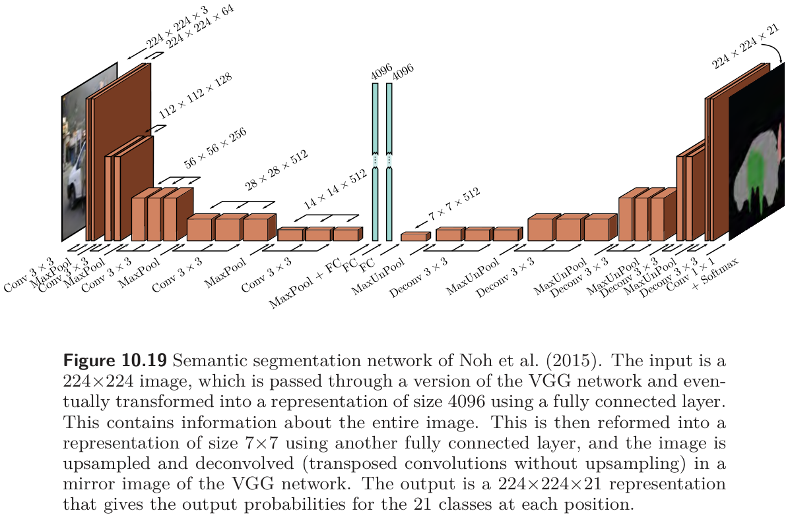{#fig-udl-10-19 width=84%}

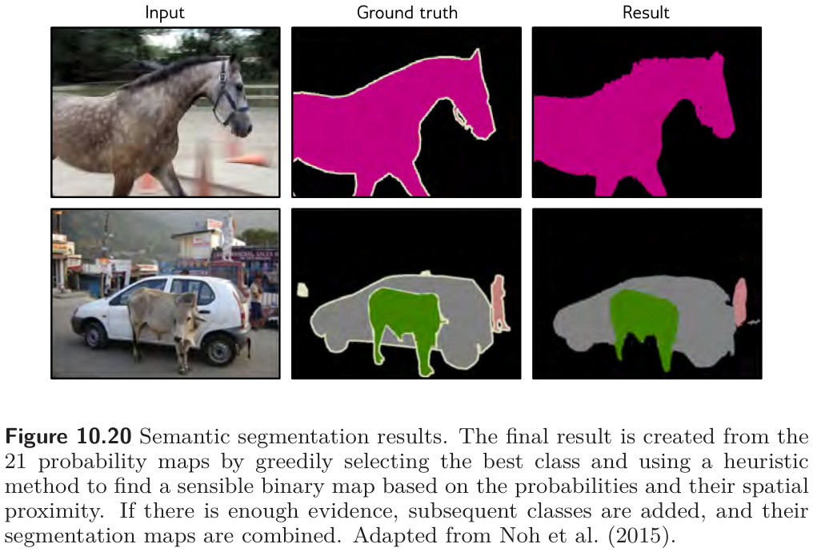{#fig-udl-10-20 width=70%}

### Where the field went

*Prince §10.6 and chapter notes, pp. 179–184; figure on p. 182.*

@fig-udl-10-21 plots ImageNet top-1 error over a decade. AlexNet and VGG were
remarkable for their time but are far from the current state of the art. The
next two steps on the curve are ResNet and DenseNet — the subject of the second
half of this note — and the models after 2020 (ViT, SWIN, DaViT) are
transformers, the subject of the next one.

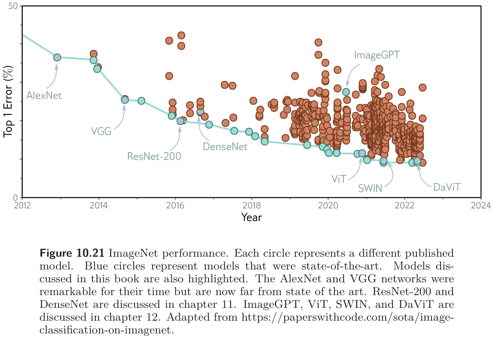{#fig-udl-10-21 width=78%}

The chapter notes (pp. 180–184) are worth a skim. Two items matter for
practice. First, dropout works poorly on convolutional layers, because
neighboring pixels carry nearly the same information, so a dropped unit is
replaced by its neighbors; **spatial dropout** (drop whole channels) and
**cutout** (mask a square of the input) are the convolutional substitutes.
Second, standard convolutional layers have many cheaper variants —
**depthwise**, **grouped**, and **separable** convolutions — that reduce
$C_i C_o K^2$ toward $C K^2$ and are the basis of mobile architectures.

::: {.callout-tip}
## The recipe, in one paragraph
Every classifier in this section follows the same template, and so does the
one you will build at the end of this note. Convolutional layers with small
kernels, interspersed with downsampling by a factor of two. As the network
deepens, the spatial size halves and the channel count doubles, so the number
of values per layer falls slowly while the receptive field grows quickly. At
the end, something that integrates over the whole image — fully connected
layers in AlexNet and VGG, global average pooling in everything since — and a
softmax. If the output is an image, a mirrored decoder upsamples back.
:::

## Residual Networks

*Prince, Chapter 11 opening, p. 186.*

Going from AlexNet's eight layers to VGG's eighteen improved ImageNet
performance, so the obvious next experiment was to add more. It failed:
performance *decreased* when many more layers were added. Chapter 11 explains
why, and introduces the two components that fixed it. A **residual block**
computes an additive change to the representation instead of replacing it,
which makes very deep networks trainable but causes activations to grow
exponentially with depth at initialization. **Batch normalization** re-centers
and rescales the activations at each layer to compensate. Together they allow
networks hundreds of layers deep.

### Sequential processing and its limits

*Prince §11.1, pp. 186–189; figures on pp. 187–188.*

Every network so far processes data sequentially: each layer receives the
previous layer's output and passes its own to the next (@fig-udl-11-1). For
three hidden layers,

$$
\begin{aligned}
\mathbf{h}_1 &= \mathbf{f}_1[\mathbf{x}, \boldsymbol{\phi}_1] \\
\mathbf{h}_2 &= \mathbf{f}_2[\mathbf{h}_1, \boldsymbol{\phi}_2] \\
\mathbf{h}_3 &= \mathbf{f}_3[\mathbf{h}_2, \boldsymbol{\phi}_3] \\
\mathbf{y}   &= \mathbf{f}_4[\mathbf{h}_3, \boldsymbol{\phi}_4],
\end{aligned}
$$ {#eq-sequential}

or, as one nested function,
$\mathbf{y} = \mathbf{f}_4\big[\mathbf{f}_3\big[\mathbf{f}_2\big[\mathbf{f}_1[\mathbf{x},\boldsymbol{\phi}_1],\boldsymbol{\phi}_2\big],\boldsymbol{\phi}_3\big],\boldsymbol{\phi}_4\big]$.
In a fully connected network each $\mathbf{f}_k$ is a linear transformation
followed by an activation; in a convolutional network it is a set of
convolutions followed by an activation.

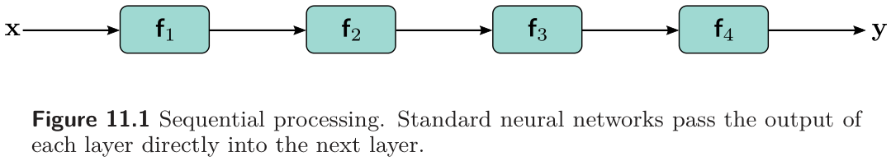{#fig-udl-11-1 width=66%}

In principle we can stack as many layers as we like. In practice,
@fig-udl-11-2 shows a 56-layer convolutional network doing *worse* than a
20-layer one on CIFAR-10 — on the test set *and on the training set*. The
training-set result is the diagnostic: this is not a failure to generalize but
a failure to *train*, which is surprising when more capacity usually helps
(figure 8.10 in Week 8).

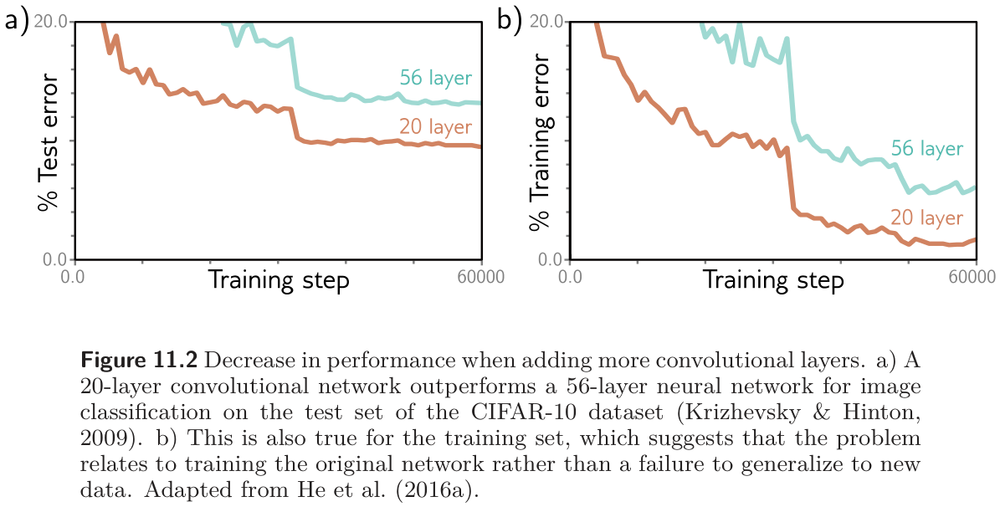{#fig-udl-11-2 width=82%}

The phenomenon is not fully understood. Prince's conjecture is about the
*geometry* of the loss surface rather than the size of the gradients. With
proper initialization (Week 7) the gradient at the start is reasonable — it
neither explodes nor vanishes. But a derivative describes an *infinitesimal*
change, and an optimizer takes a *finite* step. In a very deep network, any
reasonable step may land somewhere whose gradient is unrelated to the one just
used: the loss surface looks like a vast field of tiny mountains rather than a
smooth valley. @fig-udl-11-3 shows the supporting evidence from networks with
one input and one output. For a shallow network, the gradient $\partial y /
\partial x$ changes slowly with $x$; for a 24-layer network it changes
unpredictably, and the **autocorrelation function** of the gradient drops to
zero over tiny distances. This is the **shattered gradients** phenomenon
[@balduzzi2017].

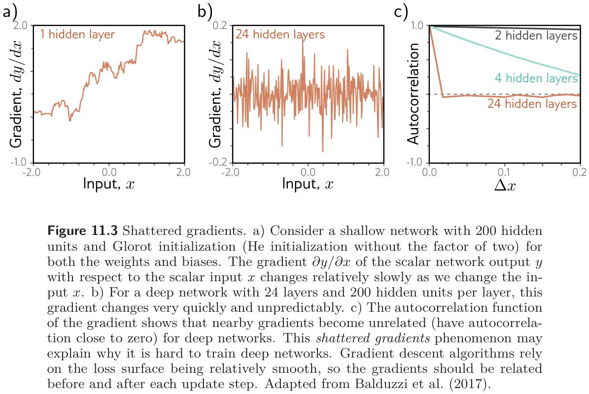{#fig-udl-11-3 width=84%}

The reason is visible in the chain rule. The derivative of the output with
respect to the first layer of @eq-sequential is

$$
\frac{\partial \mathbf{y}}{\partial \mathbf{f}_1}
= \frac{\partial \mathbf{f}_4}{\partial \mathbf{f}_3}
  \frac{\partial \mathbf{f}_3}{\partial \mathbf{f}_2}
  \frac{\partial \mathbf{f}_2}{\partial \mathbf{f}_1},
$$ {#eq-seq-grad}

and when the parameters of $\mathbf{f}_1$ change, *every* factor in the
product changes, because every later layer is computed from
$\mathbf{f}_1$. The gradient at each training example can therefore be
completely different after a step.

The cell reproduces the experiment. One remark before the plot: Prince's own
notebook 11.1 reports that a plain deep ReLU network with Glorot
initialization does *not* visibly reproduce @fig-udl-11-3**b** — its gradient
just shrinks toward zero. The original experiment of Balduzzi et al. used
batch normalization in the deep network, which keeps every layer's signal at
unit scale across the input range. We therefore show both the plain and the
normalized 24-layer networks, plus a residual network as a preview of the
cure.

```{python}
#| label: fig-shattered
#| fig-cap: "Shattered gradients, reproduced. Networks with one input, one output, and 200 hidden units per layer, Glorot-initialized. (a) With one hidden layer, the gradient $\\partial y/\\partial x$ is a slowly varying step function. (b) With 24 layers and batch normalization after each linear transformation, it is white noise: nearby inputs have unrelated gradients. (c) The autocorrelation of the gradient as a function of the input separation $\\Delta x$. The shallow network stays correlated; the 24-layer plain network also stays correlated but its gradient has shrunk to about $3\\times 10^{-4}$ (it has vanished rather than shattered); the normalized 24-layer network loses all correlation within one grid step; and a 24-layer residual network with the same normalization keeps its gradient correlated over far larger distances, which is the point of the next section."

def make_net(depth, width=200):
    layers = [nn.Linear(1, width)] + [nn.Linear(width, width) for _ in range(depth)] + [nn.Linear(width, 1)]
    for layer in layers:                                   # Glorot: variance 1 / fan_in for weights and biases
        nn.init.normal_(layer.weight, 0, np.sqrt(1 / layer.in_features))
        nn.init.normal_(layer.bias,   0, np.sqrt(1 / layer.in_features))
    return layers

def batchnorm(f):
    """Standardize each unit over the batch of inputs; statistics held fixed so each gradient is per-example."""
    return (f - f.mean(0).detach()) / (f.std(0).detach() + 1e-5)

def forward(layers, x, kind):
    h = layers[0](x)
    for layer in layers[1:-1]:
        if kind == "plain":          h = F.relu(layer(h))
        elif kind == "batchnorm":    h = F.relu(batchnorm(layer(h)))
        elif kind == "residual+bn":  h = h + layer(F.relu(batchnorm(h)))
    return layers[-1](h)

def gradient_curve(depth, kind, n=2000):
    torch.manual_seed(774)
    layers = make_net(depth)
    x = torch.linspace(-2, 2, n).view(-1, 1).requires_grad_(True)
    g, = torch.autograd.grad(forward(layers, x, kind).sum(), x)
    return x.detach().view(-1).numpy(), g.view(-1).numpy()

def autocorrelation(g, max_lag):
    g = g - g.mean()
    return np.array([(g[:len(g) - k] * g[k:]).mean() / (g * g).mean() for k in range(max_lag + 1)])

configs = [("1 hidden layer",               1,  "plain",       NDSU_GREEN),
           ("24 layers, plain",             24, "plain",       STEEL),
           ("24 layers + batch norm",       24, "batchnorm",   ACCENT),
           ("24 residual blocks + batch norm", 24, "residual+bn", NDSU_GOLD)]

fig, axes = plt.subplots(1, 3, figsize=(11, 3.2))
xs, g1 = gradient_curve(1, "plain")
axes[0].plot(xs, g1, color=NDSU_GREEN, lw=1); axes[0].set_title("(a) 1 hidden layer", fontsize=10)
xs, g24 = gradient_curve(24, "batchnorm")
axes[1].plot(xs, g24, color=ACCENT, lw=0.6); axes[1].set_title("(b) 24 layers + batch norm", fontsize=10)
for ax in axes[:2]:
    ax.set_xlabel("input $x$"); ax.set_ylabel("gradient $\\partial y / \\partial x$")
dx = 4 / 1999
lags = np.arange(0, 101)
for name, depth, kind, color in configs:
    _, g = gradient_curve(depth, kind)
    axes[2].plot(lags * dx, autocorrelation(g, 100), color=color, lw=2, label=name)
axes[2].set_xlabel("$\\Delta x$"); axes[2].set_ylabel("autocorrelation"); axes[2].set_title("(c)", fontsize=10)
axes[2].axhline(0, color="k", lw=0.5); axes[2].legend(fontsize=7.5)
plt.tight_layout()
plt.show()

print(f"{'network':36s}{'gradient std':>14s}{'autocorrelation at one grid step':>34s}")
for name, depth, kind, _ in configs:
    _, g = gradient_curve(depth, kind)
    print(f"{name:36s}{g.std():>14.2e}{autocorrelation(g, 1)[1]:>34.3f}")
```

### Residual connections and residual blocks

*Prince §11.2, pp. 189–192; figures on pp. 190–191.*

A **residual** or **skip connection** is a branch in the computational path
that adds each layer's *input* back to its *output* (@fig-udl-11-4**a**). The
network of @eq-sequential becomes

$$
\begin{aligned}
\mathbf{h}_1 &= \mathbf{x} + \mathbf{f}_1[\mathbf{x}, \boldsymbol{\phi}_1] \\
\mathbf{h}_2 &= \mathbf{h}_1 + \mathbf{f}_2[\mathbf{h}_1, \boldsymbol{\phi}_2] \\
\mathbf{h}_3 &= \mathbf{h}_2 + \mathbf{f}_3[\mathbf{h}_2, \boldsymbol{\phi}_3] \\
\mathbf{y}   &= \mathbf{h}_3 + \mathbf{f}_4[\mathbf{h}_3, \boldsymbol{\phi}_4].
\end{aligned}
$$ {#eq-residual}

Each $\mathbf{f}_k$ now learns an *additive change* to the current
representation, so its output must have the same size as its input. Each
sum of input and processed output is a **residual block**. Substituting each
line into the next "unravels" the network:

$$
\begin{aligned}
\mathbf{y} = \mathbf{x} &+ \mathbf{f}_1[\mathbf{x}] \\
&+ \mathbf{f}_2\big[\mathbf{x} + \mathbf{f}_1[\mathbf{x}]\big] \\
&+ \mathbf{f}_3\big[\mathbf{x} + \mathbf{f}_1[\mathbf{x}] + \mathbf{f}_2[\mathbf{x} + \mathbf{f}_1[\mathbf{x}]]\big] \\
&+ \mathbf{f}_4\big[\mathbf{x} + \mathbf{f}_1[\mathbf{x}] + \mathbf{f}_2[\cdots] + \mathbf{f}_3[\cdots]\big],
\end{aligned}
$$ {#eq-unraveled}

with the parameters omitted. The output is the input plus four smaller
networks, one per line (@fig-udl-11-4**b**), so one reading is that residual
connections turn the network into an *ensemble* of shallower networks whose
outputs are summed. A complementary reading counts *paths*: the four-block
network has $2^4 = 16$ paths from input to output, of every length from zero
(the identity) to four, and $\mathbf{f}_1$ sits on eight of them.

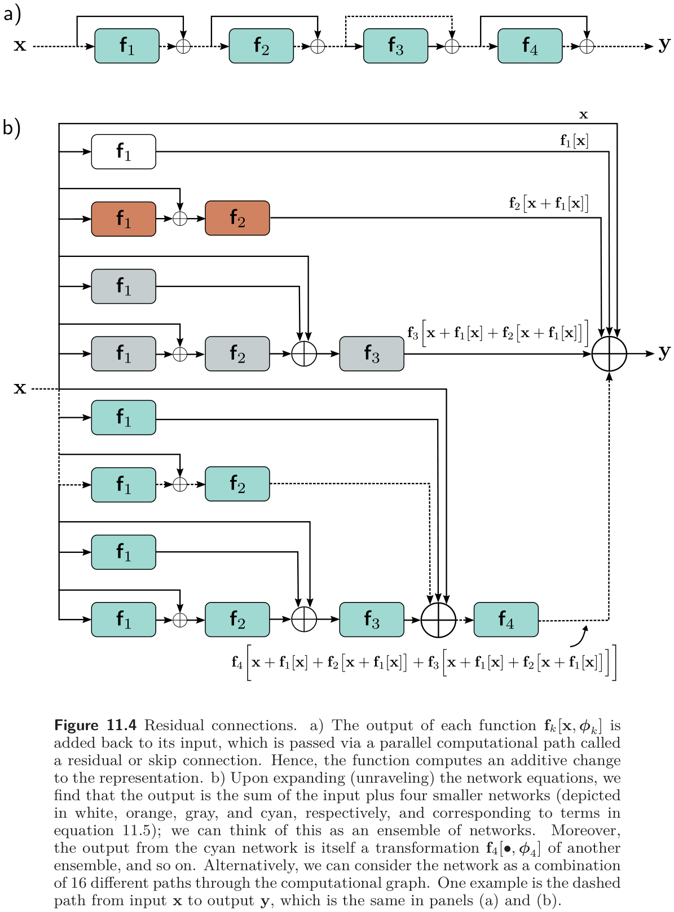{#fig-udl-11-4 width=70%}

The derivative with respect to the first layer now has one term per path
through $\mathbf{f}_1$:

$$
\frac{\partial \mathbf{y}}{\partial \mathbf{f}_1}
= \mathbf{I}
+ \frac{\partial \mathbf{f}_2}{\partial \mathbf{f}_1}
+ \Big(\frac{\partial \mathbf{f}_3}{\partial \mathbf{f}_1}
     + \frac{\partial \mathbf{f}_3}{\partial \mathbf{f}_2}\frac{\partial \mathbf{f}_2}{\partial \mathbf{f}_1}\Big)
+ \Big(\frac{\partial \mathbf{f}_4}{\partial \mathbf{f}_1}
     + \frac{\partial \mathbf{f}_4}{\partial \mathbf{f}_2}\frac{\partial \mathbf{f}_2}{\partial \mathbf{f}_1}
     + \frac{\partial \mathbf{f}_4}{\partial \mathbf{f}_3}\frac{\partial \mathbf{f}_3}{\partial \mathbf{f}_1}
     + \frac{\partial \mathbf{f}_4}{\partial \mathbf{f}_3}\frac{\partial \mathbf{f}_3}{\partial \mathbf{f}_2}\frac{\partial \mathbf{f}_2}{\partial \mathbf{f}_1}\Big).
$$ {#eq-residual-grad}

Compare @eq-seq-grad, which had only the last, longest term. The identity says
that a change in $\boldsymbol{\phi}_1$ reaches the output *directly*; the short
chains are better behaved than the long one; and since every layer's gradient
contains an identity and several short chains, residual networks suffer far
less from shattered gradients — which is what the gold curve in
@fig-shattered**c** showed.

::: {.callout-tip}
## Worked: counting paths (problem 11.2)
Unraveling $K$ residual blocks gives one path for every subset of the blocks
(each block is either on the path or skipped), so there are $2^K$ paths in
all, and the number of paths of length $\ell$ is the number of $\ell$-subsets,
$\binom{K}{\ell}$. For $K = 4$ that is 1, 4, 6, 4, 1; for $K = 3$ it is 1, 3,
3, 1; for $K = 5$ it is 1, 5, 10, 10, 5, 1. The *average* path length is
$K/2$, which is one way to see why a 200-block ResNet behaves like a
combination of 100-block networks rather than one 200-block network.
:::

```{python}
#| label: path-count

from math import comb
print(f"{'blocks K':>9s}  {'paths of length 0, 1, ..., K':40s}{'total':>7s}")
for K in (3, 4, 5, 8):
    print(f"{K:>9d}  {str([comb(K, l) for l in range(K + 1)]):40s}{2 ** K:>7d}")
```

**Order of operations.** The additive function $\mathbf{f}[\bullet]$ must
contain a nonlinearity, or the whole network is linear. But if the ReLU comes
*last*, as in an ordinary layer, every block can only *add non-negative*
quantities (@fig-udl-11-5**a**). So residual blocks usually apply the
activation *first* and end with the linear transformation or convolution
(@fig-udl-11-5**b**), possibly with several layers in between
(@fig-udl-11-5**c**). One consequence: a block that starts with a ReLU does
nothing if the network input is entirely negative, so networks start with a
plain linear layer rather than a residual block.

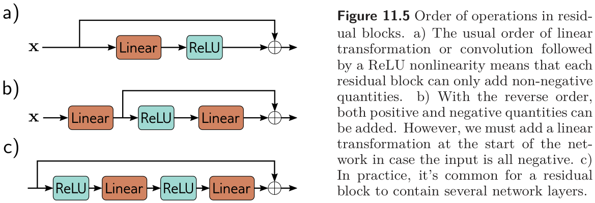{#fig-udl-11-5 width=84%}

Residual connections roughly *double* the depth at which a network can be
trained before performance degrades. To go further we need to look at what
happens to the variance of the activations in the forward pass.

### Exploding activations in residual networks

*Prince §11.3, p. 192; figure on p. 193.*

Week 7 initialized the parameters so that the variance of the activations
stays constant from layer to layer in the forward pass, and the variance of
the gradients in the backward pass. He initialization does this for ReLU
layers: biases zero, weights normal with variance $2 / D_h$. In a residual
network, vanishing is no longer a concern — every layer has a direct path to
the output — but there is a new problem. The two branches of each block, the
skip and the processing, carry *uncorrelated* variability, so when they are
added the variances add. He initialization makes the processing branch's
variance equal to its input's, so **the variance doubles at every block**
(@fig-udl-11-6**a**): after $K$ blocks it is $2^K$, and the forward pass
overflows floating point long before $K$ reaches a few hundred. The same
argument applies to the gradients in the backward pass, so residual networks
with He initialization still have exploding gradients.

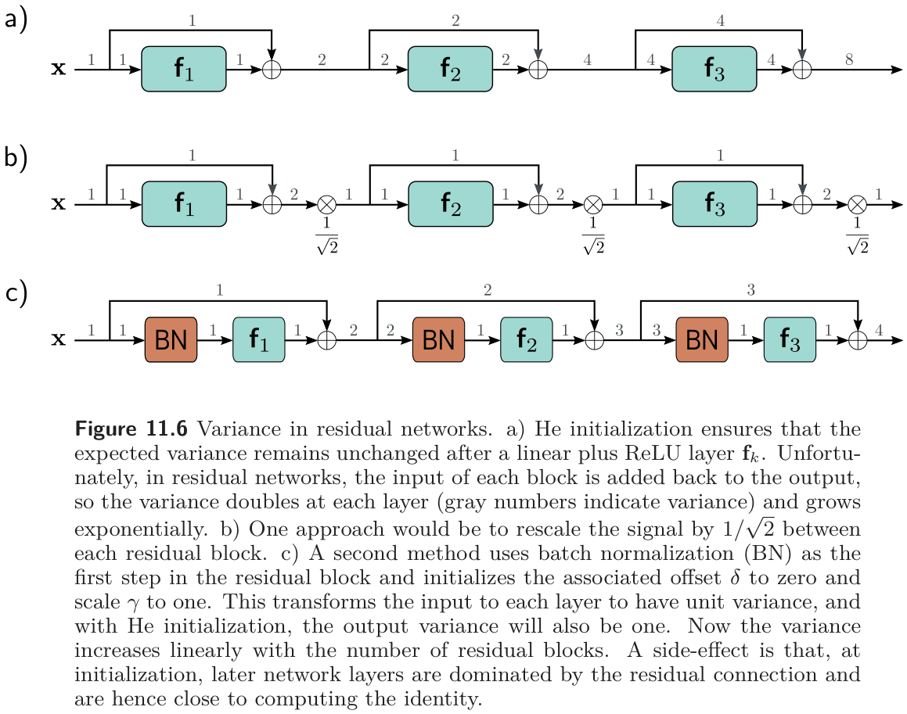{#fig-udl-11-6 width=78%}

One fix multiplies the output of each block by $1/\sqrt{2}$
(@fig-udl-11-6**b**). The usual fix is batch normalization at the *start* of
each block (@fig-udl-11-6**c**), which transforms the block's input to unit
variance so that the processing branch adds exactly one unit of variance: the
variance after block $k$ is $k + 1$, growing *linearly* instead of
exponentially. The cell measures all three.

```{python}
#| label: fig-variance-growth
#| fig-cap: "Activation variance through twenty residual blocks at initialization (256 units wide, He-initialized, measured over 4,000 inputs), on a log scale. Plain residual blocks double the variance at each step and reach about a million by block twenty. Rescaling by $1/\\sqrt{2}$ holds it at one. Batch normalization at the start of each block makes it grow linearly, as $k + 1$ (dashed lines are the three theoretical curves)."

def residual_variance(K=20, D=256, N=4000, mode="plain"):
    g = torch.Generator().manual_seed(774)
    h = torch.randn(N, D, generator=g)
    var = [h.var().item()]
    for k in range(K):
        W = torch.randn(D, D, generator=g) * np.sqrt(2 / D)     # He initialization
        z = (h - h.mean(0)) / (h.std(0) + 1e-5) if mode == "batchnorm" else h
        h = h + F.relu(z) @ W.T                                  # residual block: ReLU first, then linear
        if mode == "rescale":
            h = h / np.sqrt(2)
        var.append(h.var().item())
    return np.array(var)

k = np.arange(21)
fig, ax = plt.subplots(figsize=(7, 3.8))
for mode, color, label, theory in [("plain",     ACCENT,     "plain residual blocks",   2.0 ** k),
                                   ("rescale",   STEEL,      "rescale by $1/\\sqrt{2}$", np.ones_like(k, dtype=float)),
                                   ("batchnorm", NDSU_GREEN, "batch norm at block start", k + 1.0)]:
    v = residual_variance(mode=mode)
    ax.semilogy(k, v, "o-", color=color, ms=4, lw=1.8, label=label)
    ax.semilogy(k, theory, "--", color=color, lw=1, alpha=0.6)
ax.set_xlabel("residual blocks $k$"); ax.set_ylabel("activation variance"); ax.set_xticks(range(0, 21, 5))
ax.legend()
plt.tight_layout()
plt.show()

for mode in ("plain", "rescale", "batchnorm"):
    v = residual_variance(mode=mode)
    print(f"{mode:10s} variance after 5, 10, 20 blocks: {v[5]:>12,.1f} {v[10]:>12,.1f} {v[20]:>14,.1f}")
```

### Batch normalization

*Prince §11.4, pp. 192–195.*

**Batch normalization** (BatchNorm) shifts and rescales each activation $h$ so
that its mean and variance across the current batch $\mathcal{B}$ become
values that are *learned*. First compute the empirical mean and standard
deviation of that activation over the batch,

$$
m_h = \frac{1}{|\mathcal{B}|} \sum_{i \in \mathcal{B}} h_i, \qquad
s_h = \sqrt{\frac{1}{|\mathcal{B}|} \sum_{i \in \mathcal{B}} (h_i - m_h)^2},
$$ {#eq-bn-stats}

then standardize,

$$
h_i \leftarrow \frac{h_i - m_h}{s_h + \epsilon} \qquad \forall i \in \mathcal{B},
$$ {#eq-bn-standardize}

where $\epsilon$ prevents division by zero if every member of the batch has the
same value, and finally scale by $\gamma$ and shift by $\delta$,

$$
h_i \leftarrow \gamma\, h_i + \delta \qquad \forall i \in \mathcal{B}.
$$ {#eq-bn-affine}

After this the activation has mean $\delta$ and standard deviation $\gamma$
across the batch, and both are learned. Every hidden unit has its own
$\gamma$ and $\delta$: a fully connected network with $K$ layers of $D$ units
has $KD$ of each. In a convolutional network the statistics are computed over
the batch *and* the spatial positions, and there is one $\gamma, \delta$ pair
per channel, so $K$ layers of $C$ channels have $KC$ of each. At test time
there is no batch, so the statistics $m_h$ and $s_h$ are computed over the
whole training set (in practice, as running averages during training) and
frozen into the network. In PyTorch, `model.train()` and `model.eval()` switch
between the two behaviors, which is why forgetting `eval()` at test time is a
classic bug.

```{python}
#| label: batchnorm-check

bn = nn.BatchNorm1d(4)                       # gamma = 1 and delta = 0 at initialization
h = torch.randn(32, 4) * torch.tensor([1.0, 3.0, 0.5, 10.0]) + torch.tensor([0.0, -2.0, 5.0, 1.0])

m, s = h.mean(0), h.std(0, unbiased=False)   # equation 11.7, one mean and sd per unit
by_hand = (h - m) / (s + 1e-5)               # equation 11.8 (gamma = 1, delta = 0 make 11.9 the identity)
print(f"hand-coded BatchNorm matches nn.BatchNorm1d:          {torch.allclose(bn(h), by_hand, atol=1e-4)}")
print(f"output unchanged when the incoming weights double:    {torch.allclose(bn(2 * h), bn(h), atol=1e-4)}")
print(f"output mean and sd per unit after BatchNorm:          "
      f"{[round(v, 2) for v in bn(h).mean(0).tolist()]}  {[round(v, 2) for v in bn(h).std(0, unbiased=False).tolist()]}")

# Problem 11.6: one input, one output, ten hidden layers of twenty units, with and without BatchNorm.
plain = nn.Sequential(nn.Linear(1, 20), nn.ReLU(), *[m for _ in range(9) for m in (nn.Linear(20, 20), nn.ReLU())], nn.Linear(20, 1))
with_bn = nn.Sequential(nn.Linear(1, 20), nn.BatchNorm1d(20), nn.ReLU(),
                        *[m for _ in range(9) for m in (nn.Linear(20, 20), nn.BatchNorm1d(20), nn.ReLU())], nn.Linear(20, 1))
print(f"\nproblem 11.6: parameters without BatchNorm {n_params(plain):,}, with BatchNorm {n_params(with_bn):,} "
      f"(+ {n_params(with_bn) - n_params(plain)} = 2 x 20 units x 10 layers)")
```

**Costs and benefits** (§11.4.1, p. 194). The second line of the printout is
the cost. BatchNorm makes the network *invariant* to rescaling the weights and
biases feeding each unit — double them and the standardization undoes it — so
a large family of parameter settings now produces the same function, and the
layer adds two new parameters per unit to compensate for that redundancy.
That is inefficient, but three benefits outweigh it.

- **Stable forward propagation.** With $\delta = 0$ and $\gamma = 1$ at
  initialization, every output activation has unit variance. In a residual
  network the variance still grows, but linearly (@fig-variance-growth).
  A side effect: at initialization later blocks change the representation
  proportionally less than earlier ones, so the network is *effectively
  shallower* at the start of training and can grow its own depth by increasing
  $\gamma$ in later layers.
- **Higher learning rates.** Theory and experiment agree that BatchNorm makes
  the loss surface and its gradient change more smoothly — it reduces
  shattering — so larger steps are safe, and Week 9 showed that larger
  learning rates generalize better.
- **Regularization.** The normalization of each example depends on which other
  examples share its batch, so it is slightly different at every iteration.
  That is injected noise, which Chapter 9 listed among the regularizers.

The chapter notes (pp. 203–204) add that BatchNorm's original rationale,
reducing *internal covariate shift*, has not held up [@santurkar2018]; the
smoothing of the loss surface is the better-supported explanation. They also
survey the alternatives of @fig-udl-11-14: **LayerNorm** normalizes each
example over its own channels and positions and needs no batch (it is the
normalization in transformers, next week); **GroupNorm** and **InstanceNorm**
normalize over subsets of channels. All keep a learned $\gamma$ and $\delta$
per channel.

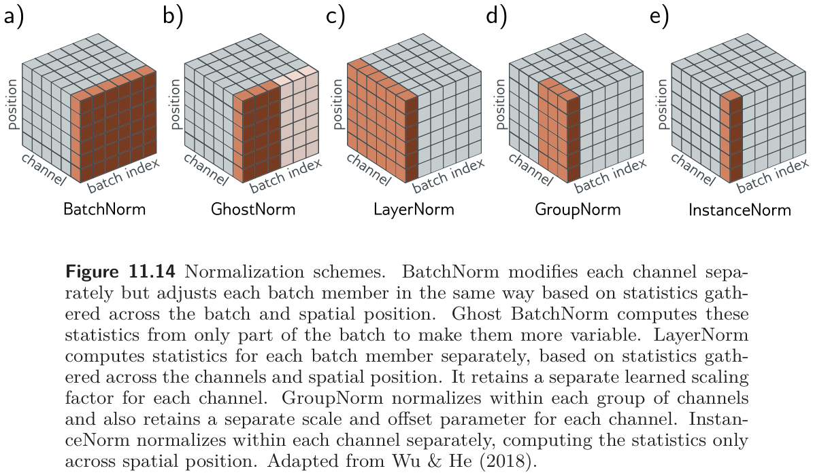{#fig-udl-11-14 width=84%}

### Common residual architectures

*Prince §11.5, pp. 195–199; figures on pp. 196–200.*

**ResNet** (§11.5.1) [@he2016resnet; @he2016identity]. In the standard block a
BatchNorm, a ReLU, and a 3×3 convolution are applied twice before the result is
added back to the input (@fig-udl-11-7**a**). For very deep networks the
**bottleneck block** (@fig-udl-11-7**b**) saves parameters with three
convolutions: a 1×1 that reduces the channel count by a factor of four, a 3×3
on the smaller representation, and a 1×1 that restores the channel count so the
result can be added back. Information is still integrated over a 3×3 region,
at a fraction of the cost. ResNet-200 (@fig-udl-11-8) opens with a 7×7
convolution and a max pool, then stacks bottleneck blocks with periodic
stride-two downsampling and channel doubling (with zero-channel padding or a
1×1 convolution to match sizes across the change), then global average pooling
and a fully connected layer to 1,000 classes. It reached 4.8% top-5 and 20.1%
top-1 error, against 16.4%/38.1% for AlexNet and 6.8%/23.7% for VGG, and was
among the first networks to exceed the estimated human top-5 error of 5.1%.

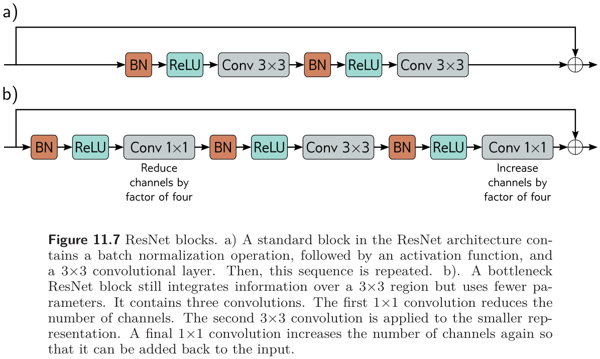{#fig-udl-11-7 width=84%}

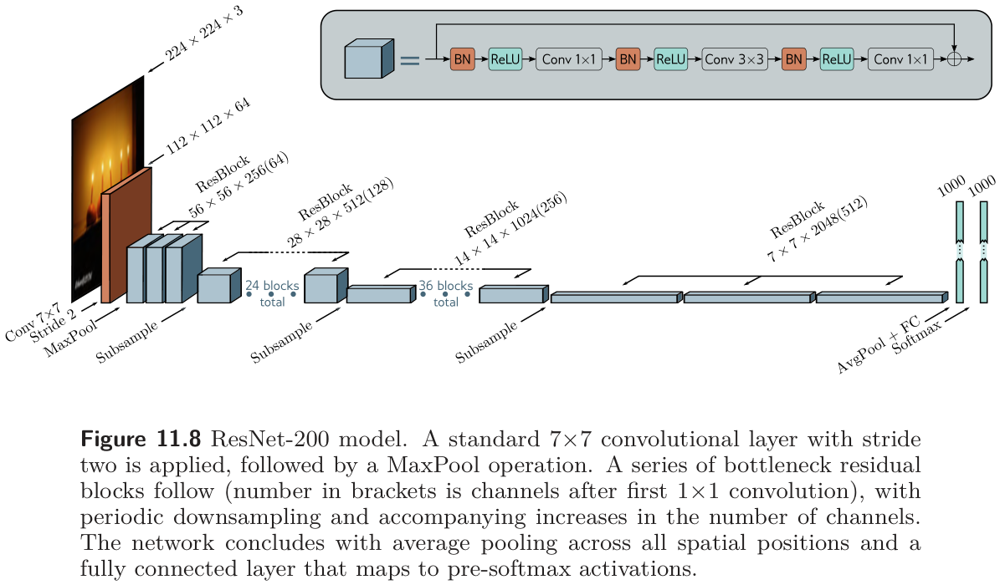{#fig-udl-11-8 width=84%}

```{python}
#| label: resblock-params

def pre_activation(c_in, c_out, k):
    """BatchNorm -> ReLU -> convolution, the order of figure 11.7."""
    return nn.Sequential(nn.BatchNorm2d(c_in), nn.ReLU(), nn.Conv2d(c_in, c_out, k, padding=k // 2))

standard   = nn.Sequential(pre_activation(512, 512, 3), pre_activation(512, 512, 3))
bottleneck = nn.Sequential(pre_activation(512, 128, 1), pre_activation(128, 128, 3), pre_activation(128, 512, 1))

print("problem 11.8, blocks with 512 input and output channels")
print(f"  standard block   (3x3, 3x3)      {n_params(standard):>12,} parameters")
print(f"  bottleneck block (1x1, 3x3, 1x1) {n_params(bottleneck):>12,} parameters   "
      f"({n_params(standard) / n_params(bottleneck):.1f}x fewer)")
```

**DenseNet** (§11.5.2) [@huang2017densenet]. Instead of *adding* the
processed signal to the input, **concatenate** them along the channel
dimension (@fig-udl-11-9). Each layer then receives the outputs of *all*
previous layers, and an optional 1×1 convolution can map the concatenation
back to a smaller size — which lets the network learn to add, to take a
weighted sum, or to combine representations in any other way. The channel
count grows quickly, so 1×1 bottlenecks are inserted, and the concatenation
chain restarts at each downsampling (concatenating representations of
different sizes makes no sense). DenseNet matches or beats ResNet at a
comparable parameter count, presumably because it reuses earlier processing
more flexibly.

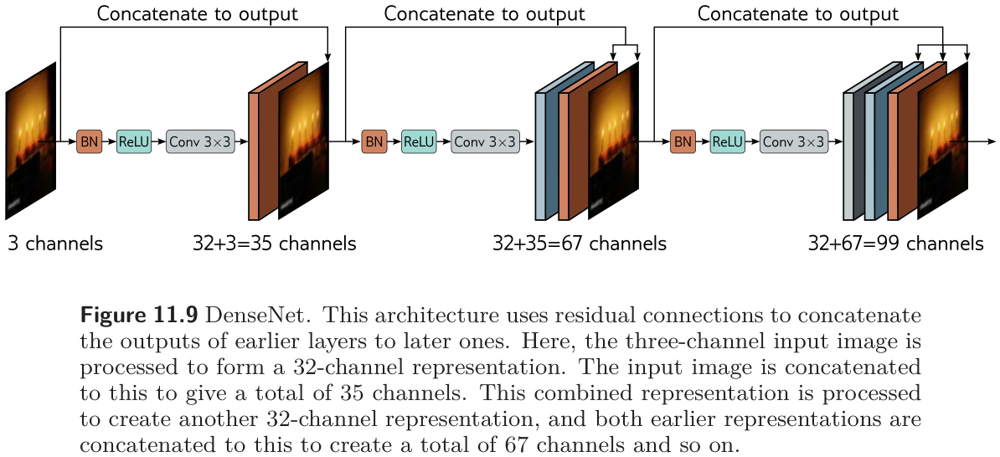{#fig-udl-11-9 width=84%}

**U-Net and hourglass networks** (§11.5.3) [@ronneberger2015]. The
encoder–decoder of @fig-udl-10-19 has a weakness: the low-resolution
representation in the middle must *remember* every high-resolution detail the
decoder will need. Residual connections remove that burden by passing each
scale's last encoder representation to the decoder's first representation at
the same scale (@fig-udl-11-10). The **U-Net** concatenates them, as DenseNet
does. The original used valid convolutions, so each 3×3 layer lost two pixels
and the encoder representations had to be cropped before concatenation; later
versions zero-pad. Because it is entirely convolutional, a trained U-Net runs
on an image of any size. **Hourglass** networks add further convolutions along
the skip connections and *add* the result rather than concatenating; stacked
hourglasses alternate between local and global views and are used for pose
estimation, predicting one heat map per joint (@fig-udl-11-12).

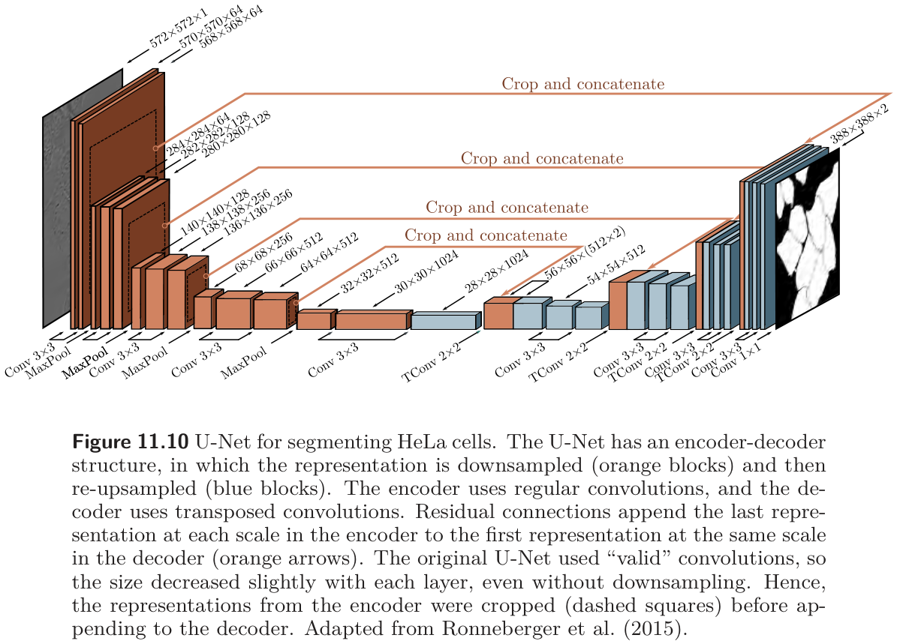{#fig-udl-11-10 width=82%}

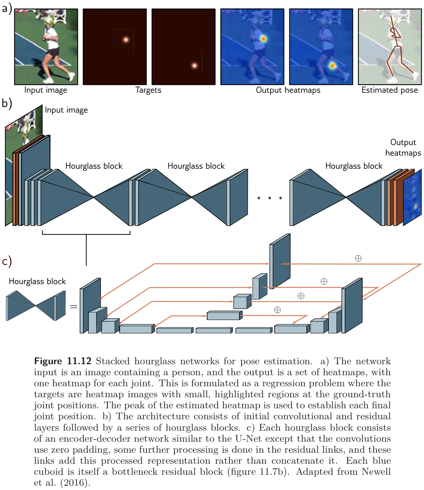{#fig-udl-11-12 width=66%}

::: {.callout-tip}
## U-Nets in this course
U-Net is the single most reused architecture in applied deep learning: medical
segmentation, defect segmentation on production images, depth estimation,
inpainting, and image-to-image translation all use it. It also returns in
Week 15 as the denoiser inside diffusion models.
:::

### Why do residual networks work so well?

*Prince §11.6, p. 199; figure on p. 201.*

ResNets can be extended to 1,000 layers and still train, and the improvement
in classification was first credited to that depth. Two findings complicate
the story. Shallower, *wider* residual networks sometimes beat deeper, narrower
ones with the same parameter count [@zagoruyko2016], and gradients do not
propagate effectively along the very long paths of the unraveled network:
Veit et al. [@veit2016] found that in a 54-block ResNet, almost all gradient
came from paths 5 to 17 blocks long, which are 0.45% of the paths, and that
deleting individual blocks from a trained ResNet barely hurts it, whereas
deleting a layer from VGG is catastrophic. A very deep residual network
behaves more like a combination of shallow networks. The current view is that
residual connections add value of their own, beyond enabling depth: the loss
surface around a minimum is smoother and more predictable with the skip
connections than without them (@fig-udl-11-13), which makes a good, generalizing
solution easier to find.

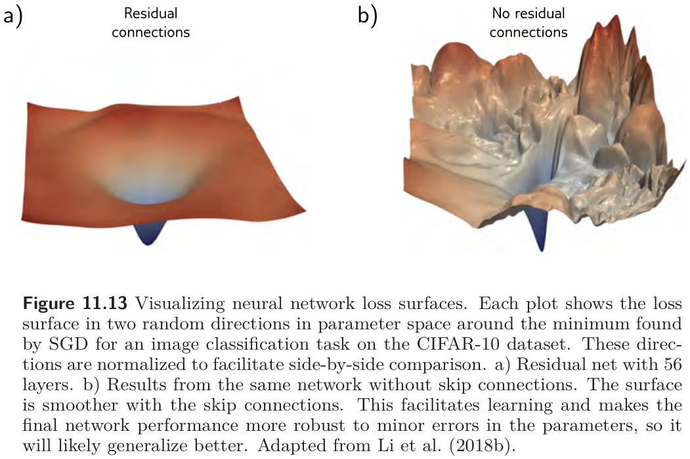{#fig-udl-11-13 width=78%}

## Training a CNN in PyTorch

*Our own section; the recipe of Prince §10.6 and §11.5.1.*

This section shows its code, because the point is the code. The task is a
small industrial one: classify 28×28 grayscale patches from an imaginary
surface-inspection camera as *clean*, *scratch* (a thin bright line at a
random position and angle), or *pit* (a dark blob of random size). The data
are synthetic, so you can regenerate as much as you want, and the model is a
miniature of the recipe above: three convolution–BatchNorm–ReLU stages, max
pooling between the first two, global average pooling, and one linear layer.

```{python}
#| label: fig-defect-data
#| echo: true
#| fig-cap: "Samples from the synthetic inspection dataset: 28×28 patches with brushed-metal noise, labeled clean, scratch, or pit."

def make_defect_images(n, rng, S=28):
    """n patches of size S x S. Class 0: clean; 1: scratch (bright line); 2: pit (dark blob)."""
    yy, xx = np.mgrid[0:S, 0:S]
    X = 0.5 + 0.1 * rng.standard_normal((n, S, S))
    y = rng.integers(0, 3, n)
    for i in range(n):
        if y[i] == 1:
            theta = rng.uniform(0, np.pi)
            cx, cy = rng.uniform(6, S - 6, 2)
            across = np.abs((xx - cx) * np.sin(theta) - (yy - cy) * np.cos(theta))
            along  = np.abs((xx - cx) * np.cos(theta) + (yy - cy) * np.sin(theta))
            X[i][(across < 0.8) & (along < rng.uniform(4, 9))] += 0.3
        elif y[i] == 2:
            cx, cy = rng.uniform(5, S - 5, 2)
            r = rng.uniform(1.2, 2.5)
            X[i] -= 0.35 * np.exp(-((xx - cx) ** 2 + (yy - cy) ** 2) / (2 * r ** 2))
    return torch.tensor(X, dtype=torch.float32).unsqueeze(1), torch.tensor(y)   # (n, 1, S, S)

rng = np.random.default_rng(774)
X_train, Y_train = make_defect_images(3000, rng)
X_test,  Y_test  = make_defect_images(600, rng)
classes = ["clean", "scratch", "pit"]

fig, axes = plt.subplots(1, 8, figsize=(10, 1.7))
for ax, i in zip(axes, range(8)):
    ax.imshow(X_train[i, 0], cmap="gray", vmin=0, vmax=1)
    ax.set_title(classes[Y_train[i]], fontsize=9); ax.set_xticks([]); ax.set_yticks([]); ax.grid(False)
plt.tight_layout()
plt.show()
```

```{python}
#| label: defect-model
#| echo: true

class DefectNet(nn.Module):
    def __init__(self, n_classes=3):
        super().__init__()
        self.features = nn.Sequential(
            nn.Conv2d(1, 16, 3, padding=1),  nn.BatchNorm2d(16), nn.ReLU(), nn.MaxPool2d(2),   # 28x28 -> 14x14
            nn.Conv2d(16, 32, 3, padding=1), nn.BatchNorm2d(32), nn.ReLU(), nn.MaxPool2d(2),   # 14x14 -> 7x7
            nn.Conv2d(32, 64, 3, padding=1), nn.BatchNorm2d(64), nn.ReLU(),
            nn.AdaptiveAvgPool2d(1), nn.Flatten())                                             # 7x7x64 -> 64
        self.classifier = nn.Linear(64, n_classes)

    def forward(self, x):
        return self.classifier(self.features(x))

torch.manual_seed(774)
net = DefectNet()
print(f"DefectNet: {n_params(net):,} parameters\n")

# Trace the shape of one batch through the network, layer by layer.
h = X_train[:2]
print(f"{'layer':20s}{'output shape (batch, channels, height, width)':>50s}")
print(f"{'input':20s}{str(tuple(h.shape)):>50s}")
for layer in net.features:
    h = layer(h)
    if isinstance(layer, (nn.Conv2d, nn.MaxPool2d, nn.AdaptiveAvgPool2d, nn.Flatten)):
        print(f"{type(layer).__name__:20s}{str(tuple(h.shape)):>50s}")
print(f"{'Linear':20s}{str(tuple(net.classifier(h).shape)):>50s}")
```

```{python}
#| label: defect-train
#| echo: true

opt = torch.optim.Adam(net.parameters(), lr=1e-3)
g = torch.Generator().manual_seed(774)

def accuracy(model, X, Y):
    model.eval()                                   # use the frozen BatchNorm statistics
    with torch.no_grad():
        return 100 * (model(X).argmax(1) == Y).float().mean().item()

print(f"{'epoch':>5s}{'train loss':>12s}{'train acc':>11s}{'test acc':>10s}")
for epoch in range(1, 7):
    net.train()                                    # BatchNorm uses batch statistics
    perm, total = torch.randperm(len(X_train), generator=g), 0.0
    for i in range(0, len(X_train), 64):
        idx = perm[i:i + 64]
        loss = F.cross_entropy(net(X_train[idx]), Y_train[idx])
        opt.zero_grad(); loss.backward(); opt.step()
        total += loss.item() * len(idx)
    print(f"{epoch:>5d}{total / len(X_train):>12.3f}{accuracy(net, X_train, Y_train):>10.1f}%{accuracy(net, X_test, Y_test):>9.1f}%")

# Confusion matrix on the test set, and a translation test: shift every test patch by a few pixels.
net.eval()
with torch.no_grad():
    pred = net(X_test).argmax(1)
    shifted_acc = 100 * (net(torch.roll(X_test, shifts=(3, -2), dims=(2, 3))).argmax(1) == Y_test).float().mean().item()
print(f"\n{'true \\ predicted':18s}" + "".join(f"{c:>9s}" for c in classes))
for t, name in enumerate(classes):
    print(f"{name:18s}" + "".join(f"{int(((Y_test == t) & (pred == p)).sum()):>9d}" for p in range(3)))
print(f"\ntest accuracy after shifting every patch by (3, -2) pixels: {shifted_acc:.1f}%")
```

Three things to notice. The shape trace shows the recipe: spatial size 28 → 14
→ 7 → 1 while channels go 1 → 16 → 32 → 64, and global average pooling means
the classifier never sees a position, which is where the translation invariance
of the last line comes from: shifting every test patch by a few pixels costs
only a couple of points of accuracy. The whole network has about 24,000
parameters, fewer than half of the fully connected MNIST-1D network that worked
on a 40-sample input, and it would have the same count on 280×280 patches. And `net.train()` / `net.eval()` matters: BatchNorm
normalizes by batch statistics in one mode and by the frozen training-set
statistics in the other, and evaluating in training mode on a small batch gives
noisy, sometimes wrong, predictions.

## Summary

Convolutional layers compute each hidden unit as a weighted sum of nearby
inputs, plus a bias, through an activation function, with the same weights and
bias at every position. They have far fewer parameters than fully connected
layers, a count that does not grow with the image size, and they are
equivariant to translation, which is the right inductive bias for images — the
MNIST-1D experiment showed a 2,050-parameter convolutional network beating a
59,065-parameter fully connected one that could have imitated it. Several
kernels in parallel give channels; stacked layers grow receptive fields;
stride and pooling halve the spatial size while channels double; a 1×1
convolution changes the channel count; transposed convolutions and unpooling
scale back up when the output is an image. AlexNet, VGG, YOLO, and the
encoder–decoder segmentation network are all this recipe at different depths.

Depth helps, up to a point: beyond it, a sequential network becomes hard to
*train*, plausibly because its gradients shatter. A residual block adds its
input back to its output, which gives every layer a direct path to the loss and
turns the network into an ensemble of shallow paths, at the price of
activations whose variance doubles at every block. Batch normalization
standardizes each unit over the batch and then applies a learned scale and
shift, making the growth linear, smoothing the loss surface enough for larger
learning rates, and adding a little regularizing noise. ResNet, its bottleneck
block, DenseNet's concatenation, and U-Net's skip connections across an
encoder–decoder are the standard ways of putting these pieces together.

**Next:** Chapter 12 replaces the convolution's fixed, local weighted sum with
*self-attention*, a weighted sum whose weights are computed from the data
itself — the transformer, which now also holds the ImageNet records in
@fig-udl-10-21.

---

## Exercises

::: {.callout-note appearance="minimal"}
Problem numbers refer to Prince, Chapter 10 (pp. 184–185) and Chapter 11
(pp. 205–206). Starred UDL problems have published answers on the [UDL
website](https://udlbook.github.io/udlbook/). The computational problems
extend code that is already written for you — start from the [Colab
notebook](https://colab.research.google.com/github/harunpirim/IMSE774-NeuralNetworks/blob/main/notebooks/week10-convolutional-networks.ipynb).
:::

**1. (UDL 10.2, 10.3, 10.4)** Write the equation, in the style of @eq-conv1d,
for a 1D convolution with (a) kernel size three and stride two
(@fig-udl-10-3**a–b**); (b) kernel size three and dilation rate two
(@fig-udl-10-3**d**); (c) kernel size seven, dilation rate three, and stride
three. For (c), use @eq-output-size to find how many outputs a 40-dimensional
input produces, and check against the shape-calculator cell.

**2. (UDL 10.8 and 10.14)** A 1D network's input has three channels. The first
hidden layer uses kernel size three and has four channels; the second uses
kernel size five and has ten channels. How many weights and biases does each
layer need? Then do the same for a 2D layer with a 5×5 kernel, three input
channels, and ten output channels. Confirm with the parameter-count cell.

**3. (UDL 10.9, 10.10, 10.11)** Compute the receptive field at the third
layer of (a) three zero-padded layers of kernel size three and stride one;
(b) the same with kernel size seven; (c) a layer with kernel size five and
stride two, then kernel size three, then kernel size five with dilation two.
Use @eq-receptive-field, then verify (a) and (c) against
@fig-receptive-field.

**4. (UDL 10.12 and 10.16\*)** (a) The network of @fig-udl-10-7 was trained
with batch size 100 on 4,000 examples for 100,000 steps. How many epochs is
that? (b) For AlexNet as drawn in @fig-udl-10-16 (channels 96, 256, 384, 384,
256; fully connected 4,096, 4,096, 1,000; a 13×13×256 representation before
the first fully connected layer), compute the parameters of every layer and
the total. Compare with the torchvision variant in the architecture-table
cell and explain the difference.

**5. (UDL 10.15)** Draw the 1D weight matrix that keeps every other input
(the 1D version of @fig-udl-10-11**a**). Show that the matrix for a
convolution with kernel size three and stride two (@fig-weight-matrices**b**)
is the product of this sampling matrix and the stride-one matrix
(@fig-weight-matrices**a**). What does this say about what a strided
convolution computes and does not compute?

**6.** The MNIST-1D experiment (@fig-mnist1d-conv-vs-fc) shows the fully
connected network reaching lower training error *sooner* and higher test
error. Explain both halves using (a) the "smaller family of plausible
functions" reading and (b) the "infinite penalty" reading of §10.2.7. Then say
which of the four mechanisms in figure 9.14 (Week 9) the convolutional
structure belongs to.

**7. (UDL 11.2 and 11.4\*)** (a) How many paths of each length are there in a
residual network with three blocks? With five? State the rule for $K$ blocks
and check the path-count cell. (b) Explain why the two branches of a residual
block are uncorrelated at initialization, and show that the variance of a sum
of uncorrelated variables is the sum of their variances. Use this to derive the
dashed curves in @fig-variance-growth.

**8. (UDL 11.6 and 11.8)** (a) A fully connected network has one input, one
output, and ten hidden layers of twenty units. Count its parameters, then
count them again with BatchNorm between each linear transformation and ReLU.
(b) Count the parameters of the standard and bottleneck residual blocks of
@fig-udl-11-7 with 512 input and output channels (the bottleneck reduces to
128). Both answers are printed on this page; show the arithmetic.

**9. (UDL 11.7\*)** An L2 penalty is applied to the convolutional weights in
the block of @fig-udl-11-7**a** but not to the $\gamma$ parameters of the
BatchNorm layers that follow them. What do you expect to happen to the weights
and to $\gamma$ as training proceeds, and why does the network's function not
change? Which line of the batchnorm-check cell is the relevant evidence?

**10. (UDL 11.9)** A U-Net is fully convolutional and can be run on an image
of any size after training. Why do we nevertheless not train it on a
collection of arbitrarily sized images? (Think about batches and about
BatchNorm.)

**11. Choosing an architecture.** A line produces 2,000 extruded aluminum
profiles per hour, photographed at 1,024×256 pixels. You must (a) flag
profiles with a surface defect, (b) outline each defect so an operator can see
it, and (c) run on an embedded GPU with little memory. For each of (a) and
(b), say whether the output should be translation-invariant or equivariant,
which architecture family on this page fits, and where downsampling and
upsampling occur. For (c), name two ways to cut the parameter count without
reducing depth.

**12. Computational.** Extend the `fig-receptive-field` cell to 2D: build a
stack of `nn.Conv2d` layers matching the first three layers of AlexNet
(11×11 stride 4; 3×3 max pool stride 2; 5×5), differentiate one central output
unit with respect to the input, and report the receptive field in pixels
(problem 10.17). Then replace the 11×11 layer by three 3×3 layers of stride
one and compare receptive field and parameter count.

**13. Computational.** In the `fig-mnist1d-conv-vs-fc` cell, (a) replace the
three stride-two convolutions by stride-one convolutions with 2×1 max pooling
and compare test error; (b) remove the random placement in `make_mnist1d` so
that every template starts at position 10, retrain both networks, and explain
what happens to the gap between them; (c) add `nn.BatchNorm1d(15)` after each
convolution and report the change in the number of steps to reach 5% training
error.

**14. Computational.** Turn `DefectNet` into a residual network: wrap the
second and third stages as pre-activation residual blocks (BatchNorm → ReLU →
Conv, twice, plus the skip; use a 1×1 convolution on the skip where the
channel count changes), and stack eight such blocks. (a) Train it with and
without the BatchNorm layers inside the blocks and compare training loss after
one epoch. (b) Measure the standard deviation of the activations after each
block at initialization, as in @fig-variance-growth, in both versions.

---

## Textbook Reference Map {#sec-reference-map}

Every part of this page, mapped to Prince, *Understanding Deep Learning*
(MIT Press, 2024) [@prince2024]. Page numbers are those of the printed book.

| This page | Prince section | Pages | Figures used |
|:--|:--|:--:|:--|
| Why Images Need Their Own Layers | Ch. 10 opening | 161 | — |
| Invariance and Equivariance | §10.1 | 161–162 | 10.1 (p. 162) |
| Convolutional Networks for 1D Inputs | §10.2 | 163 | — |
| — The 1D convolution operation | §10.2.1 | 163 | 10.2 (p. 163) |
| — Padding | §10.2.2 | 164 | — |
| — Stride, kernel size, and dilation | §10.2.3 | 164–165 | 10.3 (p. 164) |
| — Convolutional layers | §10.2.4 | 165 | 10.4 (p. 166) |
| — Channels | §10.2.5 | 165–167 | 10.5 (p. 166) |
| — Receptive fields | §10.2.6 | 167 | 10.6 (p. 168) |
| — Example: MNIST-1D | §10.2.7 | 167–170 | 10.7, 10.8 (p. 169) |
| Convolutional Networks for 2D Inputs | §10.3 | 170–171 | 10.9 (p. 171), 10.10 (p. 172) |
| Downsampling and Upsampling | §10.4 | 171 | — |
| — Downsampling | §10.4.1 | 171–172 | 10.11 (p. 173) |
| — Upsampling | §10.4.2; notes | 172–174, 181 | 10.12, 10.13 (p. 173) |
| — Changing the number of channels | §10.4.3 | 174 | 10.14 (p. 175) |
| Applications | §10.5 | 174 | — |
| — Image classification | §10.5.1 | 174–176 | 10.15 (p. 175), 10.16 (p. 176), 10.17 (p. 177) |
| — Object detection | §10.5.2 | 177 | 10.18 (p. 178) |
| — Semantic segmentation | §10.5.3 | 178–179 | 10.19 (p. 179), 10.20 (p. 180) |
| — Where the field went | §10.6; notes | 179–184 | 10.21 (p. 182) |
| Residual Networks | Ch. 11 opening | 186 | — |
| — Sequential processing and its limits | §11.1, §11.1.1 | 186–189 | 11.1 (p. 187), 11.2, 11.3 (p. 188) |
| — Residual connections and residual blocks | §11.2, §11.2.1, §11.2.2 | 189–192 | 11.4 (p. 190), 11.5 (p. 191) |
| — Exploding activations | §11.3 | 192 | 11.6 (p. 193) |
| — Batch normalization | §11.4, §11.4.1; notes | 192–195, 203–204 | 11.14 (p. 204) |
| — Common residual architectures | §11.5.1–§11.5.3 | 195–199 | 11.7, 11.8 (p. 196), 11.9 (p. 197), 11.10 (p. 198), 11.12 (p. 200) |
| — Why residual networks work so well | §11.6; notes | 199, 202 | 11.13 (p. 201) |
| Training a CNN in PyTorch | §10.6, §11.5.1 (recipe) | 179–180, 195 | — |
| Summary | §10.6, §11.7 | 179–180, 199–201 | — |
| Exercises 1–10 | Problems 10.2–10.4, 10.8–10.16, 11.2, 11.4, 11.6–11.9 | 184–185, 205–206 | — |

: {tbl-colwidths="[36,22,16,26]"}

Equations on this page correspond to Prince as follows: @eq-invariance is his
(10.1), @eq-equivariance is (10.2), @eq-conv1d is (10.3), @eq-conv-layer is
(10.4), @eq-fc-layer is (10.5), @eq-conv2d is (10.6), @eq-sequential is
(11.1), @eq-seq-grad is (11.3), @eq-residual is (11.4), @eq-unraveled is
(11.5), @eq-residual-grad is (11.6), @eq-bn-stats is (11.7),
@eq-bn-standardize is (11.8), and @eq-bn-affine is (11.9). Equations
@eq-output-size, @eq-conv-params, and @eq-receptive-field are ours; the first
and third are standard results summarized in Dumoulin & Visin's guide
[@dumoulin2016].

::: {.callout-note appearance="simple"}
## Figure credits
Figures 10.1–10.21, 11.1–11.10, and 11.12–11.14 are reproduced unaltered from Prince,
*Understanding Deep Learning* (MIT Press, 2024), which is distributed under a
Creative Commons CC-BY-NC-ND license, and are used here for non-commercial
classroom instruction. Original sources credited within the figures: panels
c–f of figure 10.1 are adapted from Bousselham et al. (2021); figure 10.15 from
Russakovsky et al. (2015); figure 10.16 depicts AlexNet, Krizhevsky et al.
(2012); figure 10.17 depicts VGG, Simonyan & Zisserman (2014); figure 10.18 is
adapted from Redmon et al. (2016); figures 10.19 and 10.20 from Noh et al.
(2015); figure 10.21 from paperswithcode.com; figure 11.2 from He et al.
(2016a); figure 11.3 from Balduzzi et al. (2017); figure 11.10 from
Ronneberger et al. (2015); figure 11.12 from Newell et al. (2016); figure 11.13
from Li et al. (2018b); and figure 11.14 from Wu & He (2018). All other
figures on this page are generated by the code in this week's notebook.
:::

---

## Further Reading

- Prince, *Understanding Deep Learning*, Chapters 10 and 11 [@prince2024] — the assigned reading. The Chapter 10 notes (pp. 180–184) survey convolution variants, pooling, equivariance to other transformations, and detection and segmentation; the Chapter 11 notes (pp. 201–205) cover why residual connections help, the many normalization schemes, and the alternatives to BatchNorm.
- **[▶ UDL notebooks 10.1–10.5](https://github.com/udlbook/udlbook/tree/main/Notebooks/Chap10)** and **[11.1–11.3](https://github.com/udlbook/udlbook/tree/main/Notebooks/Chap11)** — Prince's own Colab notebooks for these chapters; links to each are at the top of this page.
- **[▶ This week's notebook](https://colab.research.google.com/github/harunpirim/IMSE774-NeuralNetworks/blob/main/notebooks/week10-convolutional-networks.ipynb)** — every cell above, in one Colab file.
- Dumoulin & Visin (2016) [@dumoulin2016] — *A guide to convolution arithmetic for deep learning*: every padding, stride, dilation, and transposed-convolution case with animations; the source of @eq-output-size.
- LeCun et al. (1998) [@lecun1998] — LeNet, the recognizable ancestor of every network on this page; Krizhevsky, Sutskever & Hinton (2012) [@krizhevsky2012] — AlexNet; Simonyan & Zisserman (2015) [@simonyan2015] — VGG.
- Redmon et al. (2016) [@redmon2016] — YOLO; Noh, Hong & Han (2015) [@noh2015] — the deconvolution segmentation network of figure 10.19; Ronneberger, Fischer & Brox (2015) [@ronneberger2015] — U-Net.
- He et al. (2016) [@he2016resnet] — the ResNet paper; He et al. (2016) [@he2016identity] — the pre-activation block of figure 11.7 and ResNet-200; Huang et al. (2017) [@huang2017densenet] — DenseNet.
- Balduzzi et al. (2017) [@balduzzi2017] — the shattered gradients paper behind figure 11.3; Veit, Wilber & Belongie (2016) [@veit2016] — residual networks as ensembles of shallow paths; Li et al. (2018) [@li2018visualizing] — the loss-surface visualizations of figure 11.13.
- Ioffe & Szegedy (2015) [@ioffe2015] — batch normalization; Santurkar et al. (2018) [@santurkar2018] — why it actually helps (smoothing, not covariate shift); Wu & He (2018) [@wu2018groupnorm] — GroupNorm and the comparison of figure 11.14.
- Zagoruyko & Komodakis (2016) [@zagoruyko2016] — wide residual networks, evidence that width can substitute for depth.
- Zhang (2019) [@zhang2019blur] — how far CNNs really are from shift-invariant, and the anti-aliased pooling that fixes it.
