::: {.lecture-meta}
**Reading** Glassner, *Deep Learning: A Visual Approach*, Chapter 20 (pp. 565–599) &nbsp;·&nbsp;
**Also** Prince, *Understanding Deep Learning*, Chapter 12 (pp. 207–239) &nbsp;·&nbsp;
**Due** Presentation paper selection, Thursday, November 5
:::

::: {.callout-note appearance="simple"}
## How to read the references in these notes
This week is taught from Chapter 20 of Glassner, *Deep Learning: A Visual
Approach* (No Starch Press, 2021) [@glassner2021]. Glassner does not number his
sections, so every section below opens with the section *title* and the printed
page range it covers. Where Prince, *Understanding Deep Learning* [@prince2024]
treats the same idea with the mathematics written out, his section number is
given too. Figures taken from Glassner are captioned with their original figure
number and page; figures generated by the code behind this page are ours. A
complete cross-reference table appears in @sec-reference-map, and
@sec-departures lists the few places where these notes correct or sharpen the
chapter.
:::

## Learning Objectives

By the end of this session you should be able to:

1. Explain what a **word embedding** is, why arithmetic on embeddings is meaningful, and why a single vector per word fails for words such as *train*.
2. State the two drawbacks of recurrent networks that attention removes.
3. Map the paint-store analogy onto **query**, **key**, and **value**, and write the four steps of **self-attention**.
4. Distinguish self-attention from **Q/KV (encoder-decoder) attention**, and say what **multi-head attention** adds.
5. Explain what **skip connections**, **layer normalization**, and **positional encoding** each contribute to a transformer, and why the position information survives many layers.
6. Draw the **encoder block** and the **decoder block**, and explain what **masking** hides and why training needs it.
7. Say how **BERT** and **GPT-2** are built from those blocks, what each is trained to do, and what zero-shot, few-shot, temperature, and beam search mean.
8. Implement self-attention in a dozen lines of PyTorch and check it against the library.
9. Describe two risks of large text generators that the chapter raises: inherited bias and **data poisoning**.

::: {.callout-tip}
## Two companions to this page

- **[▶ From CNNs to Transformers — the interactive walkthrough](https://harunpirim.github.io/IMSE774-NeuralNetworks/interactive/from-cnns-to-transformers.html)** — eleven timed steps with live figures: drag a query against four keys, step through self-attention on a nine-word sentence with every number shown, shuffle the sentence to watch word order disappear, and switch a causal mask on and off. It runs in the browser with nothing to install.
- **[▶ Open the Week 11 notebook in Google Colab](https://colab.research.google.com/github/harunpirim/IMSE774-NeuralNetworks/blob/main/notebooks/week11-transformers.ipynb)** — every code cell behind this page, in order.

Colab gives you a Python environment with NumPy, matplotlib, and PyTorch
already installed. In Colab, run a cell with **Shift+Enter**.
:::

```{python}
#| label: setup
#| code-fold: true
#| code-summary: "Plotting setup (click to expand)"

import math
import numpy as np
import matplotlib.pyplot as plt
from matplotlib.colors import LinearSegmentedColormap
import torch
import torch.nn as nn
import torch.nn.functional as F

torch.manual_seed(774)
np.random.seed(774)

plt.rcParams.update({
    "figure.figsize": (7, 4),
    "figure.dpi": 130,
    "axes.spines.top": False,
    "axes.spines.right": False,
    "axes.grid": True,
    "grid.alpha": 0.25,
    "font.size": 10,
    "axes.titlesize": 11,
    "axes.labelsize": 10,
    "legend.frameon": False,
})

NDSU_GREEN = "#005643"
NDSU_GOLD  = "#FFC72C"
ACCENT     = "#C1121F"
STEEL      = "#1864AB"

# One hue for magnitudes, two hues around a neutral midpoint for signed values.
SEQ = LinearSegmentedColormap.from_list("seq", ["#ffffff", NDSU_GREEN])
DIV = LinearSegmentedColormap.from_list("div", [STEEL, "#f3f3f3", ACCENT])
```

---

## Why Leave Recurrent Networks Behind

*Glassner, chapter opening, pp. 565–566. Prince §12.1, pp. 207–208.*

Chapter 19 of Glassner handles sequences with recurrent networks (RNNs). An RNN
reads a sentence one token at a time and keeps a running summary of what it has
seen in a fixed-size state, the **context vector**. Chapter 20 opens by naming
two drawbacks of that design.

The first is a bottleneck. Everything the network knows about the input has to
fit in one piece of state memory, so the cell must work hard to compress, and
however large we make the state there is always a longer input that overflows
it. Something gets lost. The second is speed. An RNN is trained and used one
word at a time, and step $t$ cannot start until step $t-1$ has finished.

Attention removes both. An attention network has no state memory, and it
processes all the words of a sentence at the same time. Stacks of attention
networks are called **transformers**, and the same building blocks give the
language models of @sec-bert-gpt.

::: {.callout-note}
## If you have not met RNNs
This course followed Prince, who does not give RNNs a chapter. The three facts
above are all you need for this week. Step 3 of the
[interactive walkthrough](https://harunpirim.github.io/IMSE774-NeuralNetworks/interactive/from-cnns-to-transformers.html#rnn)
shows the recurrence and lets you watch a signal fade over twenty steps.
:::

## Embedding

*Glassner, "Embedding", pp. 566–568; figures on pp. 567–568.*

Before attention can compare words, the words need a representation that can be
compared. A single integer per word will not do: nothing about the numbers
1,003 and 1,004 says whether the two words are related. The fix is to give each
word a list of numbers, a point in space, arranged so that similar words are
near each other. This is a **word embedding** (a **token embedding** when the
units are tokens, not whole words).

Glassner introduces the idea with a story. You are an animal wrangler, and a
film director wants animals for a chase scene. Your office sends a chart of the
available animals, laid out by top speed horizontally and adult weight
vertically, but the axis labels were lost in printing. The director asks for
horses, then complains they are too twitchy: "Give me horses that are less
fox-like." You can satisfy that request with nothing but arrows. Draw an arrow
from the corner of the chart to the horse and another to the fox, subtract the
second from the first, and see where you land (@fig-dlva-20-3).

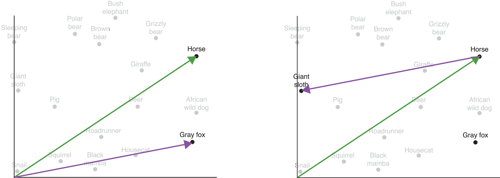{#fig-dlva-20-3 width=95%}

The director now wants the sloths faster, "like roadrunners", so you add the
roadrunner arrow and arrive at a brown bear (@fig-dlva-20-4). In symbols,
horse − fox + roadrunner = brown bear.

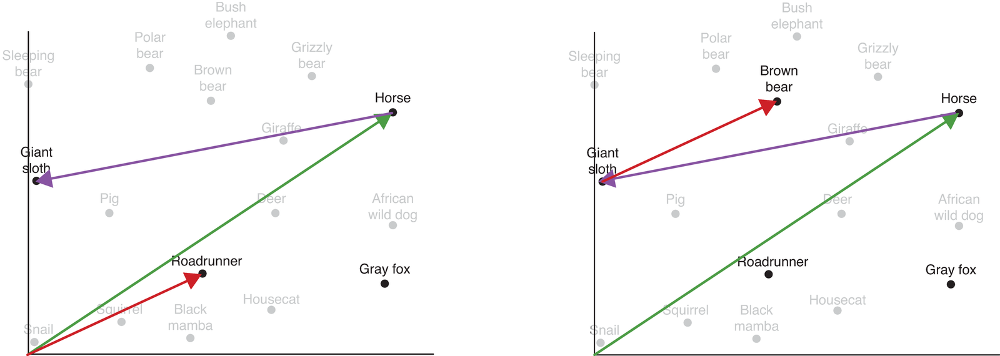{#fig-dlva-20-4 width=95%}

Glassner draws two lessons (p. 568). The layout of the chart was useful even
though we never knew what the axes meant. And we never needed to know: we
navigated by adding and subtracting arrows that point at the items themselves,
and their attributes came along implicitly.

### Embedding words

*Glassner, "Embedding Words", pp. 569–571; figure on p. 570.*

Replace the animals with words and the two axes with several hundred. An
algorithm called an **embedder** decides what each axis should mean while it
places every word, using only how the words are used. If it sees many sentences
beginning *I just drank some*, whatever comes next is placed near other drinks.
With hundreds of dimensions a word can sit in many clusters at once.

Glassner tests a pretrained embedding of 684,754 words in 300 dimensions
(p. 569). The famous case works: king − man + woman returns *queen*. Others
are near misses. lemon − yellow + green returns *ginger*, with *lime* fifth;
trumpet − valves + slide returns *saxophone*, with *trombone* second. The near
misses are the point of a second benefit: a language model that predicts a
vector slightly off target still lands on a sensible word. Asked to finish
*The dragon approached and let out a mighty*, it may give *bellow* in place of
*roar*, and is unlikely to give *daffodil* (p. 570).

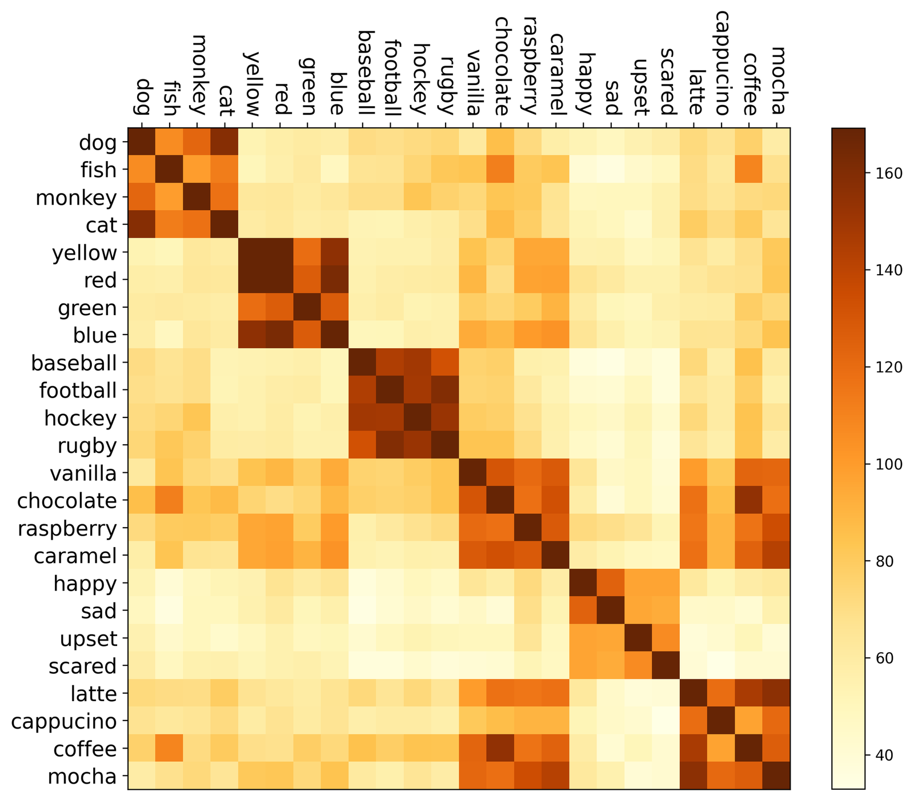{#fig-dlva-20-5 width=66%}

Pretrained embeddings are free to download. The two that most projects used
are word2vec [@mikolov2013] and GloVe [@pennington2014].

How can an algorithm find the axes with no labels? @fig-toy-embedding does it
on the smallest example we could write. We generate 2,400 four-word "sentences"
about eight people. Each person appears with a pronoun, a place word, and an
age word, for instance *queen she throne wise*. We count how often each person
appears with each context word, reweight the counts, and compress each row to
three numbers. Nothing tells the method that gender, rank, or age exist.

```{python}
#| label: fig-toy-embedding
#| fig-cap: "An embedding learned from co-occurrence counts alone. Left: the three coordinates the method assigns to each of eight words. Each column separates the words by one attribute; the column names are ours, attached after looking at which words each coordinate splits. Right: two of the three coordinates for the four older people (the younger four sit almost on top of them in this view, because they differ only in the age coordinate). The arrow from *man* to *king* is the same as the arrow from *woman* to *queen*, which is why king − man + woman lands on queen."

people = {"king": ("he", "royal", "old"),      "queen": ("she", "royal", "old"),
          "prince": ("he", "royal", "young"),  "princess": ("she", "royal", "young"),
          "man": ("he", "common", "old"),      "woman": ("she", "common", "old"),
          "boy": ("he", "common", "young"),    "girl": ("she", "common", "young")}
context = {"royal": ["crown", "throne", "palace"], "common": ["village", "farm", "market"],
           "old": ["wise", "grey"],                 "young": ["small", "plays"]}

# 300 four-word sentences per person: the word, a pronoun, a place word, an age word.
rng = np.random.default_rng(774)
sentences = [[w, pron, rng.choice(context[rank]), rng.choice(context[age])]
             for w, (pron, rank, age) in people.items() for _ in range(300)]

words = list(people)
context_words = sorted({t for s in sentences for t in s[1:]})
counts = np.array([[sum(c in s for s in sentences if s[0] == w) for c in context_words]
                   for w in words], dtype=float)

# Positive pointwise mutual information, then keep the three strongest directions.
P = counts / counts.sum()
ppmi = np.maximum(np.log(np.maximum(P, 1e-12) / (P.sum(1, keepdims=True) * P.sum(0, keepdims=True))), 0)
U, S, _ = np.linalg.svd(ppmi - ppmi.mean(0))
E = U[:, :3] * S[:3]                      # one 3-number embedding per word
emb = dict(zip(words, E))

# Name each coordinate by the attribute it separates (done after the fact, by us).
attrs = {"gender": [p[0] == "she" for p in people.values()],
         "rank":   [p[1] == "royal" for p in people.values()],
         "age":    [p[2] == "old" for p in people.values()]}
name_of = {}
for name, flags in attrs.items():
    f = np.array(flags, dtype=float)
    name_of[int(np.argmax([abs(np.corrcoef(f, E[:, j])[0, 1]) for j in range(3)]))] = name
col = {v: k for k, v in name_of.items()}

fig, axes = plt.subplots(1, 2, figsize=(9.2, 3.7), gridspec_kw={"width_ratios": [1, 1.3]})
ax = axes[0]
ax.imshow(E, cmap=DIV, vmin=-1, vmax=1, aspect="auto")
ax.set_xticks(range(3), [name_of.get(j, f"coordinate {j+1}") for j in range(3)])
ax.set_yticks(range(len(words)), words)
for i in range(len(words)):
    for j in range(3):
        ax.text(j, i, f"{E[i, j]:+.2f}", ha="center", va="center", fontsize=8.5,
                color="white" if abs(E[i, j]) > 0.6 else "black")
ax.grid(False)
ax.set_title("Learned coordinates")

ax = axes[1]
gx, ry = col["gender"], col["rank"]
adults = ["king", "queen", "man", "woman"]   # the younger four differ only in the age coordinate, not drawn here
ax.scatter([emb[w][gx] for w in adults], [emb[w][ry] for w in adults], s=42, color=NDSU_GREEN, zorder=3)
for w in adults:
    ax.annotate(w, emb[w][[gx, ry]], xytext=(9, -3), textcoords="offset points", fontsize=10)
for a, b in [("man", "king"), ("woman", "queen")]:
    ax.annotate("", xy=emb[b][[gx, ry]], xytext=emb[a][[gx, ry]],
                arrowprops=dict(arrowstyle="->", color=ACCENT, lw=1.8))
ax.set_xlabel("gender coordinate"); ax.set_ylabel("rank coordinate")
ax.set_title("Same arrow, two starting points")
ax.margins(0.22)
plt.tight_layout()
plt.show()
```

```{python}
#| label: word-arithmetic

def nearest(v, exclude):
    candidates = [w for w in words if w not in exclude]
    sims = [v @ emb[w] / (np.linalg.norm(v) * np.linalg.norm(emb[w])) for w in candidates]
    order = np.argsort(sims)[::-1]
    return [(candidates[i], sims[i]) for i in order[:2]]

print(f"{'expression':28s}  nearest word (cosine)   runner-up")
for a, b, c in [("king", "man", "woman"), ("prince", "boy", "girl"),
                ("king", "prince", "princess"), ("woman", "queen", "king")]:
    (w1, s1), (w2, s2) = nearest(emb[a] - emb[b] + emb[c], exclude=(a, b, c))
    print(f"{a + ' - ' + b + ' + ' + c:28s}  {w1:9s} ({s1:+.2f})       {w2} ({s2:+.2f})")
```

The method recovers one coordinate per attribute and the arithmetic works. A
real embedder does the same thing with a neural network, billions of words, and
hundreds of coordinates that do not line up with tidy named attributes.

### Contextual embeddings: ELMo

*Glassner, "ELMo", pp. 571–574; figure on p. 573.*

One vector per word has a problem with words that are spelled alike and mean
different things. *Train* is a vehicle in "I rode on a train" and an action in
"I like to train dogs". A manufacturing engineer meets the same thing daily:
*press*, *die*, *mill*, and *lead* each name both a thing and something else.
Handling this takes two steps: give each meaning its own embedding, and pick
the right one for each occurrence. Both need the surrounding words.

**ELMo**, Embeddings from Language Models [@peters2018], was the first system
to do this at scale. It runs a two-layer RNN forward over the sentence and
another backward, and concatenates what the two produce at each word. The
result is a **contextualized word embedding**: a vector for this word in this
sentence. @fig-dlva-20-8 shows it working.

{#fig-dlva-20-8 width=64%}

An embedding stage is normally the first layer of a language network. Embedders
such as ELMo are trained on general text and then **fine-tuned** on text from
the field where they will be used, such as medicine or law, so that the
specialised vocabulary of that field is placed sensibly (p. 574).

ELMo still depends on RNNs. The rest of the chapter gets context a different
way, and in a transformer the attention layers themselves do the job ELMo did:
they turn one-vector-per-word inputs into vectors that depend on the sentence.

## Attention

*Glassner, "Attention", p. 574. Prince §12.1, p. 208.*

Take the sentence *I saw a big dog eat his dinner* (p. 574). To translate
*dog* we do not need *saw*. To translate the pronoun *his* correctly we may
need *big dog*. Not every word matters to every other word. If, for each word,
we could work out which other words influence it, we could focus on those and
ignore the rest, and if we could do that without reading the words in order we
could do it for all the words in parallel. The algorithm that does this is
**attention** [@bahdanau2015].

### The paint-store analogy

*Glassner, "A Motivating Analogy", pp. 574–575; figure on p. 575.*

You need paint, and all you have is a description: "light yellow with a bit of
dark orange". The clerk suggests comparing that description with the name on
every can in the shop, and pouring into an empty can an amount of each paint
that depends on how well its name matches.

{#fig-dlva-20-10 width=100%}

Three things are in play: your **request**, the **description** on each can,
and the **content** of each can. Compare the request with every description;
the better the match, the more of that content goes into the result. That is
attention. The standard names come from databases:

| In the paint store | In attention | What it is |
|:--|:--|:--|
| Your request | **Query** | What is being looked for |
| The name on a can | **Key** | What each item offers for matching |
| The paint in the can | **Value** | What is handed over if the item is chosen |

: The three roles in attention (Glassner, p. 575). Together they are called QKV. {tbl-colwidths="[30,20,50]"}

@fig-paint puts numbers on the story. The request and the six names become
vectors that count their words, the score of each can is the dot product of
its name vector with the request vector, a softmax turns the six scores into
weights that sum to one, and the result is the weighted average of the six
paint colours.

```{python}
#| label: fig-paint
#| fig-cap: "The paint store, computed. Each bar is the softmax weight a can receives; the swatch on the right is the weighted average of the six paints. The two cans whose names share a colour word with the request take most of the weight, *Lunch with Teal* gets some for the word *with*, and the three cans with no shared word still get a little: a softmax never returns exactly zero."

cans = ["Sunny Yellow", "Purple Lollipop", "Green Monster", "Orange Crush", "Lunch with Teal", "Mellow Blue"]
paint = np.array([[1.00, 0.84, 0.00], [0.58, 0.25, 0.75], [0.20, 0.65, 0.25],
                  [1.00, 0.50, 0.05], [0.00, 0.60, 0.60], [0.35, 0.50, 0.85]])   # values (RGB)
request = "light yellow with a bit of dark orange"

vocab = sorted(set(request.split()) | {w.lower() for c in cans for w in c.split()})
colour_words = {"yellow", "orange", "purple", "green", "teal", "blue"}
# Query: the request's words, colour words counting double the others.
q = np.array([(1.0 if w in colour_words else 0.5) if w in request.split() else 0.0 for w in vocab])
# Keys: which words appear in each can's name.
K = np.array([[1.0 if w in c.lower().split() else 0.0 for w in vocab] for c in cans])

scores  = K @ q                                         # one dot product per can
weights = np.exp(3 * scores) / np.exp(3 * scores).sum() # softmax (sharpness 3)
mix     = weights @ paint                               # weighted average of the values

fig, axes = plt.subplots(1, 2, figsize=(8.6, 3.0), gridspec_kw={"width_ratios": [4, 1]})
ax = axes[0]
ax.barh(range(6), weights, color=paint, edgecolor="#333333", linewidth=0.8)
ax.set_yticks(range(6), cans); ax.invert_yaxis()
for i, (s, w) in enumerate(zip(scores, weights)):
    ax.text(w + 0.01, i, f"{w:.1%}   (score {s:.1f})", va="center", fontsize=9)
ax.set_xlim(0, 0.62); ax.set_xlabel("attention weight")
ax.set_title(f'Request: "{request}"'); ax.grid(axis="y", visible=False)
ax = axes[1]
ax.imshow(mix.reshape(1, 1, 3)); ax.set_xticks([]); ax.set_yticks([]); ax.grid(False)
ax.set_title("Mixture")
plt.tight_layout()
plt.show()
```

### Self-attention

*Glassner, "Self-Attention", pp. 576–579; figures on pp. 576–577. Prince §12.2, pp. 208–213.*

Now apply the idea to a sentence. @fig-dlva-20-11 shows one comparison. Three
small networks, usually a single fully connected layer each, turn a word's
embedding into its query, its key, and its value. To work out how much *dinner*
matters to *dog*, we score the query of *dog* against the key of *dinner* and
use the score to scale the value of *dinner*.

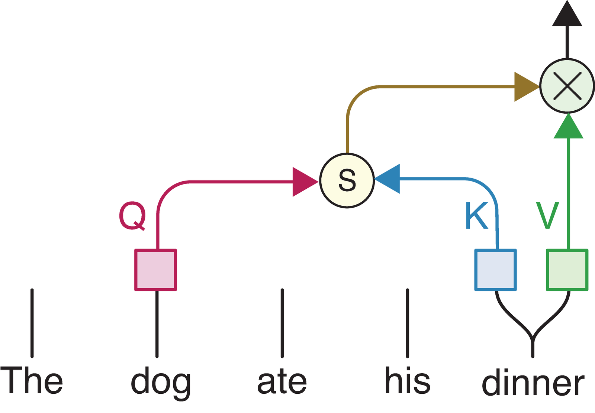{#fig-dlva-20-11 width=62%}

@fig-dlva-20-12 does the same for all five words and adds up the scaled
values. The sum is the new representation of *dog*.

{#fig-dlva-20-12 width=62%}

Glassner makes five points about this picture (pp. 577–578).

1. **Only three networks exist**, one each for queries, keys, and values. The same three are applied to every word.
2. **The scores are normalised.** A softmax is applied across the scores, so the weights are positive, sum to one, and exaggerate the best matches.
3. **A word may attend to itself**, and often gives itself the highest score. Other words win when order changes between languages, when a word has no direct translation, or when a pronoun must be resolved.
4. **Every word is a query at once.** The picture is repeated for each of the five words, independently.
5. **The whole computation is four parallel steps**, whatever the length of the sentence: (1) transform the inputs into queries, keys, and values; (2) score every query against every key; (3) use the scores to scale the values; (4) add up the scaled values.

Because the queries, keys, and values all come from the same inputs, this is
**self-attention**: the sentence is working out how much attention to pay to
itself. The input is a list of word vectors and the output is a list of the
same shape, so attention layers can be stacked.

Write the $N$ input vectors as the rows of a matrix $\mathbf{X}$, and the three
small networks as matrices. The four steps become one line:

$$
\mathbf{Q} = \mathbf{X}\boldsymbol{\Omega}_q, \quad
\mathbf{K} = \mathbf{X}\boldsymbol{\Omega}_k, \quad
\mathbf{V} = \mathbf{X}\boldsymbol{\Omega}_v, \qquad
\text{Sa}[\mathbf{X}] = \text{Softmax}\!\left[\frac{\mathbf{Q}\mathbf{K}^{T}}{\sqrt{D}}\right]\mathbf{V}.
$$ {#eq-attention}

Row $i$ of $\mathbf{Q}\mathbf{K}^T$ holds the scores of word $i$'s query
against all $N$ keys, the softmax acts on each row, and $D$ is the length of
the query and key vectors.

::: {.callout-note}
## Notation
Rows are words here, as in PyTorch and in Vaswani et al. Prince stores words as
*columns*, so his version of @eq-attention is the transpose:
$\text{Sa}[\mathbf{X}] = \mathbf{V}\cdot\text{Softmax}[\mathbf{K}^T\mathbf{Q}/\sqrt{D_q}]$
(his equation 12.9, p. 214).
:::

::: {.callout-important}
## What the scoring function is
Glassner keeps the mathematics out of sight and describes the score as a number
between 0 and 1 (pp. 576, 579). In a transformer the score is a **dot
product**, which can be any real number, positive or negative. It is the
softmax that turns a row of scores into weights between 0 and 1. The "division"
he mentions on p. 577 is the $\sqrt{D}$ in @eq-attention, and it is applied
before the softmax, not after. It keeps the scores from growing with the
vector length; without it the softmax saturates and its gradients vanish
(Prince §12.3.2, p. 214).
:::

Now the value of embeddings is clear (p. 579). If words were numbered by their
order of first appearance in a book, *keep* and *flint* might be 1,003 and
1,004 and would look alike to any scoring function. Embeddings place *keep*
near *retain* and *hold*, and the query and key networks fine-tune that
placement for the comparison at hand.

Here is @eq-attention in PyTorch. The steps in the comments are Glassner's
four.

```{python}
#| label: attention-from-scratch
#| echo: true

class SelfAttention(nn.Module):
    def __init__(self, D):
        super().__init__()
        self.q = nn.Linear(D, D, bias=False)    # input -> query
        self.k = nn.Linear(D, D, bias=False)    # input -> key
        self.v = nn.Linear(D, D, bias=False)    # input -> value

    def forward(self, X, causal=False):                  # X: (N, D), one word per row
        Q, K, V = self.q(X), self.k(X), self.v(X)        # step 1: queries, keys, values
        S = Q @ K.T / math.sqrt(X.shape[-1])              # step 2: score every query against every key
        if causal:                                        # (masking, used later in this note)
            S = S.masked_fill(torch.ones_like(S).triu(1).bool(), float("-inf"))
        A = F.softmax(S, dim=-1)                          # each row of A sums to 1
        return A @ V, A                                   # steps 3-4: scale the values and add them up

torch.manual_seed(774)
X = torch.randn(5, 16)                 # five "words", each a vector of 16 numbers
layer = SelfAttention(16)
out, A = layer(X)

reference = F.scaled_dot_product_attention(layer.q(X), layer.k(X), layer.v(X))
print("output shape:           ", tuple(out.shape))
print("row sums of A:          ", [round(s, 4) for s in A.sum(-1).tolist()])
print("largest gap from PyTorch:", f"{(out - reference).abs().max().item():.1e}")
```

Five words in, five words out, each row of weights summing to one, and the
result agrees with PyTorch's own `scaled_dot_product_attention`.

### Q/KV attention

*Glassner, "Q/KV Attention", pp. 579–580; figure on p. 580. Prince §12.8, pp. 226–227.*

In the paint store the request came from you and the keys and values belonged
to the shop. Attention can be wired the same way: queries from one source, keys
and values from another. Glassner calls this a **Q/KV** layer; it is also
called **encoder-decoder attention** or cross-attention.

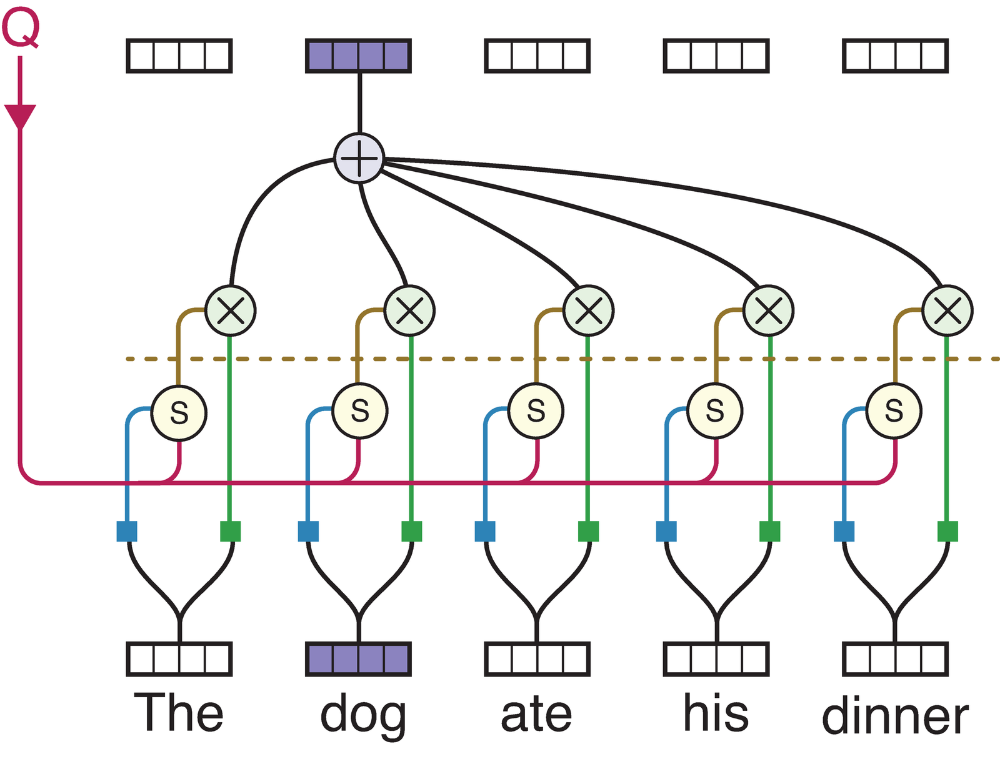{#fig-dlva-20-14 width=62%}

::: {.callout-important}
## Which side supplies the query
The sentence on p. 579 says the queries come from the encoder and the keys and
values from the decoder. It is the other way round, as Glassner's own
figure 20-23 and his text on p. 586 have it: in a transformer the **decoder**
supplies the queries and the **encoder** supplies the keys and values. The
decoder is the customer; the encoded input sentence is the shop.
:::

### Multi-head attention

*Glassner, "Multi-Head Attention", pp. 580–581; figure on p. 581. Prince §12.3.3, pp. 214–215.*

Attention finds words that are alike and mixes them, but alike in what sense?
A lyricist wants words with similar meaning, the same final sound, the same
number of syllables, and the same stress pattern, all at once (p. 580). No
single scoring network can serve every criterion.

The answer is to run several attention networks side by side. Each is a
**head**. The heads are initialised independently, and the hope is that
training makes each one compare the inputs by a different, useful criterion.
Their outputs are joined into one list and passed through a single fully
connected layer so that the output has the same shape as the input
(@fig-dlva-20-15).

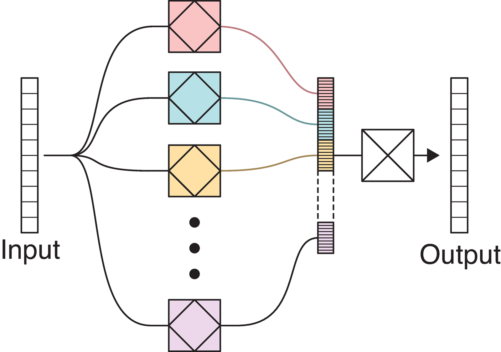{#fig-dlva-20-15 width=58%}

In practice each of $H$ heads works with queries, keys, and values of length
$D/H$, so that $H$ heads cost about the same as one full-width head (Prince
§12.3.3). The original transformer used $H = 8$ with $D = 512$.

## Three More Ingredients

*Glassner, "Transformers", pp. 581–582.*

The goal is a translator built from attention with no recurrent cells. That
model appeared in "Attention Is All You Need" [@vaswani2017], whose authors
called it a **transformer**. Glassner covers three more ideas before
assembling one.

### Skip connections

*Glassner, "Skip Connections", pp. 582–583; figure on p. 582. Prince §11.2, pp. 189–192.*

You met these in Week 10 as
[residual connections](10-convolutional-networks.qmd#residual-connections-and-residual-blocks).
Glassner's analogy is a finished portrait whose subject wishes they had worn a
different ring. You could repaint the whole canvas, or you could paint the new
ring over the old one. A layer with a skip connection takes the second option:
it computes only the change, and the change is added to the layer's input
(@fig-dlva-20-17).

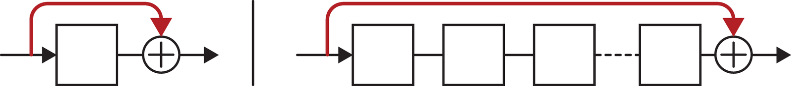{#fig-dlva-20-17 width=92%}

The layer has less to do, and gradients flow more easily through deep stacks.
Transformers have a third reason to use skip connections, which arrives with
positional encoding below.

### Norm-add

*Glassner, "Norm-Add", pp. 583–584; figure on p. 583. Prince §12.4, pp. 215–216.*

Transformers apply **layer normalization** [@ba2016] around every sublayer. For
each word vector $\mathbf{x}$ separately, it subtracts the mean of that
vector's $D$ entries and divides by their standard deviation, then applies a
learned scale and shift:

$$
\text{LayerNorm}[\mathbf{x}] = \boldsymbol{\gamma} \odot \frac{\mathbf{x} - m_{\mathbf{x}}}{s_{\mathbf{x}}} + \boldsymbol{\delta},
\qquad m_{\mathbf{x}} = \frac{1}{D}\sum_{d=1}^{D} x_d, \quad s_{\mathbf{x}}^2 = \frac{1}{D}\sum_{d=1}^{D} (x_d - m_{\mathbf{x}})^2 .
$$ {#eq-layernorm}

It keeps the values flowing through the network from growing or shrinking. It
is the cousin of the batch normalization of Week 10, with one difference that
matters here: the statistics come from one word vector, not from a batch, so
the operation behaves the same for any batch size and any sentence length.

Because the normalization and the addition of the skip connection always come
as a pair, Glassner draws them as one icon and calls the pair **norm-add**
(@fig-dlva-20-18).

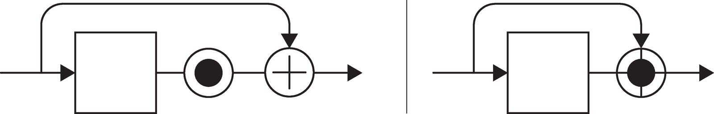{#fig-dlva-20-18 width=84%}

There is freedom in where the normalization goes. Glassner draws it just
before the addition. The original paper, and Prince's equation 12.13, add
first and normalize the sum. Many current models normalize the input of each
sublayer instead. Glassner's judgement is that the choices are comparable in
practice (p. 584), and the code on this page uses the original order.

### Positional encoding

*Glassner, "Positional Encoding", pp. 584–585; figures on pp. 584–585. Prince §12.3.1, pp. 213–214.*

Removing the RNN removes something we were getting for free. An RNN receives
the words one at a time, so it always knows their order. @eq-attention has no
such knowledge: every word is scored against every other, and nothing says
which came first.

The fix is to write each word's position into the word's own representation.
Glassner rejects the obvious way, appending a few bits that hold the index
(left of @fig-dlva-20-19): any fixed number of bits is too few for some
sentence and wasteful for the rest. The better way is a function that turns
each index into a vector as long as the embedding, 128 numbers in his example,
which is then **added** to the embedding (middle of @fig-dlva-20-19). This is
a **positional embedding**.

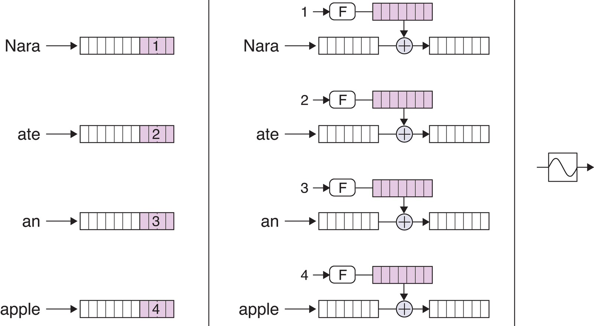{#fig-dlva-20-19 width=80%}

The sine wave on the icon is the function of the original paper. Position $p$
gets the vector with entries

$$
P_{p,\,2i} = \sin\!\left(\frac{p}{10000^{2i/D}}\right), \qquad
P_{p,\,2i+1} = \cos\!\left(\frac{p}{10000^{2i/D}}\right),
$$ {#eq-posenc}

so each pair of entries is a clock hand turning at its own speed, fast for the
first pairs and slow for the last. @fig-posenc draws it.

```{python}
#| label: fig-posenc
#| fig-cap: "The positional embedding of @eq-posenc for the first 50 positions of a 128-element vector, the size in Glassner's example. Each row is the vector added to the word at that position. Over a sentence of this length only the first few dozen entries change from row to row; the rest are almost the same for every position, which is the sense in which Glassner says the function touches only one end of the vector."

def positional_embedding(N, D):
    p = torch.arange(N)[:, None]
    i = torch.arange(0, D, 2)[None, :]
    angle = p / 10000 ** (i / D)
    P = torch.zeros(N, D)
    P[:, 0::2], P[:, 1::2] = torch.sin(angle), torch.cos(angle)
    return P

P = positional_embedding(50, 128)
fig, ax = plt.subplots(figsize=(8.4, 3.3))
im = ax.imshow(P, cmap=DIV, vmin=-1, vmax=1, aspect="auto", interpolation="nearest")
ax.set_xlabel("element of the vector"); ax.set_ylabel("position in the sentence")
ax.grid(False)
fig.colorbar(im, ax=ax, pad=0.02, label="value added")
plt.tight_layout()
plt.show()
```

Two worries remain (p. 585). Adding the position changes the word's
representation; and surely the attention layers, which transform and mix
everything, will scramble the position beyond recovery. The answer to the
second is the skip connection. Every sublayer's output is added to its input,
and the input still carries the position, so the position is put back after
every stage (@fig-dlva-20-20).

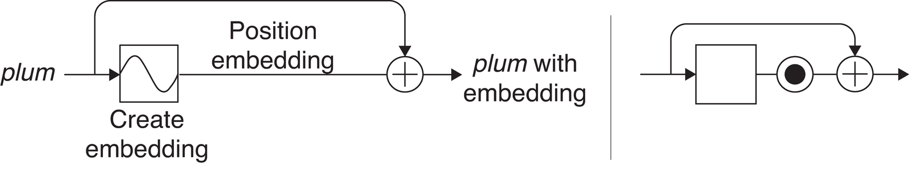{#fig-dlva-20-20 width=100%}

The claim that attention cannot see order is easy to test with the layer we
wrote above. Shuffle the five input words and compare each word's output
before and after.

```{python}
#| label: permutation-test

perm = torch.tensor([3, 0, 4, 1, 2])            # a fixed reordering of the five words

shuffled, _ = layer(X[perm])
print(f"no positional embedding:   largest change in any word's output = {(shuffled - out[perm]).abs().max().item():.1e}")

P5 = positional_embedding(5, 16)
with_pos, _     = layer(X + P5)
with_pos_shuf, _ = layer(X[perm] + P5)
print(f"with positional embedding: largest change in any word's output = {(with_pos_shuf - with_pos[perm]).abs().max().item():.2f}")
```

Without positions, each word gets exactly the output it had before; only the
order of the rows changes. The layer treats the sentence as a bag of words
(Prince calls this permutation equivariance, §12.3.1). With positions added,
moving a word changes its output.

## Assembling a Transformer {#sec-assembling}

*Glassner, "Assembling a Transformer", pp. 586–589; figures on pp. 586–588. Prince §12.4, pp. 215–216, and §12.8, pp. 226–227.*

All the pieces are in place. @fig-dlva-20-21 is the plan of a translator. An
**encoder**, a stack of encoder blocks, reads the input sentence. A
**decoder**, a stack of decoder blocks, receives the encoder's output and
produces the translation one word at a time.

{#fig-dlva-20-21 width=66%}

Both stacks begin with a word embedding followed by a positional embedding. The
decoder ends with a fully connected layer and a softmax that predict the next
word. It is **autoregressive**: each word it produces is appended to the
output so far, and that growing list is its input for the next word.

The **encoder block** (@fig-dlva-20-22) has two parts, each wrapped in a
norm-add skip connection. The first is multi-head self-attention, with eight
heads. The second is a **pointwise feed-forward layer**: two layers applied to
every word separately, the first widening each vector to 2,048 numbers with a
ReLU and the second bringing it back to 512 with no activation. Glassner
suggests thinking of them as two 1×1 convolutions, the operation you used in
Week 10 to change the number of channels at every pixel.

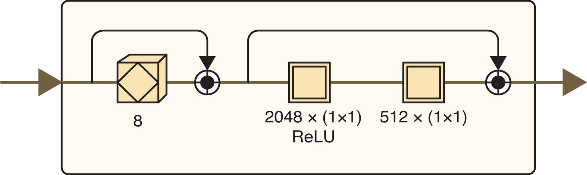{#fig-dlva-20-22 width=78%}

The **decoder block** (@fig-dlva-20-23) has three parts. First, multi-head
self-attention over the words produced so far, with masking (below). Second, a
multi-head Q/KV layer whose queries come from the previous part and whose keys
and values come from the encoder: this is where the decoder consults the input
sentence. Third, the same pair of 1×1 convolutions.

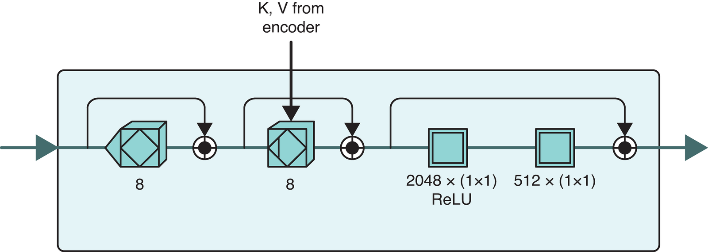{#fig-dlva-20-23 width=78%}

| Block | Sublayers, each followed by norm-add | Reads from |
|:--|:--|:--|
| Encoder | Self-attention; feed-forward | The input sentence |
| Decoder | Masked self-attention; Q/KV attention; feed-forward | The output so far, and the encoder |

: The two transformer blocks (Glassner, pp. 587–588). {tbl-colwidths="[16,50,34]"}

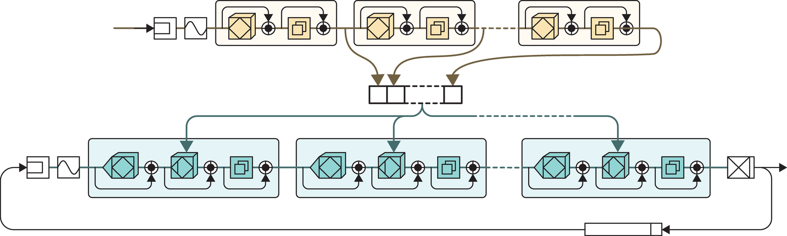{#fig-dlva-20-24 width=100%}

The original model stacked six blocks of each kind [@vaswani2017].

### Masking

*Glassner, "Assembling a Transformer", pp. 588–589. Prince §12.7.2, p. 223.*

Attention is parallel, and we want to keep that during training. Given the
sentence *My dog loves taking long walks*, we would like to train the model to
predict every word from the words before it, all in one pass. But if the model
is handed *My dog loves taking long* and asked for the fifth word, the answer
is sitting in its input. It would learn to copy, not to predict.

**Masking** hides from each prediction the words it is not supposed to see.
The computation that predicts the fifth word sees only *My dog loves taking*,
the one that predicts the fourth sees *My dog loves*, and so on, all at once.
Mechanically, the scores for forbidden pairs are set to $-\infty$ before the
softmax, which makes their weights exactly zero. That is the `causal` branch
in the code above, and @fig-mask draws it.

```{python}
#| label: fig-mask
#| fig-cap: "The mask for one training sentence. Row by row, the decoder predicts the next word from the words it is allowed to read (green); the rest are hidden (hatched). Six predictions are trained from one pass over the sentence."

tokens  = ["[START]", "My", "dog", "loves", "taking", "long"]
targets = ["My", "dog", "loves", "taking", "long", "walks"]
allowed = np.tril(np.ones((6, 6)))

fig, ax = plt.subplots(figsize=(5.6, 3.6))
ax.imshow(allowed, cmap=SEQ, vmin=0, vmax=1.6)
for i in range(6):
    for j in range(6):
        if j > i:
            ax.add_patch(plt.Rectangle((j - 0.5, i - 0.5), 1, 1, fill=False, hatch="////",
                                       edgecolor="#9a9a9a", linewidth=0))
ax.set_xticks(range(6), tokens, rotation=30, ha="right")
ax.set_yticks(range(6), [f"predict “{t}”" for t in targets])
ax.set_xlabel("word in the decoder's input")
ax.set_xticks(np.arange(-0.5, 6), minor=True); ax.set_yticks(np.arange(-0.5, 6), minor=True)
ax.grid(False); ax.grid(which="minor", color="white", linewidth=2)
ax.tick_params(which="minor", length=0)
plt.tight_layout()
plt.show()
```

```{python}
#| label: mask-check

masked, _ = layer(X, causal=True)
X_changed = X.clone()
X_changed[4] = torch.randn(16)                 # replace the last word with a different one
masked_changed, _ = layer(X_changed, causal=True)
unmasked_changed, _ = layer(X_changed)

print(f"with the mask:    outputs for words 1-4 change by at most {(masked_changed[:4] - masked[:4]).abs().max().item():.1e}")
print(f"without the mask: outputs for words 1-4 change by at most {(unmasked_changed[:4] - out[:4]).abs().max().item():.2f}")
```

With the mask in place, replacing the last word leaves the outputs for the
earlier words untouched: they never read it.

### Transformers in action

*Glassner, "Transformers in Action", pp. 589–590; figure on p. 590.*

Glassner trains a transformer of this design to translate Portuguese to
English from 50,000 examples, a small dataset. Given *você se sente da mesma
maneira que eu?* ("do you feel the same way that I do?"), it answers *do you
see , do you get the same way i do ?* (p. 589). Not perfect, and clearly in
the right spirit. @fig-dlva-20-25 shows where the eight heads of the last
Q/KV layer were looking.

{#fig-dlva-20-25 width=100%}

Transformers trained longer on more data match or beat RNNs, train in
parallel, and need no recurrent state that can overflow. The cost is that the
memory attention needs grows quickly with the length of the input (p. 590):
every word is scored against every other, so $N$ words need $N^2$ scores.

We can watch a transformer learn on a problem small enough to train in a few
seconds. The task: read eight digits and write them in reverse. To produce
output position $i$ the model must fetch the digit at position $7 - i$, which
is a job for attention. The model below is one encoder block in the original
layout, with a learned positional embedding. This cell shows its code.

```{python}
#| label: tiny-transformer
#| echo: true

class Block(nn.Module):
    """One encoder block: self-attention and a feed-forward layer, each with skip connection + layer norm."""
    def __init__(self, D, H):
        super().__init__()
        self.attn = nn.MultiheadAttention(D, H, batch_first=True)
        self.ff = nn.Sequential(nn.Linear(D, 4 * D), nn.ReLU(), nn.Linear(4 * D, D))
        self.norm1, self.norm2 = nn.LayerNorm(D), nn.LayerNorm(D)

    def forward(self, x):                       # x: (batch, N, D)
        a, weights = self.attn(x, x, x)         # queries, keys, values all from x
        x = self.norm1(x + a)
        return self.norm2(x + self.ff(x)), weights

class TinyTransformer(nn.Module):
    def __init__(self, vocab=10, N=8, D=32, H=1, use_position=True):
        super().__init__()
        self.tok, self.pos = nn.Embedding(vocab, D), nn.Embedding(N, D)
        self.block, self.out = Block(D, H), nn.Linear(D, vocab)
        self.use_position = use_position

    def forward(self, idx):                     # idx: (batch, N) integers
        x = self.tok(idx)                       # word embedding
        if self.use_position:
            x = x + self.pos(torch.arange(idx.shape[1]))   # positional embedding, added
        x, weights = self.block(x)
        return self.out(x), weights             # scores for each digit at each position

def train(model, steps=400):
    opt, losses = torch.optim.Adam(model.parameters(), lr=3e-3), []
    for _ in range(steps):
        x = torch.randint(0, 10, (128, 8))      # a batch of random digit strings
        y = x.flip(1)                           # the target is the same string reversed
        logits, _ = model(x)
        loss = F.cross_entropy(logits.reshape(-1, 10), y.reshape(-1))
        opt.zero_grad(); loss.backward(); opt.step()
        losses.append(loss.item())
    return losses

results = {}
for use_position in (True, False):
    torch.manual_seed(774)
    model = TinyTransformer(use_position=use_position)
    losses = train(model)
    x_test = torch.randint(0, 10, (2000, 8))
    logits, weights = model(x_test)
    accuracy = (logits.argmax(-1) == x_test.flip(1)).float().mean().item()
    results[use_position] = (losses, weights.mean(0).detach(), accuracy)
    print(f"positional embedding {'on ' if use_position else 'off'}: {accuracy:.1%} of digits correct on 2,000 new strings")
```

```{python}
#| label: fig-reverse
#| fig-cap: "A one-block transformer learning to reverse eight digits. Left: training loss with and without the positional embedding. Without it the model cannot tell positions apart and stalls. Right: the attention weights the trained model uses, averaged over 2,000 test strings. Each output position reads from the mirror-image input position, the anti-diagonal. Nobody told it to; the pattern was learned from the task."

fig, axes = plt.subplots(1, 2, figsize=(9.2, 3.5), gridspec_kw={"width_ratios": [1.25, 1]})
ax = axes[0]
ax.plot(results[True][0],  color=NDSU_GREEN, lw=1.8, label="with positional embedding")
ax.plot(results[False][0], color=ACCENT,     lw=1.8, label="without")
ax.set_xlabel("training step"); ax.set_ylabel("cross-entropy loss"); ax.legend()
ax = axes[1]
im = ax.imshow(results[True][1], cmap=SEQ, vmin=0, vmax=1)
ax.set_xlabel("input position read"); ax.set_ylabel("output position")
ax.set_xticks(range(8)); ax.set_yticks(range(8)); ax.grid(False)
fig.colorbar(im, ax=ax, fraction=0.046, pad=0.04, label="attention weight")
plt.tight_layout()
plt.show()
```

The model with positions solves the task. The one without cannot: for it,
every arrangement of the same digits looks alike, so the best it can do is
guess from which digits are present. @fig-reverse is our small version of
@fig-dlva-20-25, an attention pattern that came out of training.

## BERT and GPT-2 {#sec-bert-gpt}

*Glassner, "BERT and GPT-2", p. 590.*

The full transformer has an encoder that analyses the input and a decoder that
generates the output. Neither block is specific to translation. Each is a
general-purpose processor for relationships between the elements of a
sequence, and each can be used alone.

### BERT: encoder blocks only

*Glassner, "BERT", pp. 590–593; figures on pp. 591–592. Prince §12.6, pp. 219–222.*

**BERT**, Bidirectional Encoder Representations from Transformers
[@devlin2019], is a word embedder, a position embedder, and a stack of encoder
blocks (@fig-dlva-20-26). The "large" version has 340 million weights and was
trained on Wikipedia and more than 10,000 books.

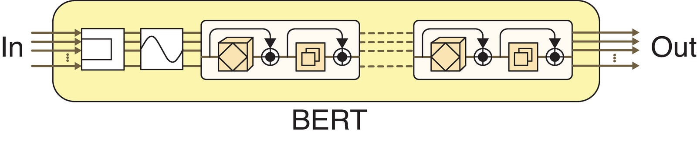{#fig-dlva-20-26 width=84%}

It was trained on two tasks that need no human labels (p. 591). In **next
sentence prediction** it is given two sentences and asked whether the second
plausibly follows the first. In the second task some words of a sentence are
removed and it must fill in the blanks, which language teachers call the cloze
task.

BERT does well because every word can attend to every other word, on both
sides, and because stacking encoder blocks repeats this many times. It is
described as deeply bidirectional; Glassner's suggestion is that "deeply
dense" says it better, since with attention the notion of direction hardly
applies (p. 592).

A pretrained BERT is put to work by adding a small **downstream** model and
fine-tuning. For a yes-or-no question about a sentence, a single fully
connected layer is enough (@fig-dlva-20-28).

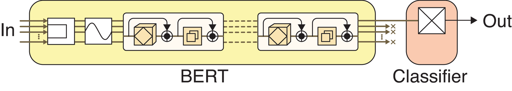{#fig-dlva-20-28 width=92%}

| Task | Model | Test set | Correct |
|:--|:--|:--|:--:|
| Is this sentence grammatical? | 12-block BERT, four epochs of fine-tuning | about 1,000 sentences | about 82% |
| Is this movie review positive? | DistilBERT, a smaller distilled BERT [@sanh2019] | 1,730 reviews | about 82% |

: Glassner's two fine-tuning experiments (pp. 592–593). {tbl-colwidths="[30,38,20,12]"}

BERT turns a sentence into vectors that capture enough of its meaning for many
tasks. It is not built to generate text. For that we want decoder blocks.

### GPT-2: decoder blocks only

*Glassner, "GPT-2", pp. 593–596; figure on p. 594. Prince §12.7, pp. 222–226.*

With no encoder there is nothing for a Q/KV layer to consult, so remove it
from the decoder block. What is left is masked self-attention and the pair of
1×1 convolutions. A stack of those, after the usual two embeddings, is
**GPT-2** [@radford2019] (@fig-dlva-20-29).

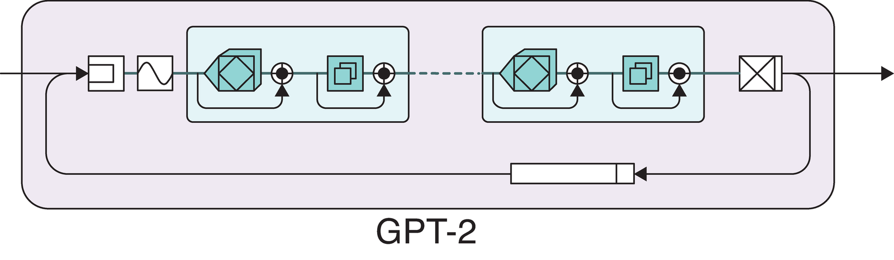{#fig-dlva-20-29 width=72%}

The largest GPT-2 has 48 decoder blocks and 1,542 million parameters, and was
trained on about 40 GB of text from eight million web documents (p. 594).

A generator is steered by the text we give it (p. 594). With an instruction
and a prompt and nothing else, the setting is **zero-shot**. Supplying one
worked example before the prompt makes it **one-shot**, and two or three make
it **few-shot**. The examples are not training; they are simply part of the
input the model continues.

Glassner prompts a pretrained GPT-2 with *I woke up this morning to the roar
of a hippopotamus.* The first result is grammatical and dull: after two
sentences it repeats *I was so excited* without end (p. 595). Always choosing
the most probable next word led it into a loop. Three standard remedies:

- An **n-gram penalty** makes it costly to produce the same group of $n$ words twice.
- **Beam search** follows several candidate continuations for a few words and keeps the one whose whole sequence is most probable, instead of committing to the best single next word.
- **Temperature** makes the choice random. The scores $z_i$ of the candidate words are divided by a temperature $T$ before the softmax, and the next word is drawn from the resulting probabilities, $p_i \propto \exp(z_i / T)$. At $T$ near zero the top word always wins; larger $T$ spreads the probability.

```{python}
#| label: fig-temperature
#| fig-cap: "What temperature does to the choice of the next word. The five scores are ours, chosen to illustrate Glassner's dragon sentence; they are not the output of a model. A low temperature concentrates the probability on the top word, and a high one gives the unlikely words a real chance."

candidates = ["roar", "bellow", "blast", "sigh", "daffodil"]
scores_z = np.array([4.0, 2.5, 2.0, 1.0, -2.0])

fig, ax = plt.subplots(figsize=(7.2, 3.2))
for k, (T, colour) in enumerate([(0.5, NDSU_GREEN), (1.0, NDSU_GOLD), (2.0, ACCENT)]):
    p = np.exp(scores_z / T); p /= p.sum()
    ax.bar(np.arange(5) + (k - 1) * 0.27, p, width=0.25, color=colour, label=f"T = {T}")
ax.set_xticks(range(5), candidates); ax.set_ylabel("probability of being chosen")
ax.set_title("“The dragon approached and let out a mighty …”")
ax.grid(axis="x", visible=False); ax.legend(title="temperature")
plt.tight_layout()
plt.show()
```

With a penalty on repeated pairs of words, beam search, and some temperature,
the same prompt produces a long, coherent, slightly unhinged paragraph
(p. 595). Fine-tuned on the Sherlock Holmes stories, a small GPT-2 writes
passable Holmes (p. 596).

### Scale and its limits

*Glassner, "Generators Discussion", pp. 596–598. Prince §12.7.4, pp. 224–226.*

GPT-3 [@brown2020] kept the architecture and enlarged everything: 2,048 tokens
of input at a time, 96 decoder blocks, 96 heads per block, 175 billion
parameters, trained at an estimated cost of 355 GPU-years (p. 596). It writes
code, legal language, and fiction.

Glassner closes the section with a warning that has aged well. On a benchmark
of 57 subjects from law to physics, the generators of the time came nowhere
near human performance [@hendrycks2021]. They produce words according to the
probability that those words belong together. They have no common sense, no
notion of accuracy or fairness, and they repeat whatever stereotypes and
prejudices their training text contains (pp. 597–598). The chapter was written
in 2021. The models have grown a great deal since, and Week 12 picks up the
story; the cautions still apply.

### Data poisoning

*Glassner, "Data Poisoning", pp. 598–599.*

Convolutional networks can be fooled by adversarial inputs. Language models
have their own weakness, **data poisoning**: manipulating the training text so
that the trained system gives a chosen wrong answer, always or only when a
trigger phrase appears. Glassner's example is text that leads a model to
believe strawberries are made of cement, with consequences for whoever uses
that model to order stock.

Three properties make this hard to defend against (pp. 598–599). The training
sets hold billions of words that nobody reads. The poison can be **concealed**,
written so that it never mentions its target [@wallace2021]. And it can be
planted by anyone, long in advance, simply by publishing text where a crawler
will collect it. Unlike an adversarial input, it becomes part of the trained
model. Glassner's conclusion is that a language system used for consequential
decisions should be checked for poisoning as well as for bias, and that no
reliable method for certifying either yet existed when he wrote.

## Summary

*Glassner, "Summary", p. 599.*

- A **word embedding** gives each word a vector, placed so that similar words are near each other and arithmetic on the vectors is meaningful. **Contextual** embeddings such as ELMo give a word a different vector in each sentence.
- **Attention** compares a query with a set of keys and returns a mixture of the corresponding values, weighted by how well each key matched. In **self-attention** the queries, keys, and values all come from the same sentence. It runs in four parallel steps and needs no state memory.
- **Q/KV attention** takes its queries from one place and its keys and values from another. **Multi-head attention** runs several attention networks side by side so that words can be compared by several criteria.
- A transformer adds **skip connections**, **layer normalization**, and a **positional embedding**. The skip connections also carry the position information through the stack.
- The **encoder block** is self-attention plus a feed-forward layer. The **decoder block** adds **masking** to its self-attention and a Q/KV layer that reads the encoder.
- **BERT** is a stack of encoder blocks, trained to fill in blanks, and is fine-tuned for analysis tasks. **GPT-2** is a stack of decoder blocks without the Q/KV layer, trained to predict the next word, and generates text.
- Generators reproduce the statistics of their training text, biases included, and can be compromised through that text by **data poisoning**.

**Next:** Week 12 follows the decoder-only family to today's large language
models: pretraining and fine-tuning at scale, tokenization, and what it takes
to run them efficiently.

---

## Exercises

::: {.callout-note appearance="minimal"}
Problems marked (UDL) are from Prince, Chapter 12, p. 239; a star means a
worked answer is available on the book's website. The rest are ours.
:::

**1. Arrows without axes.** In Glassner's animal chart the axis labels are
missing, and the arithmetic still works. Explain why. Then describe a chart of
the same animals on which horse − fox + roadrunner would return nonsense, and
say what property the useful chart has that yours lacks.

**2. One word, two jobs.** *Press*, *die*, *mill*, and *lead* each have at
least two unrelated meanings on a factory floor. Write two sentences for one of
them. Explain why a single embedding per word must fail here, and name the
component of a transformer that does the job ELMo was built for.

**3. A maintenance paint store.** A plant keeps ten years of closed work
orders, each with a short title and a repair procedure. A technician types a
description of a new fault. Map this onto query, key, and value, and say what
a single Q/KV layer would return. What would a second head add?

**4. (UDL 12.1)** A self-attention layer processes $N$ inputs of length $D$ and
produces $N$ outputs of the same size. How many weights and biases are used to
compute the queries, keys, and values? How many attention weights are there?
How many weights and biases would a fully connected layer need to relate all
$DN$ inputs to all $DN$ outputs? Evaluate all three for $N = 100$, $D = 512$.

**5. (UDL 12.3\*)** Show that self-attention is equivariant to a permutation
of its inputs: if the rows of $\mathbf{X}$ are reordered, the rows of
$\text{Sa}[\mathbf{X}]$ are reordered the same way and are otherwise
unchanged. Which printed result on this page is the numerical version of your
proof?

**6. (UDL 12.4)** Consider a softmax over five inputs with values
$z_1 = -3$, $z_2 = 1$, $z_3 = 100$, $z_4 = 5$, $z_5 = -1$. Compute the 25
derivatives $\partial y_i / \partial z_j$. What do you conclude, and what does
it say about the $\sqrt{D}$ in @eq-attention?

**7. (UDL 12.5)** Why is it more efficient to give each of the $H$ heads
queries, keys, and values of length $D/H$, where $D$ is the length of the
input vectors?

**8. Masking by hand.** For the sentence *The press stopped at noon* preceded
by a [START] token, write out the mask as a table like @fig-mask. How many
predictions does one training pass over this sentence produce? Then
**(UDL 12.7)**: a new token is appended to a masked self-attention layer whose
outputs for the first $N$ tokens have already been computed. What extra
computation is needed, and what can be reused?

**9. (UDL 12.6)** BERT was pretrained on two tasks: predicting masked words,
and classifying whether two sentences were adjacent in the original text.
Is each task generative or contrastive (Prince §9.3.6, Week 9)? Why might two tasks have
been used?

**10. Computational.** In the tiny transformer, change the target from the
reversed string to the string shifted one place to the right (`x.roll(1, 1)`),
retrain, and plot the attention weights. Predict the pattern before you run
it. Then set `H=2` and compare the two heads.

**11. Computational.** Using the five scores of @fig-temperature, compute the
entropy of the next-word distribution for twenty temperatures between 0.1 and
5 and plot it. At what temperature does *daffodil* first have a one-in-a-
hundred chance?

**12. Poisoned logs.** A classifier that routes maintenance requests is
retrained every month on the text of that month's requests, which anyone in
the plant can submit. Describe a data-poisoning attack on it in two sentences,
and propose one check that would make the attack harder.

---

## Where These Notes Depart from the Chapter {#sec-departures}

Glassner's chapter is a visual introduction and leaves the mathematics out.
In a few places that choice, or a slip, leaves a statement that is worth
correcting when you read.

| Page | The chapter says | Read it as |
|:--:|:--|:--|
| 571 | GloVe is credited to Mikolov et al. and word2vec to Pennington et al. | The citations are swapped: word2vec is Mikolov et al. (2013), GloVe is Pennington et al. (2014). |
| 576, 579 | The scoring function returns a number from 0 to 1. | The score is a dot product and can be any real number. The softmax produces weights between 0 and 1. |
| 577 | A softmax is applied to the scores, "followed by a division". | The division by $\sqrt{D}$ comes before the softmax (@eq-attention). |
| 579 | In Q/KV attention the queries come from the encoder and the keys and values from the decoder. | The reverse, as on his p. 586: queries from the decoder, keys and values from the encoder. |
| 583 | Layer norm is a regularization technique that controls overfitting. | It is a normalization that keeps activations in a stable range so that deep stacks train (@eq-layernorm). |
| 588 | The Q/KV layer's keys and values come from the concatenated outputs of all the encoder blocks. | In the original transformer they come from the output of the last encoder block. |
| 588 | An attention block runs in the same time for five words or five hundred. | True of the number of sequential steps. The work and memory grow as $N^2$, which the chapter notes on p. 590. |
| 594 | The largest GPT-2 processes 512 tokens with 12 heads per block. | The released model reads 1,024 tokens and uses 25 heads at a width of 1,600. The 48 blocks and 1,542 million parameters are right. |

: Corrections and clarifications to Glassner, Chapter 20. {tbl-colwidths="[8,44,48]"}

---

## Textbook Reference Map {#sec-reference-map}

Every part of this page, mapped to Glassner, *Deep Learning: A Visual
Approach* (No Starch Press, 2021) [@glassner2021], with the matching section
of Prince, *Understanding Deep Learning* (MIT Press, 2024) [@prince2024].
Page numbers are those of the printed books.

| This page | Glassner section | Pages | Figures used | Prince |
|:--|:--|:--:|:--|:--|
| Why Leave Recurrent Networks Behind | Chapter opening | 565–566 | — | §12.1 |
| Embedding | Embedding | 566–568 | 20-3 (p. 567), 20-4 (p. 568) | — |
| — Embedding words | Embedding Words | 569–571 | 20-5 (p. 570) | §12.5.2 |
| — Contextual embeddings: ELMo | ELMo | 571–574 | 20-8 (p. 573) | — |
| Attention | Attention | 574 | — | §12.1 |
| — The paint-store analogy | A Motivating Analogy | 574–575 | 20-10 (p. 575) | — |
| — Self-attention | Self-Attention | 576–579 | 20-11 (p. 576), 20-12 (p. 577) | §12.2, §12.3.2 |
| — Q/KV attention | Q/KV Attention | 579–580 | 20-14 (p. 580) | §12.8 |
| — Multi-head attention | Multi-Head Attention | 580–581 | 20-15 (p. 581) | §12.3.3 |
| Three More Ingredients | Transformers | 581–582 | — | — |
| — Skip connections | Skip Connections | 582–583 | 20-17 (p. 582) | §11.2 |
| — Norm-add | Norm-Add | 583–584 | 20-18 (p. 583) | §12.4 |
| — Positional encoding | Positional Encoding | 584–585 | 20-19 (p. 584), 20-20 (p. 585) | §12.3.1 |
| Assembling a Transformer | Assembling a Transformer | 586–588 | 20-21 (p. 586), 20-22, 20-23 (p. 587), 20-24 (p. 588) | §12.4, §12.8 |
| — Masking | Assembling a Transformer | 588–589 | — | §12.7.2 |
| — Transformers in action | Transformers in Action | 589–590 | 20-25 (p. 590) | — |
| BERT and GPT-2 | BERT and GPT-2 | 590 | — | — |
| — BERT: encoder blocks only | BERT | 590–593 | 20-26 (p. 591), 20-28 (p. 592) | §12.6 |
| — GPT-2: decoder blocks only | GPT-2 | 593–596 | 20-29 (p. 594) | §12.7 |
| — Scale and its limits | Generators Discussion | 596–598 | — | §12.7.4 |
| — Data poisoning | Data Poisoning | 598–599 | — | — |
| Summary | Summary | 599 | — | §12.11 |
| Exercises 4–9 | — | — | — | Problems 12.1, 12.3–12.7 (p. 239) |

: {tbl-colwidths="[30,22,10,24,14]"}

Glassner's chapter has no numbered equations. @eq-attention is the scaled
dot-product self-attention of Vaswani et al. (2017) and corresponds to Prince's
equation (12.9) with rows and columns exchanged; @eq-layernorm is the layer
normalization of Ba et al. (2016); and @eq-posenc is the sinusoidal positional
encoding of Vaswani et al. (2017).

::: {.callout-note appearance="simple"}
## Figure credits
Figures 20-3, 20-4, 20-5, 20-8, 20-10, 20-11, 20-12, 20-14, 20-15, 20-17,
20-18, 20-19, 20-20, 20-21, 20-22, 20-23, 20-24, 20-25, 20-26, 20-28, and
20-29 are from Andrew Glassner, *Deep Learning: A Visual Approach* (No Starch
Press, 2021). The author distributes all of the book's figures under the MIT
license at
[github.com/blueberrymusic/Deep-Learning-A-Visual-Approach](https://github.com/blueberrymusic/Deep-Learning-A-Visual-Approach),
copyright © Andrew Glassner. They are used here from that repository, resized
and placed on a white background, with no other change. The animal data in
figures 20-3 and 20-4 are credited in the book to Reisner (2020). All other
figures on this page are generated by the code in this week's notebook.
:::

---

## Further Reading

- Glassner, *Deep Learning: A Visual Approach*, Chapter 20 [@glassner2021] — this week's reading. Chapter 19 covers the recurrent networks the chapter keeps referring back to.
- Prince, *Understanding Deep Learning*, Chapter 12 [@prince2024] — the same material with the equations written out, plus tokenization (§12.5), transformers for long sequences (§12.9), and vision transformers (§12.10).
- **[▶ From CNNs to Transformers](https://harunpirim.github.io/IMSE774-NeuralNetworks/interactive/from-cnns-to-transformers.html)** — the interactive walkthrough that accompanies this note.
- **[▶ This week's notebook](https://colab.research.google.com/github/harunpirim/IMSE774-NeuralNetworks/blob/main/notebooks/week11-transformers.ipynb)** — every cell above, in one Colab file.
- Vaswani et al. (2017) [@vaswani2017] — "Attention Is All You Need", the transformer paper. Bahdanau, Cho & Bengio (2015) [@bahdanau2015] — the translation paper that introduced attention.
- Mikolov et al. (2013) [@mikolov2013] — word2vec; Pennington, Socher & Manning (2014) [@pennington2014] — GloVe; Peters et al. (2018) [@peters2018] — ELMo.
- Ba, Kiros & Hinton (2016) [@ba2016] — layer normalization; He et al. (2016) [@he2016resnet] — the residual connection.
- Devlin et al. (2019) [@devlin2019] — BERT; Sanh et al. (2019) [@sanh2019] — DistilBERT; Radford et al. (2019) [@radford2019] — GPT-2; Brown et al. (2020) [@brown2020] — GPT-3.
- Hendrycks et al. (2021) [@hendrycks2021] — the 57-subject benchmark Glassner cites; Wallace et al. (2021) [@wallace2021] — concealed data poisoning.
