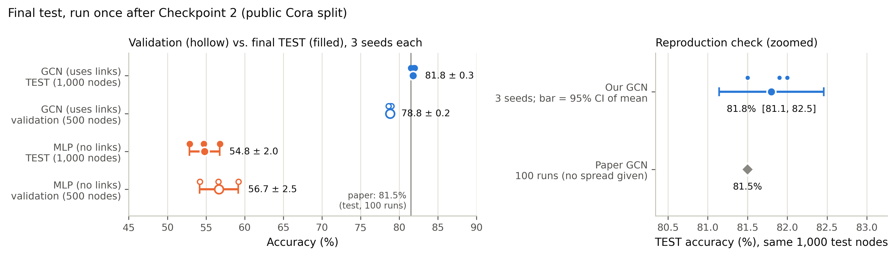

You bring the **research question, the data and the decisions**. A team of five AI agents
writes, runs and explains the code in PyTorch and PyTorch Geometric (PyG). They check that the
experiments are honest and package the result so that others can reproduce it. You learn the
libraries by reading what they build, choosing the hyperparameters, and judging the results.

The agents work with any kind of data that fits PyTorch or PyG: tables, images, text, time
series, a single graph, or many graphs. You can use them for your course project.

::: {.callout-note appearance="simple"}
**Template repository:**
[github.com/harunpirim/nn-research-template](https://github.com/harunpirim/nn-research-template).
Click **Use this template** to make your own copy, then follow [Getting started](#getting-started).
:::

## How It Works

Work moves through six stages. Two independent checkpoints sit between them, and the test
set stays locked until the second checkpoint passes.

```{mermaid}
%%| echo: false
%%| fig-cap: "The six stages, with the agent responsible for each. Hexagons are the two reviewer checkpoints."
flowchart TB
  S["Scope · you + AI"] --> D["Data · data-engineer"]
  D --> C1{{"Checkpoint 1 · reviewer"}}
  C1 --> T["Train · model-trainer"]
  T --> A["Analyse · analyst"]
  A --> C2{{"Checkpoint 2 · reviewer"}}
  C2 --> F["Final test · model-trainer"]
  F --> SH["Share · reporter"]
```

| Agent | What it does |
|:---------------|:------------------------------------------------------------|
| **data-engineer** | Cleans your data, builds PyTorch/PyG datasets and loaders, and makes fixed train/validation/test splits |
| **model-trainer** | Builds a simple baseline and your main model (from a paper, if you give one), trains them, and runs the one-time final test |
| **analyst** | Compares models across random seeds, makes figures, and writes up the results |
| **reviewer** | Checks the data (Checkpoint 1) and the evaluation and claims (Checkpoint 2). It changes nothing and reports problems |
| **reporter** | Packages everything so others can reproduce it: README, a one-command script, a paper draft, a model card |

: {tbl-colwidths="[22,78]"}

## Your Part

You never have to write code. Reading it is how you learn.

1. **Ask the question.** Say what you want to find out. The AI turns it into a short research
   plan, `reports/plan.md`, and you approve it. Your project proposal is a good starting point.
2. **Bring the data and context.** Put your files in `data/raw/`, or name a public dataset. Put
   any paper you want followed in `papers/`.
3. **Choose the hyperparameters.** Each experiment has a config file in `configs/` that explains
   every setting: what it does, a typical range, and the paper's value. You pick the values,
   and the agents never change them without asking.
4. **Launch runs** on Colab or CCAST when an agent tells you a run is ready.
5. **Read `reports/LEARNING_LOG.md`** after each stage, with the code open beside it. Each entry
   explains the PyTorch and PyG concepts used and where to find them. Ask about anything unclear.
6. **Decide** what to try next, when the final test runs, and what to conclude.

## Rules the Agents Follow

Call them out if they don't:

- The **test set stays locked** until Checkpoint 2 passes, and the final test runs **once**.
- A **simple baseline** runs before the main model, on the same data and metric.
- Every comparison uses **at least 3 random seeds**, reported as mean ± standard deviation.
- **Your config values** change only when you say so.
- **No run is deleted.** Results report how many things were tried, not only the best one.

## Getting Started

1. **Make your copy.** On the
   [template page](https://github.com/harunpirim/nn-research-template), click
   **Use this template → Create a new repository**, then clone it. From a terminal, you can instead run:

   ```bash
   gh repo create my-project --template harunpirim/nn-research-template --private --clone
   ```

2. **Install** Python 3.11+, then [PyTorch for your machine](https://pytorch.org/get-started/locally/), then:

   ```bash
   cd my-project
   python -m venv .venv && source .venv/bin/activate
   pip install -r requirements.txt
   ```

3. **Open the project in your AI tool.**

   ::: {.panel-tabset}

   ## Claude Code

   The full multi-agent setup. Start Claude **inside the project folder**, so it finds the agents:

   ```bash
   cd my-project
   claude
   ```

   Claude works through the stages and calls each agent itself. To read PDFs in `papers/`,
   install poppler: `brew install poppler` (macOS) or `sudo apt install poppler-utils` (Linux/WSL).

   ## Other coding tools

   Cursor, GitHub Copilot agent mode, OpenAI Codex, Gemini CLI and similar tools read the
   shared rules in `AGENTS.md`. Work **one stage per chat** and name the role:

   > *Act as the data-engineer described in .claude/agents/data-engineer.md and do the Data stage.*

   For each checkpoint, **open a new chat**, so the reviewer isn't checking its own work.

   ## Chat-only assistants

   ChatGPT, Claude.ai and Gemini on the web also work, with more copying. In each chat, upload
   `AGENTS.md`, the role file, `reports/plan.md` and the files the stage needs. Save the code
   it gives you into the project, and run the commands yourself.

   :::

4. **Say what you want to do**, for example:

   > *Let's start. My question is … My data is in data/raw/… I'd like to follow papers/smith2024.pdf.*

## Where Training Runs

Every run writes its own folder, `runs/<run_id>/`, recording its config, software versions,
per-epoch history and metrics. Comparing and sharing results depends on these records.

- **Laptop.** Quick smoke tests and small datasets. The agents run these for you.
- **Google Colab** (the default for real runs). Open the
  [Colab runner](https://colab.research.google.com/github/harunpirim/nn-research-template/blob/main/notebooks/colab_runner.ipynb),
  choose a GPU runtime, and set your project folder and the config the agent gives you.
  Keeping the project in Google Drive syncs results back to your laptop automatically.
- **NDSU CCAST** (optional, for long or large runs). A helper script copies your project to
  the cluster, submits the job, and brings the results back over SSH. The template's README
  covers the one-time setup. Ask the instructor for the course's CCAST account details.

## A Worked Example

Before releasing the template, we ran it end to end on a classic benchmark. **Question:** on the
Cora citation graph, does a 2-layer graph convolutional network (GCN), which uses the citation
links, classify papers more accurately than an MLP that sees only each paper's words? And can
we reproduce the accuracy reported by @kipf2017?

| Model | Validation accuracy | **Test accuracy** (3 seeds) |
|:-----------------------|:-------------------:|:---------------------------:|
| MLP (ignores links) | 56.7 ± 2.5% | **54.8 ± 2.0%** |
| GCN (uses links) | 78.8 ± 0.2% | **81.8 ± 0.3%** |
| GCN, as reported in the paper | | 81.5% (mean of 100 runs) |

: {tbl-colwidths="[40,30,30]"}

{fig-alt="Dot plot of validation and test accuracy for the MLP and GCN across three seeds, with the paper's 81.5% marked; the GCN's 95% interval, 81.1 to 82.5%, contains the paper's value."}

Some things worth knowing from the trial:

- **The checkpoints earn their place.** Checkpoint 1 caught that the first config stopped
  training on the wrong metric and applied weight decay to every layer, which differs from
  the paper. Checkpoint 2 rejected a claim in the write-up that both models had received the
  same tuning effort.
- **Everything was reproducible.** Starting from an empty copy, one script downloaded the data,
  retrained all six runs and re-scored the test set, and got the same numbers exactly.
- **Budget your time.** The whole pipeline, from plan to packaged report, took about an hour
  of agent time, and training itself took under a minute. Larger data or more experiments take
  longer. Long sessions can hit your AI plan's usage limits, so work one stage per sitting if needed.

## Using AI Responsibly in This Course

The course [AI Usage Policy](syllabus.qmd#ai-usage-policy) applies. The agents do the coding,
but **the research is yours**: you approve the plan, choose every setting, read the code
through the learning log, and write the interpretation and conclusions. The reporter's paper
draft marks those parts for you as `[STUDENT: ...]`. Passing a checkpoint doesn't replace your
own judgement, and you remain responsible for every claim you submit.

Include an AI acknowledgment statement with your project, for example:

> I acknowledge that I am responsible for the content of this submission. I used the IMSE 774
> research agents with [tool] to write and run the code for data preparation, training,
> analysis and packaging. I chose the research question, data, models and hyperparameters,
> reviewed the code and every result, and wrote the interpretation and conclusions myself.

## Questions and Problems

If something in the template doesn't work, or the agents behave in a way the rules above say
they shouldn't, please
[open an issue on the template repository](https://github.com/harunpirim/nn-research-template/issues).
